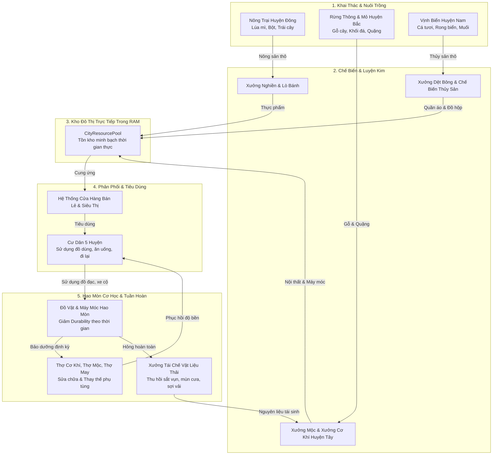
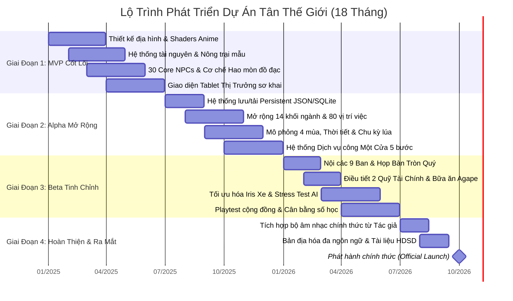
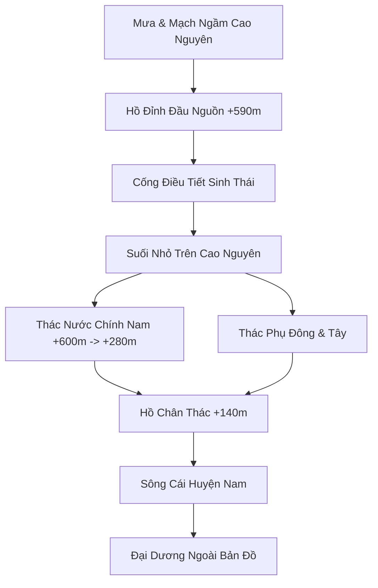

# BẢN THIẾT KẾ CONCEPT TỔNG THỂ DỰ ÁN: TÂN THẾ GIỚI

*(Master Game Design Concept Document — Tân Thế Giới: High-Plateau Commune Simulation)*

> **Tài Liệu Kỹ Thuật & Kiến Trúc Lập Trình (Tech Spec)**: Xem [ai_context_system_instructions.md](file:///d:/Eaut/GMAE/game%20t%C3%A2n%20th%E1%BA%BF%20gi%E1%BB%9Bi/ai_context_system_instructions.md) để biết các ràng buộc phần cứng (Intel Iris Xe / UHD), cấu trúc Scene Tree chuẩn, giao thức mạng và mã nguồn Shader của dự án.

---

## 1. TỔNG QUAN & TẦM NHÌN DỰ ÁN (PROJECT VISION & NORTH STAR)

* **Tên Dự Án**: **Tân Thế Giới** *(The New World)*.
* **Thể Loại**: Single-Player 3D Open-World City Builder, Macro HR Governance & Walkable Life Simulator.
* **Engine & Nền Tảng**: Godot Engine 4.x (Kiến trúc Local-First Monolith, chạy hoàn toàn offline không phụ thuộc đám mây).
* **Định Chuẩn Mỹ Thuật (Visual Benchmark)**:
  * Phong cách **Anime 3D Cel-shaded** đỉnh cao (cảm hứng từ Studio Ghibli & Makoto Shinkai).
  * Ánh sáng phân bậc Toon Shading ấm áp, viền nét vẽ Inverted Hull mảnh tinh tế, bầu trời mây cuộn anime đa tầng, mặt nước có bọt viền stylized.
  * **Hệ thống thời tiết 4 mùa sinh động**: Mưa rào anime (người dân che ô trong suốt), sương mù bảng lảng quanh vách đá cao nguyên, gió thu se lạnh (ngồi sưởi ấm trong tiệm trà), nắng hè rực rỡ trên đồng cỏ.
* **Triết Lý Xã Hội Cốt Lõi**:
  1. **Cõi Bất Tử Thanh Xuân — Không Tội Lỗi & Không Chết Chóc**: Con người trường sinh bất tử, mãi mãi tràn đầy sức sống ở độ tuổi thanh xuân rực rỡ ($20 - 25$ tuổi). Không có lão hóa tự nhiên, không có nghĩa trang, không có bệnh tật hiểm nghèo.
  2. **Liêm Khiết Tuyệt Đối & Huynh Đệ Thuần Khiết**: Tuyệt đối **không có tham nhũng**, không có tệ nạn xã hội hay cạnh tranh triệt hạ. Cư dân sống trong lòng nhân ái, coi nhau như anh em ruột thịt.
  3. **Quy Luật Hao Mòn Đồ Vật & Động Lực Kinh Tế Tuần Hoàn (Object Wear & Tear)**: Con người bất tử nhưng **máy móc, xe cộ, lò nướng, quần áo, dụng cụ bị hao mòn cơ học theo thời gian hoặc gặp sự cố**. Điều này tạo ra dòng chảy kinh tế liên tục cho các thợ cơ khí, thợ mộc, thợ may, xưởng sửa chữa và các ngành sản xuất.
  4. **Kitô Giáo Hợp Nhất & Điểm Tựa Tâm Linh**: Đức Chúa Trời và Chúa Jesus hiện diện sống động trong thế giới, ban phước lành cho đất đai trù phú dồi dào. Không còn Satan hay thế lực tà ác.

---

## 2. VAI TRÒ & GÓC NHÌN TRẢI NGHIỆM CỦA NGƯỜI CHƠI (PLAYER IDENTITY & EXPERIENCE)

* **Nhân Vật Cốt Lõi — Thị Trưởng Avatar 3D (Thực Địa & Vĩ Mô)**:
  * Người chơi trực tiếp hóa thân thành **Thị Trưởng** của Tân Thế Giới dưới dạng một nhân vật 3D sống động trong thế giới.
  * **Trải nghiệm Thực Địa (Walkable Life Sim)**: Thị trưởng có thể tự do đi bộ dạo phố, ngắm cảnh bình minh hoàng hôn anime, lái xe ô tô, đạp xe đạp, lên xe tram, bước vào từng tòa nhà (tiệm bánh, ngân hàng, bệnh viện, nhà hát, trường học) hoàn toàn **seamless** không có màn hình chờ (loading screen).

### 2.2 Giao Diện Điều Hành Trên Tablet Thị Trưởng (Diegetic Glassmorphic Civic OS)

* **Trải Nghiệm Tương Tác**:
  * Khi người chơi bấm phím `[Tab]` hoặc `[M]`, nhân vật Thị trưởng giơ chiếc tablet mỏng hiện đại trên tay (hoặc mở giao diện bán trong suốt *glassmorphism* phong cách Anime thanh lịch).
  * Âm thanh bấm nút chuyển tab nhẹ nhàng, êm dịu như tiếng gõ phím piano.
  * **Hiệu Ứng Thế Giới Chạy Chậm (Slow-Motion 20%)**: Khi Tablet mở, thời gian thế giới 3D xung quanh tự động chạy chậm lại còn $20\%$ vận tốc bình thường, giúp người chơi thảnh thơi điều hành mà không lo lỡ các sự kiện thực địa.
* **Bộ 6 Ứng Dụng Cốt Lõi Trên Tablet**:
  1. **Bản Đồ & Quy Hoạch (City Map & Zoning)**: Bản đồ mạng nhện 5 Huyện; công cụ phân lô đất ở (Studio, Nhà chung ký túc xá, Căn hộ gia đình, Nhà vườn) và đặt lệnh thi công hạ tầng công cộng.
  2. **Sổ Bộ Hộ Tịch & Căn Cước (Civil Registry)**: Biểu đồ dân số thời gian thực (đếm tới mốc 14.400 dân), tháp độ tuổi, tỷ lệ kết hôn, lượng phòng ở trống và nguồn lữ khách mới từ Cảng Hòa Bình.
  3. **Nhân Sự & Đào Tạo Chứng Chỉ (HR & Polytechnic Academy)**: Bảng việc làm 14 khối ngành; cấp học bổng khuyến khích công dân học các chứng chỉ nghề nghiệp (`CERT_*`) đang thiếu hụt.
  4. **Kho Tài Nguyên Đô Thị (Urban Resource Pool)**: Theo dõi dòng chảy vật tư (lúa mì, bột, sữa, cá biển, gỗ, đá, linh kiện cơ khí, điện, nước) và cảnh báo điều tiết dịu dàng.
  5. **Kho Bạc & Ngân Hàng Nhà Nước Tự Động (City Treasury & Algorithmic Civic Bank)**: Quản trị ngân sách thuế 5%, theo dõi tỷ lệ bảo chứng và định giá tự động của quyền in tiền, kiểm soát thanh khoản đô thị và cửa sổ gửi đề án phối hợp đồng tài trợ sang Quỹ 1/10 của Người Chăn Chiên.
  6. **Giao Thông & Phụng Vụ (Transit & Liturgy Monitor)**: Điều tiết xe tram, xe bus, cáp treo; tự động kích hoạt tăng cường 3x chuyến lúc 10h-11h20 Thứ Tư & Chủ Nhật; giám sát tỷ lệ quy tụ tại Đại Hội Trường Đỉnh Vát và 4 Tòa Vệ Tinh chân núi.
* **Metro Cao Tốc Trung Tâm**: Đại lộ 4 làn dành cho giao thông mặt đất; ga Metro trung tâm kết nối 4 tầng hầm (B1–B4). Bốn tầng lần lượt phục vụ bốn trục chéo (0°, 45°, 90°, 135°), tạo thành 8 hướng; mỗi trục gồm 4 đường ray (2 xuôi, 2 ngược), tổng cộng 16 đường ray. Mỗi trục có thêm 4 ga mặt đất kết nối sân ga — hai ga trung tuyến và hai ga cuối tuyến — ngoài ga trung tâm; tàu dừng tại cả 5 điểm để đón/trả khách. Tàu chạy 40 m/s (144 km/h). Tuyến tram mặt đất hiện hữu tiếp tục được duy trì.

### 2.3 Cơ Chế Phân Quyền Song Hành: Thị Trưởng, Người Chăn Chiên & Nội Các 8 Bộ Ban

#### 1. Nguyên Tắc Phân Định Thẩm Quyền Rành Mạch (Dual Stewardship)

* **Thị Trưởng (The Mayor — Avatar Người Chơi)**:
  * Toàn quyền điều hành hành chính công, quy hoạch không gian và hạ tầng kỹ thuật (mạng lưới giao thông, cấp thoát nước, lưới điện, viễn thông).
  * Quản trị Kho Bạc Đô Thị (City Treasury): Thu thuế thương mại $5\%$, phân bổ ngân sách đầu tư công và chi trả lương công vụ.
  * Điều phối nhân lực vĩ mô: Cấp học bổng đào tạo chứng chỉ (`CERT_*`) theo nhu cầu thiếu hụt của các ngành nghề.
* **Người Chăn Chiên (The Shepherd — Sứ Giả Từ Trời)**:
  * Toàn quyền định hướng đời sống tâm linh, giảng dạy đạo đức, chủ trì các thánh lễ và nghi thức thiêng liêng (lễ cưới vĩnh cửu, lễ tạ ơn).
  * Thực thi Sứ mạng Hòa bình (tiếp đón lữ khách tại Cảng Hòa Bình, cứu trợ thiên tai lân bang, hòa giải cộng đồng).
  * Quản trị dòng tài chính Quỹ Dâng Chúa 1/10 (The 1/10 Tithe Fund): Chu cấp mức lương sung túc đồng nhất cho NHVC, bao trọn 100% Bữa tiệc Bác ái Agape và chăm lo an sinh dân sinh.
* **Tính Độc Lập Tuyệt Đối**: Hai bên tôn trọng tuyệt đối quyền hạn của nhau, không can thiệp trái quyền vào quy trình vận hành nội bộ hàng ngày.

#### 2. Trụ Sở Chung Tại Tòa Mega-Office Skyscraper $(X=0, Z=0)$

* Cả Văn phòng Thị Trưởng và Văn phòng Người Chăn Chiên cùng làm việc chung trong Đại Cao Ốc Mega-Office trung tâm.
* **Dinh Thự Riêng & Văn Phòng Thị Trưởng (Penthouse 600m²)**: Tọa lạc trang trọng tại Tầng 13 Mega-Office với quy mô $600\text{ m}^2$ ($30\text{m} \times 20\text{m}$), vách kính Panorama nhìn ra toàn cảnh cao nguyên +600m. Không gian được quy hoạch thành 6 phân khu hoàn chỉnh:
  1. *Phòng Khách Ngoại Giao (Living Lounge - 150m²)*: Sofa da chữ L, bàn trà cẩm thạch, màn hình thông tin đô thị Civic Display Wall.
  2. *Văn Phòng Điều Hành (Executive Office - 150m²)*: Bàn làm việc lớn, ghế da, tủ sách sắc lệnh, cờ thành phố, máy tính điều hành.
  3. *Khu Bếp & Bàn Ăn (Kitchen & Dining - 105m²)*: Đảo bếp cẩm thạch, tủ lạnh hai cánh, bàn tiệc tiếp khách 8 chỗ.
  4. *Phòng Ngủ Master (Master Bedroom - 117m²)*: Giường ngủ King-size tích hợp trạm tương tác **Night Skip `[E]`** tua nhanh qua đêm sang 06:00 sáng theo **Quy tắc 5**.
  5. *Phòng Tắm & Vệ Sinh VIP (Luxury Bathroom - 42m²)*: Bồn tắm Jacuzzi ngâm nước khoáng, vòi sen kính, bàn lavabo đôi.
  6. *Kho Lưu Trữ Cá Nhân & Két Sắt Bảo Mật (Private Vault - 36m²)*: Giá đỡ vali da ngoại giao, két sắt hạng nặng và tủ hồ sơ mật (`MayorOfficeStorage`), hỗ trợ tương tác 2 lớp ([E]/[F], bán kính 6m) và lưu trữ bền vững.
* **Cơ Chế Cặp Da / Vali Ngoại Giao Thực Tế (Diegetic Briefcase Storage)**: 
  - Nhân vật mang theo chiếc cặp da cao cấp có giới hạn tải trọng thực tế ($40\text{ kg}$).
  - Mọi thao tác cất hoặc lấy đồ đều thực hiện bằng hoạt ảnh vật lý nhìn thấy được: nhân vật mở nắp cặp, nhấc đúng mô hình 3D của vật phẩm trên tay với âm thanh cơ khí tách khóa `briefcase_open`, tiếng sột soạt cất đồ `storage_transfer` và tiếng đóng nắp `briefcase_close`. Khi mở túi đồ `[I]` ngoài thực địa, nhân vật cũng chủ động mở nắp cặp da để kiểm tra.
* Việc này giúp tiết kiệm diện tích đất đai quý giá, tối ưu hóa việc dùng chung các phòng hội nghị đa năng hiện đại và tạo sự thuận tiện cho việc gặp gỡ, trao đổi gắn kết hàng ngày.
* **Mega Office** có footprint mở rộng tổng cộng 80 lần so với sàn gốc $36m \times 36m$ (xấp xỉ $322m \times 322m$), đạt công suất thiết kế 10.000 người. Tầng 1 có ba lối cửa ở mỗi mặt, tổng cộng 12 lối ra vào. Bốn thang máy kính có node gốc `AnimatableBody3D`, chạy tween vật lý theo trục Y với easing Quad; tốc độ mặc định 8m/s và các điểm dừng được xếp hàng FIFO khi người chơi chọn thêm tầng trong lúc cabin đang chạy. Cửa phát tín hiệu mở/đóng, cabin báo tầng đến qua signal và âm thanh chuông thang máy; cả bốn thang máy được gom thành một cụm phía Nam ngay sau cửa giữa. Hai cầu thang bộ chữ chi rộng 5.6m mỗi nhịp nằm ở hai góc Nam và nối liên tục từ B4 lên tầng 15. Bên cạnh mỗi cầu thang là hành lang văn phòng lát sàn riêng, ngăn bằng vách kính có khung kim loại, dải kính mờ ngang và cửa kính tự mở theo cảm biến ở từng tầng từ tầng 2 đến tầng 15. Mỗi tầng cao hơn 5m so với bố trí trước; tầng 15 ở cao độ +194m là sân thượng mở nóc nhìn thẳng lên trời, với sân đáp trực thăng gọn tại một góc Skydeck. Quảng trường bán kính 250m, tiện ích xếp thành vành đai ngoài footprint, tram chạy ở z=275m; vùng gieo cây/đá tự nhiên tránh toàn bộ các khu vực hạ tầng này. Cao nguyên phía sau tòa nhà vẫn phẳng ở +600m. Trực thăng đạt tốc độ hành trình 40m/s; giữ Shift để bật turbo tối đa 700km/h.

#### 3. Phân Quyền Triệt Để Xuống Nội Các 9 Trưởng Ban (Nguyên Tắc Bất Di Bất Dịch: Không Vi Quản Lý)

* **Thị Trưởng Tuyệt Đối KHÔNG Duyệt Hồ Sơ Từng Người**:
  * Với quy mô dân số hàng vạn người ($14.400$ đến $144.000$), việc vi quản lý hay ngồi bấm duyệt hồ sơ của từng cá nhân (từng thẻ căn cước, từng chìa khóa căn hộ, từng đơn xin cấp phép mở tiệm bánh, từng chứng chỉ học viên) là **hoàn toàn bất khả thi và phản thực tế quản trị**.
  * Toàn bộ việc tiếp nhận, thẩm định và ký duyệt hồ sơ cá thể được **phân quyền $100\%$ xuống cho Nội Các 9 Trưởng Ban Chuyên Ngành và Hệ thống Dịch vụ công Một Cửa tự động xử lý** theo khung tiêu chuẩn và quy chế đã thiết lập:
    1. *Ban Nội Vụ & Nhân Sự* (`CERT_CIVIC_ADMIN`): Tự động cấp căn cước công dân, phân bổ nhân sự, thụ lý quyền lợi lao động.
    2. *Ban Tài Chính & Kế Toán* (`CERT_FINANCE_BANKING`): Trực tiếp nắm giữ và vận hành toàn bộ Hệ Thống Ngân Hàng Nhà Nước (không tư nhân hóa); quản trị thuật toán định giá tiền tệ và quyền in tiền hoàn toàn tự động, công bằng; tự động đối soát thuế 5%, quyết toán dòng tiền và giải ngân chi phí thường xuyên.
    3. *Ban Đào Tạo & Kèm Cặp* (`CERT_EDU_*`): Tự động xét tuyển học viên, cấp phát chứng chỉ nghề và tổ chức thi nâng bậc.
    4. *Ban Kế Hoạch & SCM* (`CERT_CIVIC_ADMIN`, `CERT_LOGISTICS_SUPPLY`): Điều phối chuỗi cung ứng vật tư trong RAM, theo dõi tồn kho đô thị.
    5. *Ban Kỹ Thuật & Bảo Trì Cơ Sở Vật Chất* (`CERT_POWER_GRID`, `CERT_AUTO_MECHANIC`): Tự động tiếp nhận cảnh báo hao mòn máy móc và điều động thợ sửa chữa.
    6. *Ban Kiểm Chuẩn Chất Lượng & Môi Trường* (`CERT_ENVIRONMENTAL_HEALTH`): Giám sát an toàn sinh thái, kiểm định chất lượng sản phẩm xuất xưởng.
    7. *Ban Truyền Thông, Báo Chí & Điện Ảnh Anime* (`CERT_JOURNALISM_MEDIA`, `CERT_CINEMA_VIDEOGRAPHY`): Tổ chức truyền thông tin tức, sản xuất bản tin phát thanh, phim tài liệu và quản lý thông tin đô thị.
    8. *Ban Ca Ngợi, Âm Nhạc Phụng Vụ & Thờ Phượng* (`CERT_MUSIC_PERFORMANCE`, `CERT_MUSIC_COMPOSITION`): *(Tách riêng khỏi Ban Truyền Thông)* Chuyên trách huấn luyện ca đoàn, chỉ huy dàn nhạc, điều phối các bài thánh ca tôn vinh Chúa trong giờ Thánh Lễ và các đại lễ phụng vụ tạ ơn.
    9. *Ban Mục Vụ, Tư Vấn Tâm Lý & Sứ Mạng Hòa Bình* (`CERT_DIVINE_SHEPHERD`, `CERT_PASTORAL_COUNSELING`): Trực tiếp lắng nghe tâm tư cụ thể, điều phối mạng lưới tư vấn tâm lý, hòa giải đời sống huynh đệ và thực thi sứ mạng hòa bình.
* **Vai Trò Vĩ Mô Duy Nhất Của Thị Trưởng (Macro Governance Only)**:
  * Thị Trưởng chỉ làm việc ở **Tầng Vĩ Mô**: Mở Tablet quan sát **số lượng tổng thể, biểu đồ xu hướng và các chỉ số thống kê (BI Analytics)**.
  * Thị Trưởng can thiệp bằng cách **Ban hành Hạn ngạch (Quotas) & Chính sách khung**:
    * Thấy số liệu báo "Huyện Đông đang thiếu hụt 30 thợ gặt lúa" $\rightarrow$ Bấm 1 chạm cấp ngân sách hạn mức 35 suất học bổng nông nghiệp `CERT_AGRI_CROPS` $\rightarrow$ Ban Đào Tạo tự động tuyển sinh và xét duyệt từng học viên.
    * Thấy báo "Tàu chở 150 lữ khách vừa cập Cảng Hòa Bình" $\rightarrow$ Bấm 1 chạm mở rộng hạn mức quỹ đất cho 200 căn hộ $\rightarrow$ Ban Nội Vụ & Địa chính tự động cấp phát nhà và thẻ căn cước cho từng người.
  * Thị Trưởng hoàn toàn thảnh thơi dạo phố, ngắm cảnh anime, kiểm tra thực địa các công trình vĩ mô mà không bị chìm trong núi giấy tờ vụn vặt.

#### 4. Kỳ Họp Bàn Tròn Định Kỳ Theo Quý (3 Tháng/Lần)

* **Nhịp Độ Game Mượt Mà**: Thay vì họp hàng tháng gây ngắt quãng trải nghiệm, Kỳ Họp Bàn Tròn được tổ chức **định kỳ theo quý (3 tháng/lần)** — thời điểm lý tưởng để tổng kết mùa màng và hoạch định chiến lược mới.
* **Cơ Chế Tương Tác Kép**: Vào đầu quý, Thị trưởng có thể trực tiếp bước vào Phòng Hội Nghị Tầng Cao của Tòa Mega-Office để ngồi họp bàn tròn cùng Người Chăn Chiên và 9 Trưởng Ban; hoặc mở nhanh giao diện nghị quyết qua Tablet nếu đang bận khảo sát thực địa.
* **Cơ Chế Đồng Tài Trợ**: Thống nhất các đại dự án phúc lợi lớn cần sự bắt tay giải ngân giữa Kho Bạc Đô Thị và Quỹ 1/10.

#### 5. Cơ Chế Phủ Quyết Đạo Đức (Moral Veto as Gentle Advisory & Win-Win Solution)

* Các chính sách phát triển vật chất của Thị Trưởng phải phù hợp với chuẩn mực giá trị nhân văn mà Người Chăn Chiên bảo trợ.
* **Khuyên Nhủ & Giải Pháp Thay Thế**: Không phải là lệnh cấm đoán cứng nhắc. Khi một chính sách có nguy cơ tổn hại đến con người hoặc môi trường (ví dụ: Thị trưởng định từ chối tàu lữ khách vì thiếu phòng ở), Người Chăn Chiên sẽ ân cần khuyên nhủ và đưa ra giải pháp thay thế tốt đẹp hơn (ví dụ: đề xuất Quỹ 1/10 cùng xuất tiền dựng khu lưu trú mới).

#### 6. Sự Hiện Diện Tự Do & Nắm Bắt Toàn Cục Của Người Chăn Chiên (Macro Pastoral Guidance)

* **Người Chăn Chiên KHÔNG THỂ Đi Hỏi Thăm Vấn Đề Của Từng Người**:
  * Với hàng chục ngàn cư dân, Người Chăn Chiên không thể và không đóng vai trò đi gặp riêng từng cá nhân để nghe từng sự vụ riêng lẻ.
  * Người Chăn Chiên nắm bắt tình hình đời sống thông qua **BÁO CÁO TỔNG THỂ, SỐ LƯỢNG VÀ THỐNG KÊ TOÀN CỤC** được tổng hợp định kỳ từ:
    * 4 Người Đảm Nhiệm Nhà Thờ tại 4 Huyện chân núi (báo cáo về tỷ lệ hiệp thông, tinh thần cộng đồng địa phương).
    * Ban Mục Vụ & Tư Vấn Tâm Lý (báo cáo tổng số trường hợp cần nâng đỡ tinh thần, những nút thắt tâm lý chung).
    * Ban Đại Diện của 4 Hội Đoàn (nguyện vọng và phong trào thi đua của thanh thiếu niên, phụ nữ, tráng niên).
  * **Đưa Ra Phương Hướng Tâm Linh & Thông Điệp Lớn**: Từ bức tranh tổng quan và số liệu đó, Người Chăn Chiên đúc kết, chọn lọc chủ đề trọng tâm để truyền tải qua các **Bài Giảng Đại Lễ Thứ Tư & Chủ Nhật** tại Đại Hội Trường $15.000$ chỗ (truyền hình trực tiếp tới 4 Tòa Vệ Tinh), định hướng luân lý và củng cố đức tin cho toàn thể cư dân.
  * **Mạng Lưới NHVC Cơ Sở Trực Tiếp Chăm Sóc Cá Nhân**: Việc đồng hành, an ủi, lắng nghe và tháo gỡ tâm tư của từng cá nhân trong đời sống hàng ngày do đội ngũ Người Hầu Việc Chúa (NHVC) mặc vest tại các Tòa Vệ Tinh và trạm y tế tâm lý cơ sở trực tiếp phụ trách.
  * **Sự Hiện Diện Tự Do Của Người Chăn Chiên (The Wandering Shepherd)**: Khi Người Chăn Chiên mặc vest lịch lãm đi dạo quanh các công viên xanh, quảng trường hay ghé tiệm bánh mì thủ công, Người hiện diện như một người cha tinh thần ấm áp, tự nhiên hòa mình vào nhịp sống thanh bình của thành phố để cảm nhận hơi thở đời thường của cộng đồng, chứ không phải đi thanh tra hay xử lý công vụ sự vụ. Thị trưởng khi dạo phố có thể bước cùng Người, trao đổi những góc nhìn vĩ mô về sự hưng thịnh của vùng đất.

### 2.4 Mô Hình Thể Chế Hành Chính 2 Cấp & Trung Tâm Dịch Vụ Công Một Cửa (Two-Tier Civic Administration & One-Stop Center)

Nhằm tối ưu hóa bộ máy quản trị đô thị, tránh sự cồng kềnh, quan liêu hay các cấp trung gian trì trệ, Tân Thế Giới áp dụng mô hình **Chính Quyền Hai Cấp Tinh Gọn (Two-Tier Administrative Framework)** kết hợp **Trung Tâm Phục Vụ Hành Chính Công 5 Bước**:

```text
┌────────────────────────────────────────────────────────────────────────┐
│                   CẤP TRUNG ƯƠNG (ĐỈNH VÁT - PLATEAU CORE)             │
│  Trụ sở: Đại Cao Ốc Mega-Office Skyscraper (X=0, Z=0)                  │
│  - Cơ quan Lập hiến & Giám sát tối cao: Hội đồng Đại biểu 5 Huyện       │
│  - Cơ quan Hành pháp tối cao: Thị Trưởng & Nội Các 9 Trưởng Ban        │
│  - Cơ quan Tâm linh & Đạo đức: Người Chăn Chiên & Ban Mục Vụ Hòa Bình │
└───────────────────────────────────┬────────────────────────────────────┘
                                    │ (Kết nối trực tiếp không qua trung gian)
                                    ▼
┌────────────────────────────────────────────────────────────────────────┐
│              CẤP ĐỊA PHƯƠNG (4 HUYỆN CHÂN NÚI VỆ TINH)                 │
│  Trụ sở: 4 Tòa Cao Ốc Văn Phòng Vệ Tinh (Đông - Tây - Nam - Bắc)        │
│  - Cơ quan Đại diện cơ sở: Hội đồng Dân biểu Huyện                     │
│  - Cơ quan Hành chính cơ sở: Ban Quản trị Hành chính Huyện             │
│  - Cơ quan Mục vụ & Đồng hành: Người Đảm Nhiệm Nhà Thờ Huyện           │
└────────────────────────────────────────────────────────────────────────┘
```

#### 1. Cấu Trúc Hai Cấp Tinh Gọn

1. **Cấp Trung Ương (Đô thị Lõi Đỉnh Vát)**:
   * **Thẩm quyền**: Định hình Hiến chương Tân Thế Giới, ban hành quy hoạch không gian vĩ mô, quản lý Kho Bạc Đô Thị (5% thuế thương mại), vận hành mạng lưới giao thông liên vùng, điều phối các viện nghiên cứu chuyên sâu và đại diện ngoại giao biển (Cảng Hòa Bình).
   * **Cơ quan thường trực**: Đặt tại Tòa Mega-Office Skyscraper $(X=0, Z=0)$ với sự hiện diện song hành của Thị Trưởng, Người Chăn Chiên và 9 Trưởng Ban Chuyên Ngành.
2. **Cấp Địa Phương (4 Huyện Vệ Tinh Chân Núi: Đông, Tây, Nam, Bắc)**:
   * **Thẩm quyền**: Tổ chức thực thi các chính sách phát triển đặc thù của từng vùng (Nông nghiệp Huyện Đông, Kỹ nghệ Huyện Tây, Ngư nghiệp & Tiếp đón lữ khách Huyện Nam, Lâm nghiệp & Khoáng sản Huyện Bắc), bảo trì hạ tầng cơ sở và cung cấp dịch vụ công trực tiếp cho cư dân địa phương.
   * **Trụ sở & Đầu mối**: Đặt tại **Tòa Cao Ốc Văn Phòng Vệ Tinh** của mỗi huyện. Tại đây, đại diện chính quyền cơ sở làm việc sát cánh cùng **Người Đảm Nhiệm Nhà Thờ** địa phương (NHVC Full-time mặc vest, chung 1 mức lương bình đẳng), tạo nên sự hài hòa giữa giải quyết thủ tục hành chính và chăm sóc đời sống tinh thần cho người dân.

#### 2. Quy Trình 5 Bước Tại Trung Tâm Phục Vụ Hành Chính Công (One-Stop Civic Service Hub)

Tại tầng trệt của Tòa Mega-Office Đỉnh Vát và 4 Tòa Vệ Tinh chân núi (kết nối trực tiếp với ứng dụng **Civic Desk** trên Tablet Thị Trưởng), mọi nhu cầu của người dân và doanh nghiệp được giải quyết qua quy trình 5 bước minh bạch, tự động hóa cao:

```text
[BƯỚC 1: NỘP HỒ SƠ] ──► [BƯỚC 2: TIẾP NHẬN & KIỂM TRA] ──► [BƯỚC 3: THẨM ĐỊNH CHUYÊN MÔN]
Người dân/Doanh nghiệp   Hệ thống kiểm tra tự động          Chuyển về đúng 1 trong 9 Ban
(Nộp trực tiếp/Tablet)   (Căn cước, chứng chỉ, quỹ đất)     (Nội vụ, Kỹ thuật, Ca ngợi...)
                                                                     │
                                                                     ▼
[BƯỚC 5: TRẢ KẾT QUẢ SỐ] ◄──────────────────────────────── [BƯỚC 4: BAN CHUYÊN MÔN KÝ DUYỆT]
Ghi vào Sổ bộ công dân,                                    8 Ban ký duyệt điện tử 100%
cấp chìa khóa số & giấy phép                               (Thị Trưởng chỉ quản trị hạn ngạch)
```

* **Bước 1: Tiếp Nhận Nhu Cầu (Submission)**: Cư dân hoặc doanh nghiệp nộp yêu cầu trực tiếp tại quầy một cửa hoặc gửi trực tuyến qua ứng dụng trên Tablet. Bao gồm: Đăng ký Căn cước công dân cho lữ khách mới từ Cảng Hòa Bình, xin cấp phép mở cơ sở kinh doanh, đăng ký nhận phân lô căn hộ/nhà vườn, hoặc xin học bổng nghề (`CERT_*`).
* **Bước 2: Kiểm Tra Điều Kiện Tự Động (Verification)**: Hệ thống tự động đối soát dữ liệu: xác nhận độ tuổi thanh xuân ($20-25$), trạng thái chứng chỉ nghề nghiệp, tính khả dụng của quỹ đất và năng lực cơ sở hạ tầng. Tuyệt đối không có sách nhiễu hay phiền hà.
* **Bước 3: Chuyển Ban Chuyên Môn Thẩm Định (Appraisal)**: Hồ sơ được luân chuyển ngay lập tức đến Ban phụ trách:
  * *Hồ sơ dân sự & định cư*: Chuyển Ban Nội Vụ & Nhân Sự.
  * *Hồ sơ cấp phép xưởng sản xuất, mặt bằng*: Chuyển Ban Kế Hoạch & Ban Kỹ Thuật.
  * *Hồ sơ xin học bổng chuyên sâu*: Chuyển Ban Đào Tạo & Kèm Cặp.
* **Bước 4: Ban Chuyên Môn Tự Động Ký Duyệt Phân Cấp (100% Hồ Sơ Cá Nhân)**:
  * **Các Ban Ký Duyệt Tự Động**: Toàn bộ hồ sơ của từng công dân và cơ sở kinh doanh do **8 Trưởng Ban Chuyên Ngành ký duyệt điện tử tự động $100\%$** dựa trên hạn ngạch chính sách đã được Thị Trưởng thiết lập từ trước.
  * **Thị Trưởng Tuyệt Đối Không Duyệt Hồ Sơ Từng Người**: Thị Trưởng không nhận các lá đơn cá nhân lên bàn làm việc. Trên ứng dụng **Civic Desk** của Tablet Thị Trưởng, hệ thống chỉ hiển thị **Số Liệu Tổng Hợp (Aggregated Metrics)**: ví dụ *"Đã tự động cấp căn cước & bố trí nhà ở cho 140 lữ khách mới; còn trống 60 chỗ trong hạn ngạch đợt này"*.
  * **Quyền Can Thiệp Duy Nhất Của Thị Trưởng**: Thị Trưởng chỉ can thiệp khi muốn **nâng hạn ngạch tổng thể, điều chỉnh quy hoạch phân lô hoặc ban hành chính sách mới** (ví dụ: mở thêm hạn ngạch 100 suất học bổng công nghệ khi thấy nhà máy thiếu kỹ sư).
* **Bước 5: Trả Kết Quả Số Hóa Tức Thì (Fulfillment)**: Kết quả được trả về ngay trên Tablet của cư dân và bưu cục số: cấp mã định danh căn cước, chìa khóa thông minh nhận nhà ở, mã giấy phép kinh doanh được đồng bộ thẳng vào sổ cái đô thị mà không cần chờ đợi thủ tục rườm rà.

---

### 2.5 Mô Hình Quản Trị Doanh Nghiệp Chuẩn Mực & Phân Khúc Quy Mô (Corporate Governance)

Doanh nghiệp trong Tân Thế Giới không hoạt động vì mục tiêu tích lũy tư bản cá nhân hay cạnh tranh triệt hạ, mà là **tổ chức phối hợp con người, tri thức và nguồn lực để tạo ra sản phẩm, dịch vụ xuất sắc phụng sự cộng đồng**.

```text
┌────────────────────────────────────────────────────────────────────────┐
│                        TẦNG CHỦ SỞ HỮU / CỔ ĐÔNG                       │
│  Góp vốn sáng lập, xác định sứ mệnh phụng sự, theo dõi hiệu quả        │
└───────────────────────────────────┬────────────────────────────────────┘
                                    │ (Bổ nhiệm & Định hướng)
                                    ▼
┌────────────────────────────────────────────────────────────────────────┐
│                  TẦNG QUẢN TRỊ (HỘI ĐỒNG QUẢN TRỊ - HĐQT)              │
│  Xác định chiến lược phát triển, kế hoạch kinh doanh và giám sát       │
└───────────────────────────────────┬────────────────────────────────────┘
                                    │ (Phân công & Giám sát)
                                    ▼
┌────────────────────────────────────────────────────────────────────────┐
│             BAN ĐIỀU HÀNH (TỔNG GIÁM ĐỐC / GIÁM ĐỐC ĐIỀU HÀNH)         │
│  Phân bổ nguồn lực, điều hành vận hành hàng ngày, báo cáo kết quả      │
└───────────────────────────────────┬────────────────────────────────────┘
                                    │ (Điều phối 8 Khối Chuyên Môn)
                                    ▼
┌────────────────────────────────────────────────────────────────────────┐
│                      8 KHỐI CHUYÊN MÔN DOANH NGHIỆP                    │
│  1. Nội vụ & HR          2. Tài chính & Kế toán   3. Đào tạo & Kèm cặp │
│  4. Kế hoạch & Chuỗi ứng 5. Kỹ thuật & Bảo trì    6. Chất lượng & MT   │
│  7. Truyền thông & Bán   8. Mục vụ & Tâm lý (Chăm sóc người lao động)  │
└────────────────────────────────────────────────────────────────────────┘
```

#### 1. Phân Khúc Doanh Nghiệp Theo Quy Mô Lao Động

Hệ thống mô phỏng phân tách rõ hai phân khúc doanh nghiệp với các yêu cầu vận hành tương ứng:

* **Phân Khúc 1: Cơ Sở Nhỏ & Nghệ Nhân Thủ Công (Quy mô $\le 15$ nhân sự)**:
  * *Loại hình*: Tiệm bánh mì gia đình, xưởng mộc thủ công, quán trà thảo mộc Onsen, tiệm may thời trang, studio thiết kế anime.
  * *Cơ cấu vận hành*: Mô hình tinh gọn, linh hoạt; người sáng lập kiêm nhiệm điều hành trực tiếp; không bắt buộc phải có đủ 8 ban riêng biệt; các nghiệp vụ kế toán, thuế và pháp chế có thể sử dụng nền tảng số hóa dùng chung miễn phí do Tòa Thị Chính cung cấp.
  * *Trạng thái trên Tablet Thị Trưởng*: Hiển thị icon xanh lá, tự vận hành ổn định.
* **Phân Khúc 2: Doanh Nghiệp Lớn & Nhà Máy Công Nghiệp (Quy mô $\ge 16$ nhân sự)**:
  * *Loại hình*: Nhà máy xay bột cơ giới hóa Huyện Đông, Xưởng đúc linh kiện cơ khí Huyện Tây, Xí nghiệp đóng tàu và ngư nghiệp Huyện Nam, Công ty vận tải đường sắt và Metro xuyên núi.
  * *Yêu cầu thể chế bắt buộc*: Phải có Ban Điều Hành chuyên trách và **kiện toàn đủ 8 Trưởng Ban Chuyên Ngành** (tương ứng mã nguồn [enterprise_data.gd](file:///d:/Eaut/GMAE/game%20t%C3%A2n%20th%E1%BA%BF%20gi%E1%BB%9Bi/scripts/simulation/enterprise_data.gd#L8-L75)):
    1. *Trưởng Ban Nội Vụ & Nhân Sự* (`CERT_CIVIC_ADMIN`): Tuyển dụng, điều phối vị trí làm việc, quan hệ lao động.
    2. *Trưởng Ban Tài Chính & Kế Toán* (`CERT_FINANCE_BANKING`): Theo dõi dòng tiền, chi phí hoạt động, đóng thuế 5% và trích nộp 10% Quỹ dâng Chúa.
    3. *Trưởng Ban Đào Tạo & Kèm Cặp* (`CERT_EDU_*`): Kèm cặp công nhân mới, nâng bậc tay nghề.
    4. *Trưởng Ban Kế Hoạch & Chuỗi Cung Ứng* (`CERT_LOGISTICS_SUPPLY`): Lập kế hoạch sản xuất, điều phối luân chuyển nguyên liệu từ kho chung.
    5. *Trưởng Ban Kỹ Thuật & Bảo Trì* (`CERT_POWER_GRID`, `CERT_AUTO_MECHANIC`): Bảo dưỡng máy móc định kỳ, sửa chữa sự cố hao mòn thiết bị.
    6. *Trưởng Ban Kiểm Chuẩn & Môi Trường* (`CERT_ENVIRONMENTAL_HEALTH`): Bảo đảm tiêu chuẩn an toàn thực phẩm, xử lý rác thải sinh thái $100\%$.
    7. *Trưởng Ban Truyền Thông & Tiếp Thị* (`CERT_JOURNALISM_MEDIA`): Xây dựng thương hiệu, quản trị dịch vụ và phản hồi của người tiêu dùng.
    8. *Trưởng Ban Mục Vụ & Tâm Lý Lao Động* (`CERT_DIVINE_SHEPHERD`, `CERT_MEDICINE_GENERAL`): Chăm sóc sức khỏe tinh thần người lao động, bảo đảm không khí làm việc tràn ngập tình thân hữu.

#### 2. Cơ Chế Thắt Nút Cổ Chai (Bottleneck) & Hệ Số Năng Suất

* **Khi Thiếu Trưởng Ban**: Nếu doanh nghiệp $\ge 16$ người bị khuyết một trong 8 vị trí Trưởng Ban:
  * Doanh nghiệp rơi vào trạng thái `has_bottleneck = true`.
  * Hệ số năng suất sụt giảm còn $0.7x$, tỷ lệ hao mòn máy móc tăng cao do thiếu bảo trì kịp thời.
  * Trên Tablet Thị Trưởng xuất hiện cảnh báo mềm màu vàng, gợi ý cấp học bổng nghề tương ứng để đào tạo nhân lực bổ khuyết.
* **Khi Kiện Toàn Đủ 8 Ban**:
  * Doanh nghiệp đạt trạng thái phồn vinh `is_prosperous = true`.
  * Hệ số năng suất tăng vọt $1.5x$, sản phẩm đạt chuẩn chất lượng xuất sắc, đóng góp thặng dư dồi dào cho Kho dự trữ đô thị.

#### 3. Bộ Công Cụ Quản Trị Số Hóa (Digital Management Stack)

Mọi doanh nghiệp trong Tân Thế Giới đều được tích hợp hệ thống số hóa không giấy tờ:

* **ERP & SCM**: Tích hợp trực tiếp với `CityResourcePool` trong RAM; việc xuất nhập nguyên liệu (lúa mì, bột, sữa, đá, gỗ, linh kiện cơ khí) diễn ra tự động theo thời gian thực mà không phát sinh độ trễ.
* **HRM & Căn Cước**: Liên kết với Sổ bộ hộ tịch đô thị (`citizen_data.gd`), bảo đảm mọi công nhân đều được bảo hộ quyền lợi, có nơi ở xứng đáng và được hưởng chế độ nghỉ ngơi dưỡng sức tự nhiên.
* **CRM & Phản Hồi Khách Hàng**: Tiếp nhận đánh giá ấm áp từ cư dân để không ngừng cải tiến mẫu mã và chất lượng sản phẩm.
* **Cơ Chế Bảo Vệ Doanh Nghiệp Nhân Văn**: Trong trường hợp doanh nghiệp gặp khó khăn dòng tiền dài ngày, **tuyệt đối không có chuyện vỡ nợ quỵt lương hay sa thải vô cớ**. Kho Bạc Đô Thị và Quỹ 1/10 sẽ cử chuyên gia Ban Kế Hoạch đến hỗ trợ tái cấu trúc, hoặc cấp học bổng cho người lao động chuyển sang ngành nghề mới đầy triển vọng.

---

### 2.6 Bảng Đối Chiếu Thể Chế: Bộ Máy Nhà Nước & Doanh Nghiệp Trong Tân Thế Giới

Để làm rõ ranh giới thẩm quyền và cách thức phối hợp nhịp nhàng giữa hai cột trụ vận hành xã hội:

| Tiêu Chí So Sánh | Bộ Máy Hành Chính Nhà Nước | Bộ Máy Quản Trị Doanh Nghiệp |
| :--- | :--- | :--- |
| **Mục tiêu cốt lõi** | Quản lý công, quy hoạch hạ tầng, thực thi công lý và an sinh xã hội | Sáng tạo giá trị, sản xuất sản phẩm xuất sắc và phụng sự người tiêu dùng |
| **Cơ sở quyền hạn** | Hiến chương Tân Thế Giới, luật pháp và sự hiệp thông dân cử | Điều lệ công ty, phân quyền quản trị và các quy chuẩn ngành |
| **Người đứng đầu** | Thị Trưởng (hành pháp) & Người Chăn Chiên (tâm linh, đạo đức) | Tổng Giám Đốc / Giám Đốc Điều Hành |
| **Cơ quan giám sát** | Hội đồng Đại biểu 5 Huyện & Cơ chế Giám sát Đạo đức của Người Chăn Chiên | Hội đồng Quản trị, Ban Kiểm soát & Đại diện Người lao động |
| **Nguồn lực tài chính** | Thuế thương mại 5% (Kho Bạc) & Quỹ Dâng Chúa 10% (Tithe Fund) | Vốn sáng lập, doanh thu bán sản phẩm/dịch vụ và quỹ dự phòng |
| **Chế độ nhân sự** | Công chức công quyền, nhân viên kỹ thuật công cộng và NHVC (vest) | Người sáng lập, kỹ sư, thợ thủ công, chuyên viên và nhân viên vận hành |
| **Quy trình hoạt động** | Quy trình công vụ 5 bước chuẩn hóa tại Trung Tâm Hành Chính Công | Quy trình vận hành sản xuất chuỗi giá trị (Mua hàng - Sản xuất - Phân phối) |
| **Hệ thống số hóa** | Civic Desk OS trên Tablet Thị Trưởng, Sổ bộ hộ tịch số | ERP, CRM, SCM, WMS kết nối trực tiếp với `CityResourcePool` trong RAM |
| **Quan hệ với cư dân** | Cư dân là đồng bào, chủ nhân của vùng đất, đối tượng phụng sự công vụ | Cư dân là khách hàng thân thiết, đối tác và người thụ hưởng giá trị |
| **Giải quyết khủng hoảng** | Điều tiết ngân sách, cấp học bổng chuyển đổi nghề, mở kho cứu trợ | Tái cấu trúc chuỗi cung ứng, nhận hỗ trợ phục hồi từ Kho Bạc & Quỹ 1/10 |

---

## 3. ĐỊA HÌNH THẾ GIỚI: NGỌN NÚI 5 HUYỆN & HỆ THỐNG GIAO THÔNG MẠNG NHỆN

Godot sử dụng hệ tọa độ mét tiêu chuẩn ($1.0\text{ unit} = 1.0\text{ mét}$). Toàn bộ thế giới được tổ chức quanh một khối núi kỳ vĩ:

```text
Y-Axis (Độ Cao Mét)
  ▲
  │
+600m ───┼────────────────────────── [ HUYỆN ĐỈNH VÁT (PLATEAU CAPITAL) ] ──────────────────────────┼───
  │      │  (Bán kính R <= 7km - 8km, Diện tích ~175 km²: Đô thị lõi, nơi cư dân sinh sống CHỦ YẾU)      │
  │      │  (Đại cao ốc Mega-Office, Đại hội trường 15.000 chỗ, Học viện, Ga Trung Tâm Đa Tầng)          │
+550m ───┘                                                                                                └───
  │       \ [ SHEER CLIFFS / VÁCH ĐÁ DỰNG ĐỨNG HÀNG TRĂM MÉT ]                                          /
  │        \  (Hệ thống Cáp treo Gondola vượt mây, Đèo uốn lượn phong cảnh Anime)                      /
  │         \  (Tuyến hầm ngầm Metro cao tốc chạy xuyên thẳng trong lòng khối núi đá)                 /
+100m ───────\                                                                                      /───────
  │           \                                                                                    /
  │            \─── [ VÀNH ĐAI CHÂN NÚI BAO QUANH 4 HƯỚNG (FOOTHILL BELT - 4 HUYỆN) ] ──────────/
+20m  ──────────────\  (Bán kính R từ 8km đến 30km, Ôm trọn 4 hướng Đông - Tây - Nam - Bắc)    /────────────
  │                  \─────── [ BỜ BIỂN, CẢNG CÁ & BẾN TÀU ĐÓN TIẾP LỮ KHÁCH (HUYỆN NAM) ] ───/
  0m  ──────────────────────────────── [ MỰC NƯỚC BIỂN (SEA LEVEL y = 0.0) ] ──────────────────────────
  ▼
```

### 3.1 Cấu Trúc Địa Lý 5 Huyện

1. **Huyện Đỉnh Vát (The Plateau Capital - $R \le 7\text{km} - 8\text{km}$, Cao $+600\text{m}$)**:
   * Trái tim của toàn bộ Tân Thế Giới, nơi tập trung phần lớn dân cư sinh sống, học tập và làm việc.
   * Tại tọa độ $(X=0, Z=0)$ sừng sững **Đại Cao Ốc Văn Phòng Siêu To (Mega-Office Skyscraper Complex)** và **Nhà Ga Trung Tâm Đa Tầng (Grand Central Hub)**.
   * Phố xá rợp bóng cây xanh, đường lát đá cổ điển, ray xe tram leng keng chạy men theo các khối nhà kính hiện đại kết hợp vườn treo Sky Gardens.
2. **Huyện Đông (Thảo Nguyên Nông Nghiệp & Cối Xay Gió)**:
   * Cánh đồng lúa mì vàng óng tít tắp, cối xay gió khổng lồ, trang trại bò sữa hữu cơ, vườn táo đỏ bạt ngàn.
3. **Huyện Bắc (Đại Ngàn Rừng Thông & Suối Khoáng Onsen)**:
   * Rừng thông lá kim bảng lảng sương sớm, các khu suối nước nóng Onsen trị liệu phục hồi thể lực, các hang động mỏ lam ngọc, pha lê và đá hoa cương.
4. **Huyện Tây (Vùng Kỹ Nghệ Sạch & Làng Nghề Thủ Công)**:
   * Cánh đồng tuabin điện gió trắng muốt, xưởng chế biến thực phẩm, xưởng may mặc thời trang, xưởng mộc nghệ nhân, xưởng cơ khí chế tạo linh kiện thay thế.
5. **Huyện Nam (Vùng Duyên Hải & Bến Cảng Hòa Bình)**:
   * Bờ biển thoai thoải, làng chài cảng cá tươi ngon, ngọn hải đăng trắng kiêu hãnh.
   * **Bến Cảng Hòa Bình (Peace Harbor)**: Điểm tiếp nhận chính của những con tàu chở lữ khách, người tị nạn từ thế giới bên ngoài tìm về miền đất hứa.

### 3.2 Mạng Lưới Giao Thông Mạng Nhện (Radial-Concentric Spiderweb Network)

* **5 Tuyến Vành Đai Đồng Tâm (5 Concentric Rings)**:
  * *Vành đai 1 (Lõi Đỉnh Vát)*: Ôm quanh Tòa Mega-Office, Đại hội trường và Quảng trường Trung tâm.
  * *Vành đai 2 (Đô thị Dân cư Đỉnh Vát)*: Kết nối các khu nhà ở, học viện, ngân hàng, công viên.
  * *Vành đai 3 (Mép Vách Núi - Rim Parkway)*: Đại lộ ngắm cảnh men theo mép vực $600\text{m}$, đặt các ga đầu cáp treo và thang máy thẳng đứng.
  * *Vành đai 4 (Vòng Tròn Chân Núi)*: Đường cao tốc chân núi kết nối liên hoàn 4 Huyện (Đông - Tây - Nam - Bắc) thông suốt.
  * *Vành đai 5 (Ngoại Vi Biên Giới)*: Tuyến đường chạy dọc mép biển Nam và bìa rừng sâu.
* **8 Trục Nan Hoa Hướng Tâm (8 Radial Spokes)**:
  * 4 Trục Nan Hoa Chính (Đông, Tây, Nam, Bắc) dẫn thẳng lưu lượng từ tâm 4 Huyện chân núi quy về Tòa Mega-Office.
  * 4 Trục Nan Hoa Phụ (Đông Bắc, Đông Nam, Tây Bắc, Tây Nam) san sẻ mật độ giao thông liên huyện.

### 3.3 Hệ Thống 4 Tòa Cao Ốc Văn Phòng Vệ Tinh Tại 4 Huyện Chân Núi (District Satellite Hubs)

Để giải quyết bài toán di chuyển đường dài cho cư dân chân núi (khoảng cách $R \approx 8\text{km} - 30\text{km}$ lên đỉnh núi $+600\text{m}$):

* **4 Tòa Phức Hợp Văn Phòng Vệ Tinh (Satellite District Complexes)**: Được xây dựng tại trung tâm hành chính của 4 Huyện (Đông, Tây, Nam, Bắc).
* **Hội Trường Vệ Tinh Màn Hình LED Cực Đại**: Mỗi tòa vệ tinh tích hợp một Hội trường có mái vòm trang bị **màn hình LED vòm siêu rộng 4K/8K**, truyền hình trực tiếp bài giảng và thánh lễ từ Người Chăn Chiên tại Tòa Mega-Office trung tâm.
* **4 Người Đảm Nhiệm Nhà Thờ Khu Vực (District Church Overseers)**:
  * Là các **Người Hầu Việc Chúa (NHVC) Full-time**, được chu cấp **chung một mức lương đồng nhất** từ Quỹ 1/10 như mọi NHVC khác (công bằng tuyệt đối, không có chức vụ lương cao hay thấp hơn).
  * Quản trị đời sống tâm linh, tư vấn tâm lý, hòa giải và gắn kết cư dân địa phương; chủ trì nghi thức tại chỗ và tổ chức **Bữa tiệc Bác ái Agape địa phương** ngay sau giờ lễ.
  * **Quyền Chuyển Đổi & Nghỉ Ngơi Khi Mệt Mỏi**: Khi cảm thấy mệt mỏi hoặc muốn thay đổi môi trường, Người Đảm Nhiệm Nhà Thờ hoàn toàn có quyền xin chuyển sang sứ mệnh khác nhẹ nhàng hơn, chuyển sang làm nghề đời sống (Full-time hoặc Part-time), hoặc xin nghỉ ngơi dưỡng sức một thời gian.
* **Cơ Chế Phân Luồng Linh Hoạt Cho Cư Dân**:
  * Ai thuận tiện đi lại hoặc muốn trải nghiệm không khí đại hội $\rightarrow$ Đi tàu ngầm metro xuyên núi / xe bus BRT / cáp treo lên Đại Hội Trường $15.000$ chỗ tại Đỉnh Vát.
  * Ai đang bận việc mùa vụ gấp, làm việc tại xưởng/cảng xa, thể lực mệt mỏi hoặc khó khăn đi lại $\rightarrow$ Cùng nhau tề tựu tại Tòa Cao Ốc Vệ Tinh huyện mình để dự lễ và chung vui tiệc Bác ái. **Không một ai bị bỏ lại phía sau**.

---

## 4. DÂN SỐ, HỘ TỊCH, DIỆN TÍCH ĐẤT ĐAI & NHÀ Ở (DEMOGRAPHICS & HOUSING)

### 4.1 Quy Luật Dân Số Đặc Thù

* **Đời Sống Hôn Nhân Thuần Khiết**: Cư dân tự do tìm hiểu, yêu thương và kết hôn trong sự chúc phước của cộng đồng. Tuy nhiên, trong cõi thanh xuân bất tử, **cư dân rất ít có nhu cầu sinh sản, hiếm khi có em bé ra đời**.
* **Nguồn Tăng Trưởng Dân Số Chủ Lực — Người Nhập Cư Từ Biển**: Dân số thành phố tăng trưởng chủ yếu nhờ những chuyến tàu lữ khách, người tị nạn từ biển phương xa tìm kiếm sự bình yên và cập bến tại Cảng Hòa Bình (Huyện Nam).
* **Trần Dân Số Giai Đoạn 1 ($14.400$ Cư Dân)**:
  * Đô thị Đỉnh Vát tập trung phát triển và tiếp nhận dân cư cho đến khi đạt đúng mốc **$14.400$ người**.
  * Chạm mốc này, bến cảng tạm đóng sổ tiếp nhận cư dân mới vào Đỉnh Vát; các trường tiểu học/trung học chuyển đổi thành **Học Viện Đa Ngành & Viện Nghiên Cứu Chuyên Sâu** cho toàn bộ cư dân thanh xuân.

### 4.2 Quy Trình Đón Tiếp & Hội Nhập 4 Bước

1. **Bước 1 — Tiếp Đón Tại Cảng Nam & Y Tế Phục Hồi**:
   * Lữ khách bước xuống tàu được đội ngũ tiếp đón tặng đồ ăn ấm áp (Bữa tiệc Bác ái), kiểm tra thể lực tại Viện điều dưỡng ven biển và ngâm suối khoáng Onsen để xua tan mệt mỏi sau chuyến hải trình dài.
2. **Bước 2 — Hệ Thống Hộ Tịch & Làm Căn Cước Tự Động (Automated Civil Registry)**:
   * **Cơ chế Tự Động Hóa Thực Tế**: Cán bộ Hộ tịch tại Tòa Thị Chính tự động cấp **Thẻ Căn Cước Công Dân Tân Thế Giới** (`citizen_id`), lập Sổ Hộ Khẩu và phân bổ căn hộ cư trú theo các khu chung cư còn trống.
   * **Báo Cáo Trực Quan Cho Thị Trưởng**: Thị trưởng mở mục "Sổ Bộ Dân Cư" trên Tablet để theo dõi các biểu đồ trực quan: tháp dân số, tỷ lệ kết hôn, lượng phòng trống, bản đồ phân bổ cư dân và các ngành nghề đang thiếu nhân lực.
3. **Bước 3 — Vận Chuyển Lên Đỉnh Vát**:
   * Người mới được xe buýt trung chuyển hoặc cáp treo đưa vượt vách đá $600\text{m}$ lên nhận nhà ở tại Huyện Đỉnh Vát.
4. **Bước 4 — Nhập Học Học Viện Polytechnic & Nhận Việc Làm**:
   * Công dân đăng ký vào Học viện Đa ngành để học các chứng chỉ nghề nghiệp (`CERT_*`) theo năng khiếu và nhu cầu tuyển dụng của các cơ sở, sau đó chính thức đi làm.

### 4.3 Bài Toán Cân Bằng Diện Tích Đất Đai & 4 Hình Thức Nhà Ở Linh Hoạt

#### A. Phân Tích & Chứng Minh Độ Dư Dả Của Diện Tích Đất Đai

Nhiều người e ngại: *"Nếu ai cũng độc thân thích ở nhà riêng một mình thì liệu có đủ đất xây nhà, đất canh tác và đất cho các công trình công cộng không?"*
**Câu trả lời theo tính toán toán học chuẩn xác là: HOÀN TOÀN DƯ DẢ VÀ THOẢI MÁI!**

* **Tại Huyện Đỉnh Vát ($R \le 7.5\text{km}$)**:
  * Diện tích mặt bằng: $S = \pi \times R^2 \approx 3.1416 \times 7.5^2 \approx \mathbf{176.7\text{ km}^2}$ ($17.670\text{ hecta}$).
  * Với quy mô trần Giai đoạn 1 là $14.400$ người: Giả sử **$100\%$ cư dân đều ở nhà một mình** trong các căn nhà vườn biệt lập diện tích $300\text{ m}^2$/nhà:
    $$\text{Tổng diện tích đất ở} = 14.400 \times 300\text{ m}^2 = 4.320.000\text{ m}^2 = \mathbf{4.32\text{ km}^2}$$
  * Con số $4.32\text{ km}^2$ chỉ chiếm đúng **$2.44\%$** tổng diện tích mặt bằng Đỉnh Vát!
  * Nếu cộng thêm đường sá, ray tram, công viên, quảng trường, hồ nước, trường học, bệnh viện (chiếm khoảng $15 - 20\text{ km}^2$), thì vẫn còn dư tới **$> 150\text{ km}^2$** (hơn $85\%$) diện tích Đỉnh Vát dành cho rừng sinh thái, đồi hoa, công viên tự nhiên Ghibli!
* **Tại 4 Huyện Chân Núi ($R$ từ $8\text{km}$ đến $30\text{km}$)**:
  * Diện tích vành đai chân núi: $S = \pi \times (30^2 - 8^2) \approx \mathbf{2.626\text{ km}^2}$ (rộng gấp 1.5 lần vùng đô thị Tokyo, gấp 1.6 lần London).
  * Đất canh tác lúa mì Huyện Đông, rừng thông Huyện Bắc, cánh đồng điện gió Huyện Tây và duyên hải Huyện Nam vô cùng thênh thang, sản lượng lương thực dư dật bội phần.

#### B. Hệ Thống 4 Hình Thức Nhà Ở Linh Hoạt (Housing Typologies)

Cư dân có hoàn cảnh và sở thích khác nhau được tự do lựa chọn hình thức nhà ở yêu thích:

1. **Chung Cư Studio Anime Cho Người Độc Thân (3–5 Tầng)**:
   * Dành cho những cư dân thích sống độc lập, yên tĩnh một mình.
   * Căn hộ studio khép kín ấm cúng, có ban công trồng hoa rực rỡ phong cách anime, nằm men theo các trục đường xe tram và đại lộ để đi lại thuận tiện.
2. **Nhà Chung & Ký Túc Xá Ấm Cúng (Co-Living / Shared Houses)**:
   * Dành cho nhóm bạn bè thân thiết, đồng nghiệp cùng chỗ làm, hoặc sinh viên Học viện muốn ở chung với nhau.
   * Mỗi người có phòng ngủ riêng biệt, dùng chung phòng khách rộng rãi, bàn ăn lớn và gian bếp ấm cúng để cùng nhau nấu nướng, trò chuyện buổi tối.
3. **Căn Hộ Gia Đình Đa Phòng (Family Apartments)**:
   * Dành cho các cặp vợ chồng, gia đình gồm cha mẹ và con cái với không gian ấm cúng, tiện nghi đầy đủ.
4. **Nhà Vườn & Biệt Thự Cottage Đồng Quê (Garden Cottages)**:
   * Dành cho những người yêu thiên nhiên, thích làm vườn, nằm ven triền đồi, bìa rừng hoặc ven hồ nước, có hàng rào gỗ trắng và khoảnh sân nhỏ.

* **Nguyên Tắc Mô Phỏng Tự Do Không Thưởng Phạt**: Cư dân tự do chọn hình thức nhà ở theo thẩm mỹ và phong cách sống; trò chơi không áp đặt cơ chế phạt tâm lý hà khắc, giúp giữ trọn vẹn cảm giác thư giãn, bình yên (cozy life sim).

---

## 5. CƠ CHẾ KINH TẾ, HAO MÒN ĐỒ VẬT & QUẢN TRỊ XÂY DỰNG

### 5.1 Cơ Chế Xây Dựng Kết Hợp (Hybrid Construction)

* **Quyền Hạn Của Thị Trưởng**:
  * Trực tiếp đầu tư, đặt móng và thi công các **Công Trình Hạ Tầng Công Cộng Trọng Yếu**: Đường sá, ray xe tram, hầm metro, ga tàu, trạm cáp treo, trạm biến áp điện gió, nhà máy cấp nước, bệnh viện, trường học, tòa thị chính.
  * Phân lô quy hoạch đất đai (Khu dân cư, Khu thương mại phố đi bộ, Khu xưởng thủ công).
* **Quyền Hạn Của Tư Nhân & Cư Dân**:
  * Các công dân có chứng chỉ kinh doanh, ẩm thực, pha chế (`CERT_CULINARY_*`, `CERT_BEVERAGE_*`) tự đứng ra thuê mặt bằng tại các lô thương mại đã quy hoạch để mở tiệm bánh, quán cafe, hiệu sách, tiệm trà, xưởng mộc.
  * **Kinh Tế Thị Trường Tự Nhiên**:
    * Quán kinh doanh có lãi $\rightarrow$ Nâng cấp cơ sở, mở thêm vị trí việc làm mới (`max_job_slots`).
    * Quán kinh doanh thua lỗ liên tục $\rightarrow$ Cắt giảm nhân sự $\rightarrow$ Tự nguyện đóng cửa thanh lý phá sản trong hòa bình; nhân viên và chủ tiệm thanh thản quay lại học chứng chỉ mới hoặc chuyển sang làm nghề khác.

### 5.2 Chu Kỳ Hao Mòn Đồ Vật & Cơ Chế Sửa Chữa Đời Thực

* **Nguyên Nhân Hao Mòn / Sự Cố**:
  1. *Hao mòn cơ học tự nhiên do dùng quá mức (Overuse)*: Lò nướng bánh bật liên tục, bánh xe tram ma sát mòn theo quãng đường, cáp tời bị giãn.
  2. *Lỗi kỹ thuật / Kẹt linh kiện (Mechanical Glitch)*: Máy xay cà phê bị kẹt, đường ống nước bị rò rỉ.
  3. *Lỗi do người sử dụng thiếu kinh nghiệm (Operator Error)*: Nhân viên mới chưa thạo việc chỉnh sai nhiệt độ làm hỏng thiết bị.
* **Cơ Chế Chi Trả & Bảo Trì**:
  * **Đồ đạc cá nhân** (xe đạp, đồng hồ, quần áo): Cư dân tự trích tiền từ ví cá nhân để thuê thợ sửa hoặc mua mới.
  * **Thiết bị doanh nghiệp / cơ quan** (lò nướng tiệm bánh, máy in, máy xét nghiệm): Doanh nghiệp tự chi trả từ quỹ khấu hao và lợi nhuận hoạt động.
  * **Trường hợp khó khăn hoặc sự cố bất khả kháng**: Được Quỹ hỗ trợ cộng đồng hoặc Hội Tráng Niên tương trợ giúp đỡ miễn phí trong tinh thần huynh đệ.
  * **Đội ngũ Thợ Kỹ Thuật**: Thợ cơ khí ô tô (`CERT_AUTO_MECHANIC`), thợ mộc (`CERT_CARPENTRY`), thợ may (`CERT_TEXTILE_FASHION`), thợ điện lưới (`CERT_POWER_GRID`) trực tiếp nhận lệnh sửa chữa tại chỗ hoặc tại xưởng.

### 5.3 Hệ Thống Tài Chính Nhà Nước, Hai Quỹ Phúc Lợi & Quyền In Tiền Tự Động Hóa Công Bằng

1. **Kho Bạc Đô Thị (City Treasury)**:
   * Do Thị trưởng trực tiếp quản trị.
   * Nguồn thu: Thuế thương mại ($5\%$), phí thuê mặt bằng hạ tầng.
   * Chi phí: Xây dựng cầu đường, metro, tram, vận hành dịch vụ công cộng, trả lương công chức tòa thị chính, cảnh sát, cứu hỏa vách núi.
2. **Quỹ Dâng Chúa 1/10 (The 1/10 Tithe Fund)**:
   * Trích đúng $10\%$ từ thu nhập của mọi công dân và doanh nghiệp.
   * Vận hành minh bạch độc lập bởi Người Chăn Chiên và Ban Mục Vụ.
   * Sử dụng cho:
     * Chi trả mức lương **sung túc, xứng đáng và CHUNG 1 MỨC LƯƠNG ĐỒNG NHẤT** cho toàn thể Người Hầu Việc Chúa (NHVC) Full-time (bao gồm cả Người Đảm Nhiệm Nhà Thờ, tuyệt đối không phân biệt lương cao hay thấp) để họ thoải mái nâng cao đời sống.
     * Chu cấp đồng phục VEST trang trọng và công cụ phụng sự cho đội ngũ Tình Nguyện Viên Hỗ Trợ Chúa (NHVC Part-time — hoàn toàn không nhận lương, cống hiến vì tình yêu thương tự nguyện).
     * Bao trọn $100\%$ chi phí cho **Bữa tiệc Bác ái Agape** hàng tuần, trà Onsen miễn phí, tài trợ nhạc cụ sách vở cho học sinh, lễ hội pháo hoa mùa màng.
     * Cứu trợ nhân đạo, đón tiếp lữ khách tại Cảng Hòa Bình và gửi lương thực cho các vùng đất lân cận khi gặp thiên tai.
3. **Cơ Chế Đề Xuất Hợp Tác Phúc Lợi (Welfare Partnership Proposal)**:
   * Thị trưởng có thể gửi đề án hợp tác để Kho Bạc và Quỹ 1/10 cùng đồng tài trợ cho các đại dự án mang tính bước ngoặt (ví dụ: xây dựng Khu Điều dưỡng Onsen quy mô lớn, mở rộng Bến Cảng Hòa Bình đón lữ khách, hoặc dựng Sân Khấu Hòa Nhạc Mái Vòm).
4. **Hệ Thống Ngân Hàng Nằm Trọn Trong Hệ Thống Tài Chính Nhà Nước (Nationalized Civic Banking System)**:
   * **Thuộc quyền kiểm soát tuyệt đối của Nhà Nước**: Hệ thống ngân hàng không phải là các định chế tư nhân trục lợi, không cho vay nặng lãi, không tạo bong bóng đầu cơ tài chính hay các công cụ phái sinh độc hại. Ngân hàng là một bộ phận hữu cơ nằm trọn trong sự quản lý trực tiếp của Ban Tài Chính & Kế Toán (`CERT_FINANCE_BANKING`) và Kho Bạc Đô Thị.
   * **Chức năng phụng sự toàn dân**: Lưu ký số hóa tài sản của toàn thể cư dân và doanh nghiệp; đảm bảo giao dịch một chạm siêu tốc, miễn phí 100% qua Tablet; cấp tín dụng sản xuất $0\%$ lãi suất hoặc lãi suất điều tiết an sinh xã hội cho các doanh nghiệp kiến tạo giá trị thực và hạ tầng dân sinh.
5. **Quyền In Tiền Của Nhà Nước & Cơ Chế Định Giá Hoàn Toàn Tự Động, Công Bằng (Sovereign Algorithmic Minting & Fair Valuation Engine)**:
   * **Độc quyền in tiền thuộc về Nhà Nước (Sovereign Minting Authority)**: Quyền phát hành tiền tệ số tối cao thuộc về Nhà Nước Tân Thế Giới, xóa bỏ hoàn toàn sự thao túng tiền tệ của tư nhân hay các thế lực tài phiệt.
   * **Định giá & Cung ứng hoàn toàn tự động bằng thuật toán (Algorithmic & Transparent Valuation)**: Việc in tiền/phát hành thanh khoản không phụ thuộc vào ý chí chủ quan hay sự tùy tiện chính trị, mà được hệ thống thuật toán tài chính công tự động tính toán dựa trên **giá trị bảo chứng của nền kinh tế thực**:
     * *Bảo chứng bằng tài nguyên kho (`CityResourcePool`)*: Mọi đơn vị tiền tệ phát hành đều được đối ứng với sản lượng vật chất thực tế (lương thực, năng lượng, vật liệu xây dựng, hàng hóa thành phẩm trong RAM).
     * *Cân đối theo năng suất lao động & gia tăng dân số*: Khi có thêm cư dân mới từ Cảng Hòa Bình hoặc thêm thợ tay nghề đạt chứng chỉ (`CERT_*`), năng lực tạo ra của cải mới kích hoạt việc phát hành tiền tương ứng một cách chuẩn xác, đảm bảo triệt tiêu hoàn toàn nguy cơ lạm phát bào mòn sức mua.
     * *Bảo đảm công bằng tuyệt đối*: Giá trị của từng giờ lao động của công dân luôn được bảo tồn giá trị ngang giá và bền vững.
   * **Thặng dư quyền in tiền (Seigniorage) thuộc về toàn dân**: Mọi giá trị thặng dư sinh ra từ việc mở rộng thanh khoản tiền tệ được tự động rót ngược 100% vào Kho Bạc Đô Thị để tái đầu tư hạ tầng, công viên xanh, học bổng và phúc lợi xã hội, tuyệt đối không bị tư nhân hóa hay thất thoát.

### 5.4 Chuỗi Cung Ứng Trừu Tượng (City Resource Pool) & Cơ Chế Điều Tiết Dịu Dàng

* **Mô Phỏng Trừu Tượng Trong RAM Để Tối Ưu GPU**:
  * Nhằm đảm bảo game chạy siêu mượt $60\text{ FPS}$ trên đồ họa tích hợp Intel Iris Xe / UHD, chuỗi cung ứng hàng hóa giữa 4 Huyện chân núi và Đỉnh Vát không sinh ra hàng trăm xe tải nặng tính toán va chạm vật lý trên đường.
  * Toàn bộ sản lượng thu hoạch (lúa mì Huyện Đông, gỗ & đá Huyện Bắc, linh kiện cơ khí Huyện Tây, cá biển Huyện Nam, điện, nước) được cộng trực tiếp vào **Kho Dự Trữ Đô Thị Trong RAM (`CityResourcePool`)**.
  * Các cơ sở chế biến (nhà máy xay bột) và các cửa tiệm (tiệm bánh mì, xưởng mộc, xưởng sửa chữa) tự động trừ nguyên liệu từ kho chung theo thời gian thực.
* **Lát Cắt Logistics Đường Bộ Đang Vận Hành**:
  * Ngành vận tải dùng công ty và đơn hàng mô phỏng, không dùng một script riêng cho từng tài xế: đội xe chọn lớp tải phù hợp theo khối lượng, gồm xe tải nhẹ (3,5 tấn), xe tải trung (10 tấn), đầu kéo container (28 tấn) và xe hạng nặng (40 tấn).
  * Nhân sự có chức danh và chứng chỉ theo hạng xe; công ty khởi đầu có quản lý đội xe, điều phối viên logistics, thợ máy và tài xế chuyên môn. Đơn hàng trừ tồn kho nguồn khi xe nhận chuyến, tính thời gian theo quãng đường và tốc độ xe, rồi cộng hàng vào kho đích khi giao xong. Đơn chờ được giữ chỗ hàng để tránh nhận vượt tồn kho.
  * Tồn kho địa điểm, trạng thái xe và chuyến đang vận chuyển được đưa vào dữ liệu lưu game. Bãi công ty và bốn xe tải 3D được dựng trực tiếp trong thế giới; xe nhận chuyến di chuyển theo tiến độ từ bãi qua điểm lấy hàng đến nơi giao và bám cao độ địa hình.
  * Tuyến hiện tại là nội suy trực tiếp giữa các điểm, **chưa bám đường, chưa có tìm đường/va chạm giao thông và chưa có robot giao hàng**. Mạng đường bộ và điều phối robot là các bước phát triển tiếp theo.
* **Cơ Chế Phản Hồi Khi Thiếu Hụt (Cảnh Báo Điều Tiết Dịu Dàng)**:
  * Trong cõi phước lành bất tử, **tuyệt đối không có nạn đói, bạo động hay tử vong**.
  * Khi một loại nguyên liệu cạn kiệt (ví dụ: thiếu bột mì do thiếu thợ gặt lúa):
    * Tiệm bánh mì tạm thời đóng lò, vui vẻ treo biển *"Đang chờ đợt bột mới thơm ngon"*.
    * Cư dân không mua được bánh mì sẽ tự nhiên chọn món khác (uống trà hoa quả, ăn táo đỏ) mà không bị sụt giảm tâm trạng tiêu cực.
    * Tablet Thị trưởng nhận một **Cảnh Báo Mềm (Gentle Notification)** kèm nút tắt nhanh để cấp học bổng nghề nông nghiệp (`CERT_AGRI_CROPS`), điều phối thêm nhân lực giải quyết nút thắt sản xuất.

### 5.5 Hệ Thống Đào Tạo Đại Học Bách Khoa Đỉnh Vát & Chương Trình Môn Học (Polytechnic University Curriculum)

Trong cõi thanh xuân bất tử ($20 - 25$ tuổi), giáo dục đại học không phải là một giai đoạn áp lực thi cử hữu hạn, mà là **hành trình học tập và hoàn thiện bản thân trọn đời (Lifelong Modular Education)**:

* **Mô Hình Đào Tạo Tín Chỉ Linh Hoạt & Miễn Phí 100%**: Mọi công dân có quyền đăng ký học bất kỳ chuyên ngành nào vào bất cứ thời điểm nào; toàn bộ học phí, giáo trình và trang thiết bị thực hành được Kho Bạc Đô Thị và Quỹ 1/10 đài thọ.
* **Cơ Chế Học Bổng Điều Phối Của Thị Trưởng**: Khi một ngành nghề thiếu hụt nhân lực (ví dụ: thiếu thợ cơ khí sửa chữa tram), Thị trưởng phát hành hạn ngạch học bổng trên Tablet $\rightarrow$ Học viện tự động ưu tiên mở lớp cấp tốc và chi trả thêm sinh hoạt phí cho học viên tham gia.
* **11 Khoa Đào Tạo & Viện Nghiên Cứu Chuyên Sâu (Các Môn Học Tiêu Biểu)**:

| Khoa Đào Tạo (Faculty) | Các Môn Học Cốt Lõi (Curriculum Courses) | Chứng Chỉ Cấp Phát (`CERT_*`) | Địa Bàn Thực Hành |
| :--- | :--- | :--- | :--- |
| **1. Khoa Nông Nghiệp Sinh Thái & Thủy Sản** | • Canh tác Lúa mì & Lương thực Hữu cơ<br>• Kỹ thuật Nhà kính & Nông nghiệp Thủy canh<br>• Chăn nuôi Gia súc Trang trại & Thú y Dự phòng<br>• Khai thác & Nuôi trồng Thủy sản Bền vững<br>• Lâm nghiệp Sinh thái & Quản lý Rừng Nguyên sinh | `CERT_AGRI_CROPS`<br>`CERT_AGRI_HORTICULTURE`<br>`CERT_AGRI_LIVESTOCK`<br>`CERT_MARITIME_FISHING`<br>`CERT_FORESTRY_EXTRACTION` | Thảo nguyên Huyện Đông, Rừng Huyện Bắc, Cảng cá Huyện Nam |
| **2. Khoa Cơ Khí Chế Tạo & Chẩn Đoán Hao Mòn** | • Nguyên lý Máy & Thiết kế Chi tiết Cơ khí<br>• Gia công Phay, Tiện CNC & Hàn Kết cấu<br>• Kỹ thuật Bảo trì Công nghiệp & Chẩn đoán Hao mòn Máy móc<br>• Động lực học Ô tô & Hệ thống Truyền động Xe điện<br>• Kỹ thuật Đóng tàu & Động cơ Thủy hải | `CERT_AUTO_MECHANIC`<br>`CERT_CNC_MACHINIST`<br>`CERT_INDUSTRIAL_MAINTENANCE`<br>`CERT_NAVAL_ENGINEERING` | Xưởng cơ khí Huyện Tây, Bến tàu Huyện Nam |
| **3. Khoa Năng Lượng Tái Tạo & Tự Động Hóa** | • Lưới điện Thông minh & Trạm Biến áp Đỉnh Vát<br>• Kỹ thuật Tuabin Gió & Thủy điện Dòng chảy<br>• Lập trình PLC & Hệ thống Điều khiển SCADA<br>• Vận hành Robot Công nghiệp & Cảm biến Đo lường | `CERT_POWER_GRID`<br>`CERT_AUTOMATION_ROBOTICS` | Cánh đồng điện gió Huyện Tây, Trạm biến áp Đỉnh Vát |
| **4. Khoa Kiến Trúc, Quy Hoạch & Hạ Tầng Đô Thị** | • Thiết kế Kiến trúc Công trình Cel-shaded & Nhà ở Xanh<br>• Quy hoạch Cảnh quan Anime & Không gian Đi bộ<br>• Kỹ thuật Kết cấu Cầu đường & Hầm Metro Ngầm Xuyên Núi<br>• Mạng lưới Cấp thoát nước & Thủy lợi Vách đá<br>• Mô hình hóa Thông tin Công trình BIM & Trắc địa<br>• Vận hành Thiết bị Cơ giới & Cần cẩu Xây dựng | `CERT_CIVIC_ARCH`<br>`CERT_CIVIC_CONSTRUCTION`<br>`CERT_HEAVY_MACHINERY`<br>`CERT_CARPENTRY` | Khu đô thị Đỉnh Vát, Công trường các tuyến Nan hoa |
| **5. Khoa Công Nghệ Thông Tin & Dữ Liệu Thông Minh** | • Cấu trúc Dữ liệu, Thuật toán & Kỹ thuật Phần mềm<br>• Phát triển Ứng dụng Toàn diện (Full-stack & Mobile)<br>• Quản trị Hệ thống Đám mây & Kiến trúc DevOps<br>• Phân tích Dữ liệu Kinh doanh (BI & Data Analytics)<br>• An toàn Thông tin Đô thị & Phòng thủ Mạng | `CERT_SOFTWARE_ENG`<br>`CERT_CLOUD_DEVOPS`<br>`CERT_DATA_ANALYTICS`<br>`CERT_CYBER_SECURITY`<br>`CERT_INFO_TECH` | Trung tâm Công nghệ Tòa Mega-Office |
| **6. Khoa Quản Trị Công, Kinh Tế & Ngân Hàng** | • Khoa học Hành chính Công & Dịch vụ Một Cửa 5 Bước<br>• Quản trị Nhân sự Vĩ mô & Điều phối Thị trường Lao động<br>• Tài chính Công, Kế toán Doanh nghiệp & Kiểm toán Nội bộ<br>• Kinh tế học Tiền tệ Thuật toán & Ngân hàng Nhà nước<br>• Quản trị Chuỗi Cung ứng Đô thị (SCM) & Kho vận Logistics | `CERT_CIVIC_ADMIN`<br>`CERT_FINANCE_BANKING`<br>`CERT_LOGISTICS_SUPPLY` | Tòa Mega-Office & Trụ sở Ngân hàng Nhà nước |
| **7. Khoa Ẩm Thực, Mỹ Nghệ & Thời Trang Anime** | • Nghệ thuật Bánh mì Thủ công & Lên men Bánh ngọt<br>• Kỹ thuật Pha chế Trà Thảo mộc Onsen & Cà phê Đặc sản<br>• Thiết kế Thời trang Cel-shaded & May đo VEST Cao cấp<br>• Mỹ thuật Gốm Sứ Mỹ nghệ & Điêu khắc Gỗ Gia dụng | `CERT_FOOD_PROCESSING`<br>`CERT_BEVERAGE_BREWING`<br>`CERT_TEXTILE_FASHION`<br>`CERT_CERAMIC_CRAFT` | Phố thương mại Đỉnh Vát, Làng nghề Huyện Tây |
| **8. Khoa Sức Khỏe Phục Hồi & Khoa Học Môi Trường** | • Y học Phục hồi Thể lực & Trị liệu Suối khoáng Onsen<br>• Dinh dưỡng Thanh xuân & Vệ sinh Dịch tễ Dự phòng<br>• Khoa học Môi trường & Xử lý Tuần hoàn Sinh thái 100%<br>• Huấn luyện Thể thao Phong trào & Vận động Thể chất | `CERT_MEDICINE_GENERAL`<br>`CERT_ENVIRONMENTAL_HEALTH`<br>`CERT_SPORTS_FITNESS` | Khu Điều dưỡng Onsen Huyện Bắc, Bệnh viện Đỉnh Vát |
| **9. Khoa Nghệ Thuật, Âm Nhạc Đời Sống & Truyền Thông** | • Sáng tác Ca khúc Đời sống & Giai điệu Thanh xuân (Acoustic, Ballad, Ghibli Lo-fi)<br>• Kỹ thuật Biểu diễn Nhạc cụ (Piano, Guitar, Violin) & Hòa nhạc Đường phố (Busking)<br>• Nghệ thuật Hát Đơn ca, Ca kịch Sân khấu & Hợp xướng Phụng vụ<br>• Mỹ thuật Hội họa, Tranh tường Anime & Triển lãm Đời sống<br>• Biên kịch, Quay phim Điện ảnh Anime & Sân khấu Nghệ thuật<br>• Báo chí Phát thanh, Sản xuất Podcast & Đạo diễn Sự kiện | `CERT_MUSIC_PERFORMANCE`<br>`CERT_MUSIC_COMPOSITION`<br>`CERT_FINE_ARTS_VISUAL`<br>`CERT_CINEMA_VIDEOGRAPHY`<br>`CERT_JOURNALISM_MEDIA` | Nhà Hát Âm Nhạc, Phố đi bộ, Quán trà, Đài Phát thanh Đỉnh Vát |
| **10. Khoa Thần Học Mục Vụ, Đạo Đức & Hòa Bình** | • Thần học Giao ước Mới, Lời Chúa & Đời sống Thánh khiết<br>• Tâm lý học Tham vấn, Lắng nghe & Đồng hành Mục vụ<br>• Nghi thức Phụng vụ: Đại Lễ Hiệp Thông & Lễ Cưới Vĩnh Cửu<br>• Sứ mạng Hòa bình: Tiếp đón Lữ khách & Viện trợ Nhân đạo | `CERT_DIVINE_SHEPHERD`<br>`CERT_PASTORAL_COUNSELING` | Đại Hội Trường Mega-Office & 4 Tòa Vệ Tinh |
| **11. Khoa Khoa Học Tự Nhiên, Vật Liệu & Viện R&D** | • Phương pháp Luận Nghiên cứu Khoa học & Kỹ thuật Phòng Lab<br>• Khoa học Vật liệu Tiên tiến & Công nghệ Lớp phủ Nano Chống Hao mòn<br>• Kỹ thuật Di truyền Thực vật, Sinh học Đất & Men Vi sinh Hữu cơ<br>• Khí động học Ứng dụng & Năng lượng Tái tạo Không Thoái hóa<br>• Điều khiển học Tự động & Robot Hỗ trợ Nhân đạo | `CERT_RESEARCH_METHODOLOGY`<br>`CERT_APPLIED_RND`<br>`CERT_NANO_MATERIALS`<br>`CERT_BIO_GENETICS` | Viện Hàn Lâm Mega-Office, 4 Trạm Thí Nghiệm Vệ Tinh chân núi |

---

### 5.6 Danh Mục Nghề Nghiệp Tuyển Chọn & Bảng Tra Cứu Chứng Chỉ (Curated Job Directory)

Toàn bộ các nghề nghiệp từ danh mục thực tế được chọn lọc, tinh gọn và phân bổ vào hệ thống mô phỏng của game (khớp hoàn toàn với Autoload [building_job_registry.gd](file:///d:/Eaut/GMAE/game%20t%C3%A2n%20th%E1%BA%BF%20gi%E1%BB%9Bi/scripts/simulation/building_job_registry.gd)):

| Nhóm Ngành Lớn | Mã Vị Trí (`job_role`) | Tên Nghề / Chức Danh | Chứng Chỉ Bắt Buộc | Nơi Làm Việc (Building Slot) | Vai Trò Trong Chuỗi Giá Trị & Tuần Hoàn |
| :--- | :--- | :--- | :--- | :--- | :--- |
| **Quản Trị & Hộ Tịch** | `CIVIC_ADMIN`<br>`HR_OFFICER`<br>`PLANNER` | Cán bộ Một Cửa, Cán bộ Hộ tịch, Chuyên viên Quy hoạch | `CERT_CIVIC_ADMIN` | Tòa Mega-Office, 4 Tòa Vệ Tinh | Vận hành dịch vụ công 5 bước, thụ lý căn cước và phân lô nhà ở |
| **Tài Chính & Ngân Hàng** | `BANK_TELLER`<br>`ACCOUNTANT`<br>`BANK_DIRECTOR` | Giao dịch viên Ngân hàng, Kế toán trưởng, Giám đốc Ngân hàng | `CERT_FINANCE_BANKING` | Trụ sở Ngân hàng Nhà nước | Quản trị thanh khoản, cấp tín dụng 0% và đối soát dòng tiền |
| **Nông Lâm Thủy Sản** | `FARMER_CROPS`<br>`HYDRO_SPECIALIST`<br>`DAIRY_FARMER`<br>`FISHERMAN`<br>`FORESTER` | Nông dân trồng lúa mì, Chuyên viên thủy canh, Nông dân chăn nuôi bò sữa, Ngư dân duyên hải, Kiểm lâm | `CERT_AGRI_CROPS`<br>`CERT_AGRI_HORTICULTURE`<br>`CERT_AGRI_LIVESTOCK`<br>`CERT_MARITIME_FISHING`<br>`CERT_FORESTRY_EXTRACTION` | Trang trại lúa mì Huyện Đông, Rừng Huyện Bắc, Bến tàu cá Huyện Nam | Thu hoạch sản vật, hưởng hệ số bội thu Đất Lành 1.6x vào `CityResourcePool` |
| **Cơ Khí & Hao Mòn** | `MECHANIC`<br>`CNC_OPERATOR`<br>`MAINTENANCE_ENGINEER`<br>`SHIPWRIGHT` | Thợ cơ khí ô tô/xe điện, Thợ tiện CNC, Kỹ sư bảo trì công nghiệp, Thợ đóng tàu | `CERT_AUTO_MECHANIC`<br>`CERT_CNC_MACHINIST`<br>`CERT_INDUSTRIAL_MAINTENANCE`<br>`CERT_NAVAL_ENGINEERING` | Xưởng sửa chữa Huyện Tây, Xưởng đóng tàu Cảng Nam | **Khắc phục sự cố hao mòn cơ học**, bảo dưỡng lò nướng, ray tram và máy móc |
| **Năng Lượng & Điện** | `GRID_ENGINEER`<br>`ELECTRICIAN`<br>`AUTOMATION_ENGINEER` | Kỹ sư điện lưới, Thợ điện công nghiệp, Kỹ sư tự động hóa | `CERT_POWER_GRID`<br>`CERT_AUTOMATION_ROBOTICS` | Cánh đồng điện gió, Trạm biến áp Đỉnh Vát | Duy trì điện lưới thông minh, đảm bảo tram/metro chạy đúng giờ |
| **Kiến Trúc & Xây Dựng** | `ARCHITECT`<br>`CIVIL_ENGINEER`<br>`CRANE_OPERATOR`<br>`CARPENTER` | Kiến trúc sư, Kỹ sư cầu đường/metro, Thợ lái cần cẩu, Thợ mộc xây dựng | `CERT_CIVIC_ARCH`<br>`CERT_CIVIC_CONSTRUCTION`<br>`CERT_HEAVY_MACHINERY`<br>`CERT_CARPENTRY` | Công trường hạ tầng, Xưởng mộc Đỉnh Vát | Thi công các công trình công cộng, cầu treo vách đá và khu nhà vườn |
| **CNTT & Dữ Liệu** | `SOFTWARE_ENGINEER`<br>`DATA_ANALYST`<br>`BI_DEVELOPER`<br>`CYBER_SECURITY` | Kỹ sư phần mềm, Chuyên viên dữ liệu, Lập trình viên BI, Chuyên gia an ninh | `CERT_SOFTWARE_ENG`<br>`CERT_DATA_ANALYTICS`<br>`CERT_CYBER_SECURITY` | Viện nghiên cứu số Tòa Mega-Office | Vận hành hệ thống ERP/SCM số hóa, cập nhật chỉ số lên Tablet Thị Trưởng |
| **Ẩm Thực & Mỹ Nghệ** | `BAKER`<br>`TEA_MASTER`<br>`TAILOR`<br>`CERAMIST` | Thợ làm bánh mì thủ công, Chuyên gia pha chế tiệm trà, Thợ may VEST, Nghệ nhân gốm | `CERT_FOOD_PROCESSING`<br>`CERT_BEVERAGE_BREWING`<br>`CERT_TEXTILE_FASHION`<br>`CERT_CERAMIC_CRAFT` | Tiệm bánh phố đi bộ, Quán trà, Tiệm may anime | Sản xuất bánh mì nóng giòn, trang phục vest thanh lịch và đồ gốm trang trí |
| **Sức Khỏe & Onsen** | `DOCTOR`<br>`ONSEN_ATTENDANT`<br>`ENVIRONMENT_INSPECTOR` | Bác sĩ phục hồi thể lực, Nhân viên suối khoáng Onsen, Kiểm định viên sinh thái | `CERT_MEDICINE_GENERAL`<br>`CERT_ENVIRONMENTAL_HEALTH` | Bệnh viện Đỉnh Vát, Khu Onsen Huyện Bắc | Nâng cao thể lực và thư giãn cho cư dân sau giờ lao động sáng tạo |
| **Nghệ Thuật & Âm Nhạc Đời Sống** | `MUSICIAN_BUSKER`<br>`SINGER_PERFORMER`<br>`COMPOSER`<br>`PIANIST`<br>`PAINTER_ARTIST`<br>`JOURNALIST`<br>`CAMERAMAN` | Nghệ sĩ biểu diễn đường phố, Ca sĩ phòng trà/sân khấu, Nhạc sĩ sáng tác ca khúc đời sống, Nghệ sĩ piano, Họa sĩ tranh tường anime, Phóng viên, Quay phim | `CERT_MUSIC_PERFORMANCE`<br>`CERT_MUSIC_COMPOSITION`<br>`CERT_FINE_ARTS_VISUAL`<br>`CERT_JOURNALISM_MEDIA`<br>`CERT_CINEMA_VIDEOGRAPHY` | Phố đi bộ, Phòng trà acoustic, Nhà Hát, Quảng trường trung tâm, Đài Phát thanh | Sáng tác & biểu diễn âm nhạc đời sống, tình yêu đôi lứa trong sáng, nhạc Ghibli thư giãn, hòa nhạc đường phố, vẽ tranh tường và phụng vụ thánh ca |
| **Mục Vụ & Hành Chính Thánh Đường (NHVC Full-time)** | `CHURCH_SHEPHERD`<br>`CHURCH_OVERSEER`<br>`OVERSEER_SECRETARY`<br>`HEAD_MINISTRY_9`<br>`MINISTRY_SECRETARY` | Người Chăn Chiên, Người Đảm Nhiệm Nhà Thờ, Thư ký Người Đảm Nhiệm, 9 Trưởng Ban Chuyên Ngành (gồm Trưởng Ban Ca Ngợi), Thư ký 9 Trưởng Ban | `CERT_DIVINE_SHEPHERD`<br>`CERT_PASTORAL_COUNSELING`<br>`CERT_CIVIC_ADMIN`<br>`CERT_MUSIC_PERFORMANCE` | Đại Hội Trường Mega-Office, 4 Tòa Vệ Tinh, Trung tâm Một Cửa | Vận hành toàn diện đời sống tâm linh, thánh lễ hiệp thông, phụng vụ ca ngợi và bộ máy công vụ. Hưởng CHUNG 1 MỨC LƯƠNG ĐỒNG NHẤT SUNG TÚC từ Quỹ 1/10 |
| **Mục Vụ & Đồng Hành Tình Nguyện (NHVC Part-time / Tình Nguyện Viên Hỗ Trợ Chúa)** | `VOLUNTEER_DISTRICT_HEAD`<br>`VOLUNTEER_TEAM_LEADER`<br>`VOLUNTEER_CELL_LEADER`<br>`VOLUNTEER_COUNSELOR`<br>`VOLUNTEER_WORSHIPPER`<br>`VOLUNTEER_HOSPITALITY` | Hội Trưởng (Trưởng khu vực), Nhóm Trưởng, Tổ Trưởng, Tư vấn tâm lý cơ sở, Ca đoàn, Tiếp đón & Agape | `CERT_DIVINE_SHEPHERD`<br>`CERT_PASTORAL_COUNSELING`<br>`CERT_MUSIC_PERFORMANCE`<br>`CERT_CIVIC_ADMIN` | Trạm vệ tinh, Bến Cảng Hòa Bình, Không gian công cộng, Phòng trà, Tổ dân cư | **Tình nguyện viên hỗ trợ Chúa hoàn toàn KHÔNG CÓ LƯƠNG**, có nghề đời sống nuôi sống bản thân. Vận hành theo mạng lưới chăm sóc 4 tầng (Hội trưởng quản lý Nhóm trưởng $\rightarrow$ Nhóm trưởng quản lý Tổ trưởng $\rightarrow$ Tổ trưởng quản lý các Thành viên tổ) cùng ca đoàn phụng vụ |
| **Nghiên Cứu Khoa Học & R&D** | `CHIEF_SCIENTIST`<br>`RESEARCH_SCIENTIST`<br>`MATERIALS_SCIENTIST`<br>`BIO_RESEARCHER`<br>`LAB_TECHNICIAN` | Viện sĩ Trưởng, Nghiên cứu viên R&D, Chuyên gia Vật liệu chống mài mòn, Nhà nghiên cứu vi sinh, Kỹ thuật viên Lab | `CERT_APPLIED_RND`<br>`CERT_NANO_MATERIALS`<br>`CERT_BIO_GENETICS`<br>`CERT_RESEARCH_METHODOLOGY` | Viện Hàn Lâm Mega-Office, 4 Trạm Thí Nghiệm Vệ Tinh chân núi | Sản sinh Đơn vị Tri thức (KBU), sáng chế Bản vẽ công nghệ (Blueprints), triệt tiêu hao mòn máy móc |

---

### 5.7 Hệ Thống Nghiên Cứu Khoa Học, Viện Hàn Lâm R&D & Cây Công Nghệ Kiến Tạo (Constructive Science, R&D & Tech Tree)

#### 1. Triết Lý Nghiên Cứu Khoa Học Trong Cõi Bất Tử Thanh Xuân (The Doxological & Eco-Centric Science)

Trong một thế giới thanh xuân trường sinh ($20 - 25$ tuổi), nơi cái chết, chiến tranh, bạo lực và bệnh tật nan y hoàn toàn không tồn tại, **khoa học không phục vụ mục đích quân sự hay chế ngự thiên nhiên một cách tham lam**. Thay vào đó, nghiên cứu khoa học tại Tân Thế Giới phụng sự **4 mục đích tối thượng**:

1. **Chiêm Ngưỡng & Khám Phá Kỳ Công Sáng Tạo (Doxological Discovery)**:
   * Nghiên cứu vật lý lượng tử, thiên văn học, địa chất học cao nguyên và sinh học phân tử để thấu hiểu sự hoàn mỹ, trật tự và quy luật kỳ diệu mà Đấng Sáng Tạo đã an bài trong vũ trụ.
   * Khoa học là hành trình mở mang trí tuệ trong sự kính sợ và ngợi ca vẻ đẹp của Đất Trời.
2. **Chinh Phục Quy Luật Hao Mòn Đồ Vật (Anti-Wear Material Sciences & Nano Preservation)**:
   * Đây là **trọng tâm kỹ thuật thực tế số 1** của nền văn minh Tân Thế Giới.
   * Con người bất tử nhưng đồ vật, ray tram, cáp treo, lò nướng, máy móc và công trình bị mài mòn theo thời gian (`Object Wear & Tear`).
   * Các nhà khoa học tập trung phát triển hợp kim siêu nhẹ không gỉ, lớp phủ nano tự phục hồi vi mô (micro-self-healing), polymer sinh học và dầu bôi trơn thực vật cao nguyên giúp **kéo dài tuổi thọ máy móc và giảm tần suất hỏng hóc từ 5% xuống còn dưới 1% mỗi chu kỳ**.
3. **Nâng Tầm Năng Suất Xanh & Sinh Thái Tuần Hoàn (Clean Tech & Abundance Boost)**:
   * Lai tạo các giống lúa mì hữu cơ chịu lạnh, phân bón men vi sinh kích hoạt hệ số Đất Lành (`blessed_abundance_multiplier` tăng từ 1.6x lên 2.0x).
   * Phát triển pin tinh thể thạch anh (Quartz-Crystal Energy Cells) lưu trữ điện mặt trời và điện gió vĩnh cửu không suy hao dung lượng theo năm tháng.
   * Hệ thống lọc nước tuần hoàn sinh học 100% không để thất thoát một giọt nước ngọt nào trên cao nguyên.
4. **Tự Động Hóa Nhân Đạo (Humanitarian Automation & Gentle Robotics)**:
   * Robot và các cơ chế tự động hóa **tuyệt đối không dùng để tranh giành việc làm hay sa thải con người**.
   * Máy móc được chế tạo nhằm gánh vác các công việc cơ bắp nặng nhọc, nguy hiểm (đào hầm metro xuyên lòng núi, leo vách đá bảo trì cáp treo dựng đứng, di chuyển các khối đá tảng xây dựng), **giải phóng sức lao động để cư dân có trọn vẹn thời gian học tập, làm nghệ thuật, ca hát, phụng vụ và tận hưởng cuộc sống**.

#### 2. Cấu Trúc Thể Chế: Mô Hình "Tam Giác Kiến Tạo" (Triple Helix Model)

Hệ sinh thái khoa học công nghệ vận hành liền mạch qua 3 mắt xích tương hỗ:

```text
               ┌─────────────────────────────────────────────────────────┐
               │    VIỆN HÀN LÂM KHOA HỌC CAO NGUYÊN (HAS CENTRAL LAB)   │
               │  Nghiên cứu ứng dụng, sáng chế Blueprints & Điều phối KBU│
               └───────────┬─────────────────────────────────┬───────────┘
                           │                                 │
                           ▼                                 ▼
         ┌───────────────────────────────────┐     ┌───────────────────────────────────┐
         │     TRƯỜNG ĐẠI HỌC BÁCH KHOA      │     │    CÁC DOANH NGHIỆP & XƯỞNG NGHỀ  │
         │  (10 Khoa Đào Tạo & Nghiên Cứu Cơ Bản)│ ◄───┤  (Ứng dụng Bản vẽ Sáng chế, Vận   │
         │  Cung cấp nhân lực R&D & Chứng chỉ│     │   hành Sản xuất & Giảm Hao Mòn)   │
         └───────────────────────────────────┘     └───────────────────────────────────┘
```

* **Viện Hàn Lâm Khoa Học Cao Nguyên (Highland Academy of Sciences - HAS)**:
  * **Trụ sở Trung Tâm**: Đặt tại Tầng Cao Đại Cao Ốc Mega-Office Skyscraper $(X=0, Z=0)$, gồm các phòng thí nghiệm mô phỏng số, phòng giải trình tự gen sinh học và trung tâm nghiên cứu vật lý tinh thể.
  * **4 Viện & Trạm Thí Nghiệm Vệ Tinh Chân Núi (4 District Satellite Labs)** gắn với thế mạnh tự nhiên của từng phân khu:
    * *Lab Huyện Đông (Thảo nguyên nông nghiệp)*: Viện Sinh Học Nông Nghiệp & Di Truyền Thực Vật — Tối ưu hóa giống cây trồng hữu cơ, vi sinh đất và công nghệ thủy canh nhiều tầng.
    * *Lab Huyện Bắc (Rừng thông & Suối nước nóng)*: Viện Địa Chất, Thủy Văn & Khoáng Dược Sinh Thái — Nghiên cứu thành phần vi khoáng Onsen phục hồi thể lực và cấu trúc địa chất chống trượt lở vách đá.
    * *Lab Huyện Tây (Công nghiệp & Cánh đồng gió)*: Viện Khoa Học Vật Liệu, Cơ Điện Chính Xác & Công Nghệ Nano — Phát triển vật liệu siêu bền chống mài mòn, khí động học tuabin gió và cánh tay robot hỗ trợ cơ khí.
    * *Lab Huyện Nam (Duyên hải & Cảng biển)*: Viện Hải Dương Học & Động Lực Thủy Triều — Nghiên cứu tuabin dòng chảy ngầm dưới biển, vật liệu composite vỏ tàu chống ăn mòn muối và bảo tồn rạn san hô.
* **Trường Đại Học Bách Khoa Đỉnh Vát**: Đào tạo nguồn nhân lực kế cận, cấp các chứng chỉ nghiên cứu chuyên sâu (`CERT_RESEARCH_METHODOLOGY`, `CERT_APPLIED_RND`) cho các sinh viên có thiên hướng khoa học.
* **Các Doanh Nghiệp & Xưởng Sản Xuất Toàn Đô Thị**: Nơi tiếp nhận và hiện thực hóa các **Bản Vẽ Sáng Chế Công Nghệ (Civic Blueprints)** được Viện Hàn Lâm chuyển giao miễn phí 100%, không cấp phép độc quyền tư nhân để bảo đảm lợi ích tối đa cho toàn xã hội.

#### 3. Cơ Chế Vận Hành Trong Gameplay & Quyền Hạn Vĩ Mô Của Thị Trưởng (Macro R&D Mechanics)

Tuân thủ nghiêm ngặt **Nguyên tắc Không Vi Quản Lý (Macro Governance Only)**: Thị Trưởng tuyệt đối không ngồi trong phòng thí nghiệm nhỏ giọt dung dịch hay lắp ráp từng vi mạch. Thay vào đó, Thị Trưởng điều hành khoa học qua **Tab R&D / Sáng Chế trên Diegetic Tablet**:

1. **Đơn Vị Đột Phá Tri Thức (Knowledge Breakthrough Units - KBU)**:
   * Tài nguyên nghiên cứu sinh ra tự động theo thời gian thực (ví dụ: $+10\text{ KBU/phút}$).
   * Tốc độ sinh KBU tỷ lệ thuận với số lượng Nhà Khoa Học (`CHIEF_SCIENTIST`, `RESEARCH_SCIENTIST`, `MATERIALS_SCIENTIST`) đang làm việc tại Viện Hàn Lâm và 4 Lab Vệ Tinh.
2. **Thị Trưởng Ban Hành Đề Án Trọng Điểm (Strategic Research Directives)**:
   * Thị trưởng chọn 1 đề tài nghiên cứu trọng điểm từ Cây Công Nghệ (ví dụ: *"Đề án Lớp Phủ Nano Chống Hao Mòn Máy Móc"*).
   * Điểm KBU tự động tích lũy vào đề tài này cho đến khi đạt $100\%$.
3. **Cơ Chế Tài Trợ Đột Phá (R&D Acceleration Grants)**:
   * Khi cần giải quyết khẩn cấp một nút thắt đô thị, Thị Trưởng có thể bấm **1 chạm xuất ngân sách từ Kho Bạc Đô Thị (City Treasury)** để mua sắm thêm trang thiết bị tối tân cho các phòng Lab, giúp nhân đôi tốc độ nghiên cứu trong 7 ngày trong game.
4. **Triển Khai Bản Vẽ Công Nghệ Toàn Dân (City-Wide Blueprint Deployment)**:
   * Khi một đề án hoàn tất nghiên cứu: Hệ thống thông báo một giai điệu vui tươi *"Phát Minh Mới Được Công Bố!"*.
   * Thị Trưởng bấm nút **"Ban Hành Toàn Thành Phố"** $\rightarrow$ Toàn bộ xưởng cơ khí, tiệm bánh, nhà máy điện, trạm xe tram lập tức được cập nhật công nghệ mới, giảm chi phí bảo trì và tăng sản lượng trên toàn bộ mạng lưới đô thị!

#### 4. Cây Công Nghệ Kiến Tạo 20 Bậc Liên Tục & Biên Độ Tinh Chỉnh Thực Tế (20-Tier Continuous Tech Tree)

Để đảm bảo chiều sâu gameplay mô phỏng lâu dài, tránh tình trạng "lạm phát chỉ số" nhảy vọt phi thực tế, Cây Công Nghệ Tân Thế Giới được thiết kế với **20 Bậc Đột Phá Khoa Học Liên Tục (Từ Bậc 1 đến Bậc 20)** cho cả 5 Nhánh Mũi Nhọn. Mỗi bậc mang lại một biên độ cải tiến tinh vi, vững chắc từ **$0.5\%$ đến $2.0\%$**, tích lũy qua 20 bậc đạt tổng hiệu quả tối ưu từ **$15\%$ đến $21\%$**:

##### A. Nhánh 1: Khoa Học Vật Liệu & Chống Hao Mòn (Anti-Wear & Nano Mechanics — Giảm tỷ lệ hao mòn đồ vật)

* **Bậc 1 (Dầu Thực Vật Bôi Trơn Bản Lề)**: Giảm $0.5\%$ tốc độ hao mòn cơ học ban đầu.
* **Bậc 2 (Tinh Lọc Dầu Khoáng Suối Tự Nhiên)**: Giảm thêm $0.5\%$ hao mòn ổ bi xe tram *(Lũy kế: $-1.0\%$)*.
* **Bậc 3 (Đệm Cao Su Sinh Học Giảm Chấn)**: Giảm $1.0\%$ chấn động mài mòn bánh xe *(Lũy kế: $-2.0\%$)*.
* **Bậc 4 (Xử Lý Nhiệt Ram Bề Mặt Thép)**: Tăng $1.0\%$ độ cứng bánh răng cối xay và lò nướng *(Lũy kế: $-3.0\%$)*.
* **Bậc 5 (Hợp Kim Đồng - Thiếc Chống Ma Sát)**: Giảm $1.0\%$ ma sát trục quay tuabin *(Lũy kế: $-4.0\%$)*.
* **Bậc 6 (Sơn Lót Gốc Nhựa Thông Tự Nhiên)**: Giảm $1.0\%$ gỉ sét khung xe do sương mù vách đá *(Lũy kế: $-5.0\%$)*.
* **Bậc 7 (Dầu Bôi Trơn Chịu Nhiệt Cao)**: Giảm $1.0\%$ kẹt linh kiện lò bánh mì và máy ép *(Lũy kế: $-6.0\%$)*.
* **Bậc 8 (Hợp Kim Nhôm Siêu Nhẹ Cáp Treo)**: Giảm $1.0\%$ độ giãn cáp tời trên vách đá *(Lũy kế: $-7.0\%$)*.
* **Bậc 9 (Phốt Chắn Bụi Vi Hạt Xưởng Mộc)**: Giảm $1.0\%$ bụi mạt gỗ lọt vào động cơ cưa xẻ *(Lũy kế: $-8.0\%$)*.
* **Bậc 10 (Lớp Mạ Crom Cứng Xi-lanh Khí)**: Giảm $1.0\%$ mài mòn máy nén khí và pít-tông *(Lũy kế: $-9.0\%$)*.
* **Bậc 11 (Men Gốm Sứ Chịu Lửa Cách Nhiệt)**: Giảm $1.0\%$ nứt vỡ gạch thành lò *(Lũy kế: $-10.0\%$)*.
* **Bậc 12 (Dầu Pha Hạt Graphite Mịn Bôi Trơn Ray)**: Giảm $1.0\%$ độ mài mòn ray tram *(Lũy kế: $-11.0\%$)*.
* **Bậc 13 (Hợp Kim Titan Xốp Khung Gầm)**: Giảm $1.0\%$ ứng suất tải trọng lên trục bánh xe *(Lũy kế: $-12.0\%$)*.
* **Bậc 14 (Polymer Kháng Kiềm & Muối Biển)**: Giảm $1.0\%$ ăn mòn tàu thuyền tại Cảng Nam *(Lũy kế: $-13.0\%$)*.
* **Bậc 15 (Cảm Biến Vi Đo Độ Rung Chẩn Đoán Sớm)**: Giảm $1.5\%$ sự cố bất ngờ nhờ bảo trì đúng lúc *(Lũy kế: $-14.5\%$)*.
* **Bậc 16 (Màng Oxit Nhôm Anode Hóa Bề Mặt)**: Giảm $1.5\%$ trầy xước và ô-xy hóa vỏ máy *(Lũy kế: $-16.0\%$)*.
* **Bậc 17 (Phủ Màng Kim Cương Nhân Tạo DLC)**: Tăng $1.5\%$ tuổi thọ dao phay tiện CNC *(Lũy kế: $-17.5\%$)*.
* **Bậc 18 (Hạt Nano Phân Tán Giảm Ma Sát Khô)**: Giảm $1.5\%$ hao mòn khi khởi động nguội máy móc *(Lũy kế: $-19.0\%$)*.
* **Bậc 19 (Polymer Vi Nang Tự Chữa Lành Vết Nứt)**: Giảm $1.0\%$ nứt gãy vi mô kết cấu kim loại *(Lũy kế: $-20.0\%$)*.
* **Bậc 20 (Công Nghệ Lớp Phủ Nano Tự Phục Hồi Toàn Diện)**: Giảm thêm $1.0\%$ hao mòn *(Tổng cộng: Giảm trọn vẹn $-21.0\%$ tốc độ mài mòn máy móc toàn đô thị!)*.

##### B. Nhánh 2: Nông Nghiệp Sinh Thái & Đất Lành (Agri-Bio & Abundance Boost — Nâng cao sản lượng hữu cơ)

* **Bậc 1 (Sàng Lọc Hạt Giống Đều Hạt)**: Tăng $0.5\%$ sản lượng thu hoạch lúa mì đầu mùa.
* **Bậc 2 (Ủ Phân Hữu Cơ Rơm Rạ Vi Sinh)**: Tăng $0.5\%$ độ phì nhiêu tầng đất mặt *(Lũy kế: $+1.0\%$)*.
* **Bậc 3 (Luân Canh Cây Đậu Đỗ Cố Định Đạm)**: Tăng $1.0\%$ năng suất vụ sau tự nhiên *(Lũy kế: $+2.0\%$)*.
* **Bậc 4 (Bẫy Đèn Bắt Côn Trùng Sinh Học)**: Giảm $1.0\%$ thất thoát hạt lúa non *(Lũy kế: $+3.0\%$)*.
* **Bậc 5 (Kênh Dẫn Nước Suối Giữ Ẩm Đất)**: Tăng $1.0\%$ sức sống của mầm lúa Huyện Đông *(Lũy kế: $+4.0\%$)*.
* **Bậc 6 (Giống Lúa Mì Chịu Gió Lạnh Triền Dốc)**: Tăng $1.0\%$ tỷ lệ kết hạt chắc bông *(Lũy kế: $+5.0\%$)*.
* **Bậc 7 (Men Vi Sinh Kích Hoạt Đất Đỉnh Núi)**: Tăng $1.0\%$ hiệu quả hấp thụ khoáng chất *(Lũy kế: $+6.0\%$)*.
* **Bậc 8 (Nhà Kính Tre Ghép Đón Sáng Tối Đa)**: Tăng $1.0\%$ năng suất rau xanh mùa sương *(Lũy kế: $+7.0\%$)*.
* **Bậc 9 (Khẩu Phần Cỏ Ủ Men Cho Đàn Bò Sữa)**: Tăng $1.0\%$ sản lượng sữa tươi béo thơm *(Lũy kế: $+8.0\%$)*.
* **Bậc 10 (Lưới Bẫy Sương Bổ Sung Ẩm Tự Nhiên)**: Tăng $1.0\%$ sản lượng vườn rau thủy canh *(Lũy kế: $+9.0\%$)*.
* **Bậc 11 (Tỉa Cành Tán Tròn Đón Nắng Cây Ăn Quả)**: Tăng $1.0\%$ độ đường và sản lượng quả *(Lũy kế: $+10.0\%$)*.
* **Bậc 12 (Vi Sinh Vật Hòa Tan Lân Tự Nhiên)**: Tăng $1.0\%$ sức phát triển rễ cây lương thực *(Lũy kế: $+11.0\%$)*.
* **Bậc 13 (Giá Thể Xơ Dừa Hoạt Tính Tuần Hoàn)**: Tăng $1.0\%$ tốc độ thu hoạch rau sạch *(Lũy kế: $+12.0\%$)*.
* **Bậc 14 (Men Bánh Mì Lên Men Chậm Tinh Khiết)**: Tăng $1.0\%$ độ nở xốp và dinh dưỡng bánh mì *(Lũy kế: $+13.0\%$)*.
* **Bậc 15 (Đàn Ong Bản Địa Thụ Phấn Tự Nhiên)**: Tăng $1.5\%$ tỷ lệ đậu trái vườn dâu và táo *(Lũy kế: $+14.5\%$)*.
* **Bậc 16 (Dung Dịch Phun Sương Ion Khoáng Sinh Học)**: Tăng $1.5\%$ dưỡng chất và năng suất rau *(Lũy kế: $+16.0\%$)*.
* **Bậc 17 (Cỏ Linh Lăng Chịu Sương Muối Huyện Bắc)**: Tăng $1.5\%$ thức ăn xanh đàn gia súc *(Lũy kế: $+17.5\%$)*.
* **Bậc 18 (Hệ Thống Thủy Canh Đa Tầng Đèn Quang Phổ)**: Tăng $1.5\%$ sản lượng Huyện Đông *(Lũy kế: $+19.0\%$)*.
* **Bậc 19 (Chế Phẩm Nấm Rễ Cộng Sinh Mycorrhiza)**: Tăng $1.0\%$ độ trù phú đất canh tác *(Lũy kế: $+20.0\%$)*.
* **Bậc 20 (Đỉnh Cao Phước Lành Nông Nghiệp Hoàn Mỹ)**: Tăng thêm $1.0\%$ *(Tổng cộng: Tăng $+21.0\%$ sản lượng nông lâm thủy sản, đưa hệ số bội thu `blessed_abundance_multiplier` từ $1.60 \rightarrow 1.85$!)*.

##### C. Nhánh 3: Năng Lượng Sạch & Mạng Lưới Thông Minh (Clean Energy & Smart Grid — Cân bằng điện lưới đô thị)

* **Bậc 1 (Cân Bằng Động Cánh Tuabin Gió)**: Tăng $0.5\%$ hiệu suất quay ở tốc độ gió thấp.
* **Bậc 2 (Lõi Dây Dẫn Đồng Tinh Khiết Bện Chặt)**: Giảm $0.5\%$ tổn thất điện trở trên tuyến *(Lũy kế: $+1.0\%$)*.
* **Bậc 3 (Dầu Cách Điện Biến Áp Gốc Thực Vật)**: Tăng $1.0\%$ khả năng chịu tải đỉnh trạm biến áp *(Lũy kế: $+2.0\%$)*.
* **Bậc 4 (Cảm Biến Tự Động Định Hướng Gió)**: Tăng $1.0\%$ góc đón gió hữu ích của tuabin *(Lũy kế: $+3.0\%$)*.
* **Bậc 5 (Chống Sét Lan Truyền Vách Đá Đỉnh Vát)**: Giảm $1.0\%$ nguy cơ ngắt điện do dông sét *(Lũy kế: $+4.0\%$)*.
* **Bậc 6 (Sơn Chống Bám Bụi Bề Mặt Cánh Quạt)**: Tăng $1.0\%$ khí động học quay liên tục *(Lũy kế: $+5.0\%$)*.
* **Bậc 7 (Rãnh Hướng Dòng Thủy Điện Suối Tự Nhiên)**: Tăng $1.0\%$ lưu lượng nước vào máy phát *(Lũy kế: $+6.0\%$)*.
* **Bậc 8 (Tụ Bù Tự Động Công Suất Phản Kháng)**: Giảm $1.0\%$ sụt áp giờ cao điểm phụng vụ *(Lũy kế: $+7.0\%$)*.
* **Bậc 9 (Đèn Đường LED Cảm Biến Ánh Sáng Tự Nhiên)**: Tiết kiệm $1.0\%$ điện chiếu sáng anime *(Lũy kế: $+8.0\%$)*.
* **Bậc 10 (Pin Tinh Thể Đơn Lớp Hấp Thu Ánh Sáng Tán Xạ)**: Tăng $1.0\%$ điện ngày sương mù *(Lũy kế: $+9.0\%$)*.
* **Bậc 11 (Bộ Biến Tần Inverter Sóng Sin Chuẩn)**: Tăng $1.0\%$ hiệu suất chuyển đổi dòng điện *(Lũy kế: $+10.0\%$)*.
* **Bậc 12 (Cánh Tuabin Sợi Thủy Tinh Khí Động Mới)**: Tăng $1.0\%$ sản lượng điện gió Huyện Tây *(Lũy kế: $+11.0\%$)*.
* **Bậc 13 (Hồ Thủy Điện Tích Năng Trên Đồi)**: Tăng $1.0\%$ nguồn dự trữ điện điều tiết *(Lũy kế: $+12.0\%$)*.
* **Bậc 14 (Lưới Điện Vi Mô Phân Khu Tự Cân Bằng)**: Giảm $1.0\%$ nguy cơ quá tải cục bộ *(Lũy kế: $+13.0\%$)*.
* **Bậc 15 (Giám Sát Nhiệt Hồng Ngoại Đường Cáp Ngầm)**: Giảm $1.5\%$ rủi ro phóng điện *(Lũy kế: $+14.5\%$)*.
* **Bậc 16 (Pin Lưu Trữ Muối Khoáng Tự Nhiên Ban Đêm)**: Tăng $1.5\%$ dung lượng tích điện dự phòng *(Lũy kế: $+16.0\%$)*.
* **Bậc 17 (Thuật Toán SCADA Dự Báo Gió Đỉnh Núi)**: Tăng $1.5\%$ hiệu quả điều độ điện năng *(Lũy kế: $+17.5\%$)*.
* **Bậc 18 (Lớp Bán Dẫn Nano Bề Mặt Quang Năng)**: Tăng $1.5\%$ hấp thụ quang phổ cực tím *(Lũy kế: $+19.0\%$)*.
* **Bậc 19 (Pin Tinh Thể Thạch Anh Không Thoái Hóa)**: Tăng $1.0\%$ độ ổn định điện áp vĩnh cửu *(Lũy kế: $+20.0\%$)*.
* **Bậc 20 (Hệ Thống SCADA Tự Trị Toàn Đô Thị 2.0)**: Tăng thêm $1.0\%$ *(Tổng cộng: Tối ưu trọn vẹn $+21.0\%$ hiệu suất năng lượng sạch toàn thành phố!)*.

##### D. Nhánh 4: Tự Động Hóa Nhân Đạo (Humanitarian Automation & Robotics — Hỗ trợ sức lao động)

* **Bậc 1 (Con Lăn Trượt Chuyển Pallet Gỗ)**: Tăng $0.5\%$ tốc độ xếp dỡ kho RAM `CityResourcePool`.
* **Bậc 2 (Cơ Cấu Đòn Bẩy Trợ Lực Cửa Kho Nặng)**: Giảm $0.5\%$ sức kéo cơ bắp cho thủ kho *(Lũy kế: $+1.0\%$)*.
* **Bậc 3 (Cân Điện Tử Đồng Bộ Tự Động)**: Tăng $1.0\%$ độ chính xác kiểm kê vật tư *(Lũy kế: $+2.0\%$)*.
* **Bậc 4 (Máng Trượt Trọng Lực Cối Xay Lúa Mì)**: Tăng $1.0\%$ tốc độ nạp bột mì vào bao *(Lũy kế: $+3.0\%$)*.
* **Bậc 5 (Bàn Nâng Thủy Lực Đạp Chân Xưởng Cơ Khí)**: Giảm $1.0\%$ thời gian gá đặt linh kiện *(Lũy kế: $+4.0\%$)*.
* **Bậc 6 (Xe Đẩy Hàng 4 Bánh Có Phanh Tự Hãm Dốc)**: Tăng $1.0\%$ an toàn vận chuyển nội bộ *(Lũy kế: $+5.0\%$)*.
* **Bậc 7 (Cần Tời Cáp Mềm Dựng Khung Gỗ)**: Tăng $1.0\%$ tốc độ dựng cột nhà ở *(Lũy kế: $+6.0\%$)*.
* **Bậc 8 (Cữ Chặn Tự Động Máy Cưa Gỗ Xưởng Mộc)**: Tăng $1.0\%$ độ chuẩn xác thanh gỗ xẻ *(Lũy kế: $+7.0\%$)*.
* **Bậc 9 (Băng Chuyền Cao Su Chuyển Bao Bột Mì)**: Tăng $1.0\%$ lưu lượng hàng xuất kho *(Lũy kế: $+8.0\%$)*.
* **Bậc 10 (Máy Trộn Bột Hai Trục Đảo Tốc Độ)**: Tăng $1.0\%$ năng suất thợ làm bánh mì *(Lũy kế: $+9.0\%$)*.
* **Bậc 11 (Xe Nâng Tay Trợ Lực Điện Kiện Đá)**: Tăng $1.0\%$ tốc độ cấp đá xây dựng *(Lũy kế: $+10.0\%$)*.
* **Bậc 12 (Đồ Gá Nhanh Khí Nén Máy Tiện CNC)**: Tăng $1.0\%$ năng suất sản xuất linh kiện *(Lũy kế: $+11.0\%$)*.
* **Bậc 13 (Cảm Biến Quang Học Đếm Sản Phẩm Xuất Xưởng)**: Tăng $1.0\%$ tốc độ đối soát ERP *(Lũy kế: $+12.0\%$)*.
* **Bậc 14 (Tay Nâng Khí Nén Đỡ Chi Tiết Động Cơ Nặng)**: Giảm $1.0\%$ mệt mỏi cho thợ sửa xe *(Lũy kế: $+13.0\%$)*.
* **Bậc 15 (Cần Cẩu Tháp Điều Khiển Từ Xa Góc Rộng)**: Tăng $1.5\%$ tốc độ cẩu lắp công trình *(Lũy kế: $+14.5\%$)*.
* **Bậc 16 (Xe Kéo Điện Tự Hành Bến Cá Huyện Nam)**: Tăng $1.5\%$ tốc độ luân chuyển cá tươi *(Lũy kế: $+16.0\%$)*.
* **Bậc 17 (Cánh Tay Kẹp Hỗ Trợ Thợ Hàn Ray Tram)**: Giảm $1.5\%$ thời gian xử lý hỏng hóc lớn *(Lũy kế: $+17.5\%$)*.
* **Bậc 18 (Đầu Cắt Đĩa Xoay Thủy Lực Đào Hầm)**: Tăng $1.5\%$ tiến độ thi công metro xuyên núi *(Lũy kế: $+19.0\%$)*.
* **Bậc 19 (Robot Bò Dây Kiểm Tra An Toàn Cáp Treo)**: Tăng $1.0\%$ độ chính xác rà soát cáp treo *(Lũy kế: $+20.0\%$)*.
* **Bậc 20 (Hệ Thống Tự Động Hóa Nhân Đạo Hợp Nhất)**: Tăng thêm $1.0\%$ *(Tổng cộng: Tăng $+21.0\%$ hiệu suất luân chuyển chuỗi cung ứng RAM, giải phóng triệt để công việc nặng nhọc cho con người!)*.

##### E. Nhánh 5: Y Học Phục Hồi & Môi Trường Sinh Thái (Wellness & Eco-Sciences — Nâng niu sức khỏe & thiên nhiên)

* **Bậc 1 (Trà Thảo Mộc Sấy Lạnh Giữ Hương)**: Hồi phục thể lực nhanh hơn $0.5\%$ sau giờ đi bộ.
* **Bậc 2 (Đệm Bông Tự Nhiên Thoáng Khí Ký Túc Xá)**: Tăng $0.5\%$ chất lượng giấc ngủ sâu *(Lũy kế: $+1.0\%$)*.
* **Bậc 3 (Bể Lọc Cát Thạch Anh Nước Suối Nóng)**: Tăng $1.0\%$ độ tinh khiết dòng khoáng Onsen *(Lũy kế: $+2.0\%$)*.
* **Bậc 4 (Muối Khoáng Ngâm Chân Thảo Dược Bắc Núi)**: Giảm $1.0\%$ mỏi cơ sau giờ làm việc *(Lũy kế: $+3.0\%$)*.
* **Bậc 5 (Khử Khuẩn Nước Bằng Sục Khí Ozone Tự Nhiên)**: Tăng $1.0\%$ an toàn nước sinh hoạt *(Lũy kế: $+4.0\%$)*.
* **Bậc 6 (Bột Khoáng Dược Thảo Ngâm Bồn Gỗ Thông)**: Tăng $1.0\%$ tốc độ hồi phục sinh lực *(Lũy kế: $+5.0\%$)*.
* **Bậc 7 (Rãnh Lọc Sỏi Sinh Học Tuần Hoàn Nước Xám)**: Giảm $1.0\%$ thất thoát nước đô thị *(Lũy kế: $+6.0\%$)*.
* **Bậc 8 (Sưởi Gốm Hồng Ngoại Phòng Thay Đồ Onsen)**: Giảm $1.0\%$ sốc nhiệt gió lạnh cao nguyên *(Lũy kế: $+7.0\%$)*.
* **Bậc 9 (Phòng Xông Hơi Đá Muối Khoáng Huyện Bắc)**: Tăng $1.0\%$ tuần hoàn máu và sảng khoái *(Lũy kế: $+8.0\%$)*.
* **Bậc 10 (Lọc Than Hoạt Tính Gáo Dừa Tự Nhiên)**: Tăng $1.0\%$ độ ngọt và khoáng nước uống *(Lũy kế: $+9.0\%$)*.
* **Bậc 11 (Quy Trình Giãn Cơ Vận Động Viên Thể Thao)**: Giảm $1.0\%$ nguy cơ căng cứng cơ *(Lũy kế: $+10.0\%$)*.
* **Bậc 12 (Đèn Phổ Quang Ban Mai Trong Phòng Ở)**: Tăng $1.0\%$ sảng khoái khi thức dậy *(Lũy kế: $+11.0\%$)*.
* **Bậc 13 (Màng Thẩm Thấu Sinh Học Tuần Hoàn Nước 100%)**: Tăng $1.0\%$ tỷ lệ tái tạo nước ngọt *(Lũy kế: $+12.0\%$)*.
* **Bậc 14 (Liệu Pháp Tinh Dầu Thông Rừng Nguyên Sinh)**: Giảm $1.0\%$ mệt mỏi tâm trí *(Lũy kế: $+13.0\%$)*.
* **Bậc 15 (Bồn Tắm Bùn Khoáng Nóng Giàu Silic)**: Tăng $1.5\%$ độ dẻo dai cơ khớp *(Lũy kế: $+14.5\%$)*.
* **Bậc 16 (Cảm Biến Sinh Thái Rà Soát Tự Động Nước Thải)**: Tăng $1.5\%$ độ trong lành môi trường *(Lũy kế: $+16.0\%$)*.
* **Bậc 17 (Ánh Sáng Sinh Học Bước Sóng Ấm Thư Giãn)**: Nâng cao $1.5\%$ tâm trạng an hòa cư dân *(Lũy kế: $+17.5\%$)*.
* **Bậc 18 (Hệ Thống Lọc Không Khí Bằng Rèm Cây Dương Xỉ)**: Tăng $1.5\%$ độ trong sạch không khí *(Lũy kế: $+19.0\%$)*.
* **Bậc 19 (Tuần Hoàn Sinh Thái Không Rác Thải Zero-Waste)**: Tiết kiệm $1.0\%$ tài nguyên kho RAM *(Lũy kế: $+20.0\%$)*.
* **Bậc 20 (Hòa Nhịp Sóng Âm Trị Liệu & Khoáng Vi Lượng)**: Tăng thêm $1.0\%$ *(Tổng cộng: Nâng cao trọn vẹn $+21.0\%$ tốc độ hồi phục thể lực, giữ Chỉ Số Hòa Hợp Xã Hội luôn đạt mức tuyệt đối!)*.

#### 5. Danh Mục Môn Học & Chứng Chỉ Nghiên Cứu Mới

Để phục vụ hệ thống R&D, Học viện Bách Khoa và các Viện nghiên cứu bổ sung hệ thống môn học và chứng chỉ chuyên biệt:

* **Môn học mới bổ sung**:
  * *Phương pháp Luận Nghiên cứu Khoa học & Đo lường Thí nghiệm Chuẩn xác*.
  * *Khoa học Vật liệu Tiên tiến & Công nghệ Lớp phủ Nano Chống Hao mòn*.
  * *Kỹ thuật Di truyền Thực vật, Sinh học Đất & Men Vi sinh Hữu cơ*.
  * *Khí động học Ứng dụng & Kỹ thuật Năng lượng Tái tạo Không Thoái hóa*.
  * *Điều khiển học Tự động, Robot Hỗ trợ Nhân đạo & Thị giác Máy tính*.
* **Các chứng chỉ R&D chuẩn mực**:
  * `CERT_RESEARCH_METHODOLOGY`: Chứng chỉ Phương pháp Luận Nghiên cứu & Kỹ thuật Phòng Lab.
  * `CERT_APPLIED_RND`: Chứng chỉ Nghiên cứu Ứng dụng, Thử nghiệm Mẫu & Đổi mới Sáng chế.
  * `CERT_NANO_MATERIALS`: Chứng chỉ Khoa học Vật liệu, Nano Composite & Công nghệ Chống Mài mòn.
  * `CERT_BIO_GENETICS`: Chứng chỉ Công nghệ Sinh học Nông nghiệp, Thực phẩm & Di truyền Thực vật.

---

## 6. NHỊP SỐNG CƯ DÂN, GIỜ PHỤNG VỤ & SỰ KIỆN GIAO THÔNG

### 6.1 Thời Gian Biểu Linh Hoạt Hoàn Toàn (Autonomous Fluid Routine)

* Cư dân Tân Thế Giới không bị gò bó bởi máy chấm công hà khắc hay áp lực ca kíp căng thẳng.
* Nhịp sống vận hành theo **nhu cầu tự nhiên**:
  * Thức dậy khi năng lượng đã đầy ($100\%$) $\rightarrow$ đi bộ đến tiệm bánh mì/quán cafe ăn sáng $\rightarrow$ đến nơi làm việc khi cơ sở mở cửa.
  * Khi mệt mỏi (`energy` giảm) hoặc hết nguyên liệu $\rightarrow$ đóng cửa tiệm nghỉ ngơi, đi dạo công viên, vào quán trà sưởi ấm, ngâm suối nước nóng Onsen, hoặc tham gia sinh hoạt Hội đoàn.

### 6.2 Lịch Phụng Vụ Thiêng Liêng & Đợt Tăng Cường Giao Thông Gấp 3 (11:40 - 14:00 Thứ Tư & Chủ Nhật)

Điểm mốc quy tụ trang nghiêm và ấm áp nhất trong tuần:

* **Từ 10:00 đến 11:20 (Chuẩn Bị & Tăng Cường Giao Thông Gấp 3 Lần)**:
  * Toàn bộ hệ thống giao thông công cộng (xe bus BRT, tàu ngầm metro xuyên núi, xe tram cổ kính, cáp treo vách đá) **tự động tăng cường tần suất chạy gấp 3 lần (3x capacity)** để phục vụ dòng người di chuyển.
  * Các con đường nan hoa hướng tâm bắt đầu tấp nập xe cộ, xe đạp và các đoàn người tề tựu.
* **Từ 11:00 đến 11:20 (Phân Luồng Dòng Người Quy Tụ)**:
  * *Hướng về Đỉnh Vát*: Dòng người từ Đỉnh Vát và các huyện lân cận tiến vào Tòa Mega-Office Skyscraper $(X=0, Z=0)$ tham dự trực tiếp tại Đại Hội Trường $15.000$ chỗ.
  * *Tề tựu tại 4 Tòa Vệ Tinh Chân Núi*: Những cư dân ở các huyện xa khó khăn di chuyển cùng tề tựu về Tòa Cao Ốc Vệ Tinh của huyện mình.
* **Từ 11:40 đến 14:00 (Thánh Lễ Hiệp Thông Toàn Thế Giới)**:
  * Tại Đại Hội Trường Đỉnh Vát: Người Chăn Chiên (The Shepherd) chủ trì chia sẻ lời Chúa trong ánh sáng ngập tràn mái vòm kính.
  * Tại 4 Tòa Vệ Tinh Chân Núi: Màn hình LED vòm siêu rộng truyền hình trực tiếp bài giảng với hình ảnh và âm thanh sống động; 4 Người đảm nhiệm nhà thờ khu vực điều phối buổi lễ hiệp thông.
  * **Cơ Cấu Sứ Mệnh Người Hầu Việc Chúa: Phân Định Rành Mạch Full-Time & Part-Time**:
    * **1. Nhóm Sứ Mệnh Full-Time (Hầu Việc Chúa Toàn Thời Gian — Hưởng 1 Mức Lương Đồng Nhất Sung Túc)**:
      * Nhóm nhân sự chuyên trách toàn thời gian, gánh vác việc lãnh đạo tâm linh và điều hành bộ máy hành chính công vụ đô thị:
        1. *Người Chăn Chiên (The Shepherd — NCC)*: Đấng dẫn dắt luân lý, đạo đức và chủ trì Thánh Lễ Đại Hội Trường.
        2. *Các Người Đảm Nhiệm Nhà Thờ (District & Central Overseers)*: Người Đảm Nhiệm Đại Hội Trường Đỉnh Vát và 4 Người Đảm Nhiệm tại 4 Tòa Vệ Tinh chân núi.
        3. *Thư Ký Của Người Đảm Nhiệm (Secretaries to Overseers)*: Trợ lý điều hành, tiếp nhận thông tin dân sinh và tổng hợp số liệu mục vụ địa phương.
        4. *Nội Các 9 Trưởng Ban Chuyên Ngành (The 9 Department Heads)*:
           * Trưởng Ban Nội Vụ & Nhân Sự (`CERT_CIVIC_ADMIN`)
           * Trưởng Ban Tài Chính & Ngân Hàng Nhà Nước (`CERT_FINANCE_BANKING`)
           * Trưởng Ban Đào Tạo & Kèm Cặp (`CERT_EDU_*`)
           * Trưởng Ban Kế Hoạch & SCM (`CERT_LOGISTICS_SUPPLY`)
           * Trưởng Ban Kỹ Thuật & Bảo Trì (`CERT_POWER_GRID`, `CERT_AUTO_MECHANIC`)
           * Trưởng Ban Kiểm Chuẩn Chất Lượng & Môi Trường (`CERT_ENVIRONMENTAL_HEALTH`)
           * Trưởng Ban Truyền Thông, Báo Chí & Điện Ảnh Anime (`CERT_JOURNALISM_MEDIA`, `CERT_CINEMA_VIDEOGRAPHY`)
           * Trưởng Ban Ca Ngợi, Âm Nhạc Phụng Vụ & Thờ Phượng (`CERT_MUSIC_PERFORMANCE`, `CERT_MUSIC_COMPOSITION`) — *Tách riêng phụ trách dàn nhạc, ca đoàn và thánh nhạc phụng vụ*
           * Trưởng Ban Mục Vụ, Tư Vấn Tâm Lý & Sứ Mạng Hòa Bình (`CERT_DIVINE_SHEPHERD`, `CERT_PASTORAL_COUNSELING`)
        5. *Thư Ký Của 9 Trưởng Ban (Secretaries to the 9 Department Heads)*: Bộ máy trợ lý chuyên môn, trực tiếp thụ lý hồ sơ một cửa 5 bước và chuẩn bị báo cáo BI cho từng ban.
      * *Quy chuẩn & Quyền lợi Full-Time*:
        * Hưởng **CHUNG 1 MỨC LƯƠNG ĐỒNG NHẤT, XỨNG ĐÁNG & SUNG TÚC** từ Quỹ Dâng Chúa 1/10 (tuyệt đối không phân biệt chức vụ, cấp bậc hay giới tính nam/nữ).
        * Trang phục chuẩn mực: **Những bộ VEST (Suits) lịch lãm, hiện đại, thanh lịch** phong cách Anime cao cấp.
        * Quyền luân chuyển và nghỉ ngơi: Khi cảm thấy mệt mỏi, bất kỳ ai cũng có toàn quyền xin nghỉ ngơi dưỡng sức hoặc chuyển sang làm nghề đời sống mà vẫn giữ trọn danh dự và tình huynh đệ.
    * **2. Nhóm Tình Nguyện Viên Hỗ Trợ Chúa (Part-Time Volunteer Servants — Hoàn Toàn Không Nhận Lương)**:
      * **Bản Chất Tình Nguyện Thuần Khiết**:
        * Các nhân sự Part-time **HOÀN TOÀN KHÔNG CÓ LƯƠNG HAY PHỤ CẤP TIỀN TỆ**.
        * Họ là **những tình nguyện viên hỗ trợ Chúa**, phục vụ xuất phát 100% từ tấm lòng yêu mến Đấng Tạo Hóa, lòng biết ơn và tình huynh đệ chân thành.
        * Họ đều có **công việc nghề nghiệp đời sống chính** (Bác sĩ, thợ bánh mì, kỹ sư, thợ mộc, giáo viên, nghệ sĩ, nông dân...) để tự chủ kinh tế sung túc; thời gian rảnh rỗi họ tự nguyện đăng ký phụng sự Chúa và chăm sóc cộng đồng.
      * **Cơ Cấu Mạng Lưới Chăm Sóc & Đồng Hành 4 Cấp (Pastoral Care & Volunteer Network)**:
        1. *Hội Trưởng / Trưởng Khu Vực (District Volunteer Head / Area Fellowship Director)*:
           * 1 Hội Trưởng chịu trách nhiệm bao quát toàn bộ một khu vực/huyện lớn.
           * Trực tiếp quản lý, điều phối và hỗ trợ các **Nhóm Trưởng** trong địa bàn phụ trách.
           * Là cầu nối tổng thể với Người Đảm Nhiệm Nhà Thờ và Trưởng Ban Mục Vụ, nắm bắt bức tranh toàn cảnh về đời sống và tâm lý của cư dân trong khu vực.
        2. *Nhóm Trưởng (Team Leader / Sector Coordinator)*:
           * 1 Nhóm Trưởng phụ trách một cụm dân cư/khối phố.
           * Trực tiếp quản lý, khích lệ và đồng hành cùng các **Tổ Trưởng** trong nhóm của mình.
           * Tổ chức các buổi họp trao đổi kinh nghiệm chăm sóc, kịp thời hỗ trợ khi một tổ gặp vấn đề phức tạp cần trợ giúp.
        3. *Tổ Trưởng (Cell Leader / Unit Caretaker)*:
           * 1 Tổ Trưởng chịu trách nhiệm quản lý và chăm sóc trực tiếp một **Tổ Dân Cư** (khoảng $8 - 15$ hộ gia đình / $15 - 30$ thành viên).
           * Trực tiếp quản lý, gần gũi, lắng nghe tâm tư, thăm hỏi sức khỏe, động viên tinh thần của **các Thành Viên Trong Tổ**; kịp thời giúp đỡ nhau trong sinh hoạt và công việc hàng ngày.
        4. *Thành Viên Tổ (Cell Members / Cư Dân)*:
           * Toàn thể cư dân đều thuộc về một tổ ấm cúng, được yêu thương, che chở, tương trợ lẫn nhau như ruột thịt; bảo đảm không một ai bị cô đơn, lạc lõng hay bỏ lại phía sau.
      * **Các Ban Tình Nguyện Chuyên Môn Phụng Vụ Song Hành**:
        1. *Tư Vấn Tâm Lý & Lắng Nghe Mục Vụ Cơ Sở (Volunteer Pastoral Counselors)*: Dành các buổi rảnh trong tuần đến phòng trà, ghế đá công viên hay trạm vệ tinh để lắng nghe, an ủi, tư vấn tâm lý, tháo gỡ khúc mắc tình cảm cho anh chị em trong khu phố.
        2. *Ca Viên & Nhạc Công Ca Đoàn Phụng Vụ (Volunteer Choir & Musicians)*: Chơi đàn piano, guitar, violin, hòa âm hợp xướng dưới sự chỉ huy của Ban Ca Ngợi trong giờ Thánh Lễ Thứ Tư & Chủ Nhật.
        3. *Tiếp Đón Lữ Khách & Phục Vụ Tiệc Bác Ái (Volunteer Hospitality & Agape Stewards)*: Đón tiếp người mới tại Cảng Hòa Bình, phụ trách chuẩn bị Bữa tiệc Bác ái Agape miễn phí sau giờ lễ.
        4. *Đồng Hành Thiếu Nhi & Hội Đoàn (Volunteer Fellowship Mentors)*: Hướng dẫn kỹ năng, dạy đàn, dạy vẽ, tổ chức sinh hoạt vui tươi cho Hội Ấu Nhi và Hội Thanh Niên.
      * *Quy Chuẩn Hoạt Động Của Tình Nguyện Viên*:
        * Tuyệt đối không nhận lương hay thù lao tài chính; được Giáo Hội chu cấp **những bộ VEST anime thanh lịch, trang nhã** khi thực thi phận sự phụng vụ để tôn vinh nét đẹp thánh khiết.
        * Tự do linh hoạt đăng ký ca phục vụ trên Diegetic Tablet theo thời gian biểu cá nhân.
* **14:00 (Bữa Tiệc Bác Ái Agape Đồng Loạt & Tan Lễ)**:
  * Mọi người tại Đỉnh Vát và tại 4 Tòa Vệ Tinh đều cùng thưởng thức Bữa tiệc Bác ái Agape miễn phí, chia sẻ niềm vui trước khi tản ra sinh hoạt tự do.

### 6.3 Nhịp Sống 4 Hội Đoàn Cộng Đồng: Lịch Sự Kiện, Phiếu Nguyện Vọng & Thi Đua Vui Tươi

Đời sống xã hội gắn kết chặt chẽ qua 4 Hội Đoàn (Hội Ấu Nhi, Hội Thanh Niên, Hội Phụ Nữ, Hội Tráng Niên) thông qua cơ chế tích hợp 3 trong 1:

1. **Lịch Sự Kiện & Lễ Hội Tự Động Định Kỳ (Automated Community Calendar)**:
   * Các lễ hội bốn mùa diễn ra tự nhiên theo nhịp thời gian trong game: Giải bóng đá thanh niên tại sân vận động, Đêm nhạc acoustic ngoài trời, Lễ hội làm bánh mì mới của Hội Phụ Nữ, Lễ hội thả đèn hoa đăng và pháo hoa tạ ơn.
   * Thị trưởng có thể tự do dạo phố ghé qua hòa chung không khí rộn rã bất kỳ lúc nào.
2. **Phiếu Nguyện Vọng Ấm Áp (Fellowship Petitions)**:
   * Các Hội đoàn thỉnh thoảng gửi những đề xuất thiết thực lên Tablet Thị trưởng (ví dụ: Hội Thanh Niên xin một sân bóng mini ven sườn đồi, Hội Phụ Nữ xin mở rộng vườn trà Onsen, Hội Tráng Niên xin vật tư dựng xưởng sửa đồ mộc miễn phí).
   * Thị trưởng chỉ cần duyệt ngân sách Kho bạc; các thành viên Hội đoàn sẽ tự tay đến thi công, hoàn thiện công trình trong niềm tự hào cộng đồng.
3. **Phong Trào Thi Đua Lành Mạnh & Trao Cúp Danh Dự (Friendly Cheerful Competitions)**:
   * Các cuộc thi đua trong sáng và vui tươi: *Tuần lễ bánh ngọt ngon nhất*, *Tuyến phố phong cách anime xanh sạch đẹp nhất*, *Hội thao giao lưu 5 huyện*.
   * Thị trưởng và Người Chăn Chiên cùng trao tặng Cúp Danh Dự và biểu dương trong giờ Bữa tiệc Bác ái, nâng cao chỉ số thỏa nguyện và gắn kết huynh đệ của toàn thành phố.

---

## 7. KHỞI ĐẦU GAMEPLAY & LỘ TRÌNH TIẾN TRÌNH (ONBOARDING & PROGRESSION)

### 7.1 Khởi Đầu Game: Đô Thị Tiên Phong Đỉnh Vát (Pioneer Hub — 300 Dân)

Khi người chơi bấm **"Bắt Đầu Tân Thế Giới"**, thế giới mở ra ở trạng thái sơ khai nhưng tràn đầy sức sống:

* **Địa bàn**: Khu vực trung tâm Huyện Đỉnh Vát.
* **Công trình cốt lõi đã có sẵn**:
  * Tòa Mega-Office Skyscraper sừng sững tại tâm $(0,0)$.
  * Một quảng trường nhỏ lát đá phong cách Ghibli.
  * Tuyến xe tram số 1 chạy một vòng vành đai lõi.
  * 1 Tiệm bánh mì thủ công, 1 trạm xá nhỏ, 1 trạm biến áp điện gió và các khối nhà ở ấm cúng.
* **Quy mô ban đầu**: $300$ cư dân tiên phong.
* **Nhiệm vụ khởi động của Thị Trưởng**:
  1. Mở Tablet kiểm tra báo cáo Sổ Bộ Dân Cư và kiện toàn các vị trí nhân sự thiết yếu.
  2. Xử lý sự cố hao mòn máy móc đầu tiên (gọi thợ cơ khí sửa chữa lò nướng bánh hoặc đường ray tram).
  3. Đón chuyến tàu chở những lữ khách đầu tiên cập bến Cảng Hòa Bình, cấp Căn cước công dân và đưa lên Học viện học chứng chỉ.
  4. Trải nghiệm phiên Thánh Lễ đầu tiên với đợt tăng cường giao thông lúc 10h-11h20.

### 7.2 Lộ Trình Phát Triển: Cột Mốc 14.400 Dân & Cổng Mở Khóa Giai Đoạn 2 (Direct Phase 2 Gateway)

* **Tiến trình Giai đoạn 1**: Thị trưởng từng bước mở rộng các vành đai Đỉnh Vát, xây thêm trường học, hoàn thiện 8 bộ ban cho các tổ chức, đưa dân số đạt mốc **$14.400$ người**.
* **Khoảnh Khắc Đạt 14.400 Dân**:
  * Thành phố tổ chức Đại Lễ Tạ Ơn tại Đại hội trường $15.000$ chỗ.
  * Các trường ấu nhi hoàn tất chuyển đổi công năng sang Viện Nghiên Cứu Chuyên Sâu.
* **Khai Mở Tự Động Giai Đoạn 2 (Direct Phase 2 Gateway)**:
  * Màn sương mù bao phủ 4 Huyện chân núi lập tức tan biến!
  * Bản đồ mở rộng ra toàn bộ bán kính $30\text{km}$.
  * Xây dựng 4 Tòa Cao Ốc Văn Phòng Vệ Tinh tại 4 Huyện chân núi và kích hoạt đại chiến dịch giao thông vĩ mô (tuyến hầm metro cao tốc xuyên núi, đại lộ 8 nan hoa, cáp treo liên huyện), chuẩn bị đón nhận làn sóng lữ khách viễn dương hướng tới mục tiêu **$144.000$ cư dân** trong Kỷ nguyên Mới!

## 8. QUY CHUẨN TRIỂN KHAI HỆ THỐNG ÂM NHẠC & NGHỆ THUẬT ĐỜI SỐNG (AUDIO & ARTISTIC LIFE SPECIFICATION)

* **Pha Triển Khai Chuyên Biệt**: Hệ thống âm nhạc và âm thanh môi trường sẽ được triển khai riêng ở một chuyên đề chuyên môn sâu sau khi hoàn thiện cơ bản bộ khung thế giới và gameplay.
* **Nguồn Cung Cấp Âm Nhạc**: Các bài hát, giai điệu nhạc nền (BGM), tiếng đàn piano, guitar và ca khúc thánh ca sẽ do **Người Dùng (Tác giả) đích thân cung cấp** để đảm bảo phản ánh chuẩn xác 100% cảm xúc, linh hồn và thông điệp mà tác giả mong muốn gửi gắm vào Tân Thế Giới.
* **Triết Lý Nghệ Thuật: Không Chỉ Bó Hẹp Trong Ca Ngợi Mà Hòa Quyện Trọn Vẹn Vào Đời Sống (Secular & Everyday Cultural Life)**:
  * Nghệ sĩ trong Tân Thế Giới **tuyệt đối không bị rập khuôn hay bắt buộc chỉ sáng tác các bài ca ngợi tôn giáo**. Họ là những công dân tự do, tài hoa, gắn bó mật thiết với từng nhịp thở của cộng đồng:
    1. *Âm Nhạc Đời Sống Thường Nhật & Tình Cảm Thanh Xuân (Cozy Everyday Life & Romance)*: Các bài hát về tình yêu lứa đôi trong sáng, tình bạn bè gắn bó, niềm say mê lao động, hương bánh mì mới nướng buổi sớm, tách trà nóng bên khung cửa sổ chiều mưa thu, hay cảnh hoàng hôn rực rỡ buông xuống vách đá cao nguyên (phong cách Acoustic, Ballad, Ghibli Lo-fi).
    2. *Nghệ Thuật Đường Phố & Giao Lưu Cộng Đồng (Street Busking & Public Arts)*: Nghệ sĩ tự do biểu diễn ngẫu hứng (busking) với đàn guitar, violin, saxophone bên quảng trường, ga xe tram, ven hồ nước; các họa sĩ vẽ tranh tường anime sống động, mở các phòng triển lãm tranh phong cảnh bốn mùa.
    3. *Sân Khấu Kịch Nghệ, Điện Ảnh & Nhạc Cổ Động (Cinema, Theater & Festivals)*: Sáng tác nhạc cổ động sôi nổi cho các giải bóng đá của Hội Thanh Niên, hòa nhạc ngoài trời bên đống lửa trại của Hội Tráng Niên, dàn dựng các vở kịch sân khấu ấm áp phản ánh đời sống muôn màu.
    4. *Thánh Ca Phụng Vụ Thiêng Liêng (Sacred Liturgical Hymns)*: Là **MỘT PHẦN** trang trọng, lắng đọng vang lên trong các giờ Thánh Lễ Thứ Tư & Chủ Nhật, cùng tồn tại song hành và hài hòa tuyệt đối với nền âm nhạc đời sống phong phú.

---

## 9. HỆ THỐNG XÃ HỘI HỌC KIẾN TẠO & 10 DÒNG CHẢY VẬN HÀNH (CONSTRUCTIVE SOCIOLOGY & 10 SYSTEMIC FLOWS)

Để xã hội Tân Thế Giới vận hành sinh động, mạch lạc và giàu sức sống, thế giới được mô phỏng theo lăng kính **Xã Hội Học Kiến Tạo**: tập trung 100% vào sự hợp tác, sáng tạo giá trị, hoàn thiện nhân cách và xây dựng nền văn minh phồn vinh; tuyệt đối không đi vào mặt tối, tội phạm hay trừng phạt.

```text
┌────────────────────────────────────────────────────────────────────────┐
│             BẢN ĐỒ TOÀN DIỆN 7 TRỤ CỘT XÃ HỘI TÂN THẾ GIỚI            │
├────────────────────────────────────────────────────────────────────────┤
│ 1. Con người & Đời sống cá nhân    ──  Thanh xuân 20-25 tuổi, bất tử   │
│ 2. Gia đình & Quan hệ huynh đệ     ──  Hôn nhân thánh khiết, 4 Hội đoàn│
│ 3. Kinh tế, Sản xuất & Tuần hoàn   ──  Thủ công mỹ nghệ, hao mòn đồ vật│
│ 4. Tổ chức xã hội & Quản trị công  ──  Chính quyền 2 cấp, một cửa 5 bước│
│ 5. Tri thức, Giáo dục & Công nghệ  ──  Học viện mở, khoa học sinh thái │
│ 6. Văn hóa, Tâm hồn & Tinh thần    ──  Lễ Phụng vụ, âm nhạc thánh ca   │
│ 7. Không gian, Môi trường & Hạ tầng──  Đô thị đi bộ, giao thông mạng nhện│
└────────────────────────────────────────────────────────────────────────┘
```

### 9.1 Chi Tiết 7 Trụ Cột Xã Hội Kiến Tạo

1. **Con Người & Đời Sống Cá Nhân**:
   * *Sinh học thể chất thanh xuân*: Mọi cư dân vĩnh viễn ở lứa tuổi sung mãn nhất ($20 - 25$ tuổi), không bị suy thoái do lão hóa, không có bệnh nan y. Năng lượng tiêu hao được tái tạo tự nhiên qua giấc ngủ ngon, ẩm thực sạch và ngâm suối khoáng nóng Onsen.
   * *Tâm lý & Động lực nội tại*: Không có áp lực mưu sinh cơm áo gạo tiền đè nặng; động lực lao động xuất phát từ niềm say mê sáng tạo, khát khao cống hiến và niềm tự hào khi thấy sản phẩm của mình làm đẹp cho đời.
   * *Bản sắc & Tự do ý chí*: Mỗi cư dân tự do khám phá và phát triển tiềm năng độc đáo của bản thân (nghệ nhân làm bánh, kiến trúc sư, bác sĩ tâm lý, kỹ sư năng lượng, ca viên, mục tử).
2. **Gia Đình & Các Mối Quan Hệ Gắn Kết**:
   * *Hôn nhân thánh khiết*: Hôn nhân được xây dựng trên sự thấu hiểu, chung thủy và tình yêu thương chân thành; lễ cưới được cử hành trang nghiêm dưới sự chứng giám của Đấng Sáng Tạo và sự chung vui của cả cộng đồng.
   * *Tình huynh đệ & 4 Hội đoàn*: Cư dân gắn kết trong 4 Hội đoàn đồng trang lứa (Ấu Nhi, Thanh Niên, Phụ Nữ, Tráng Niên), cùng nhau vui chơi, chia sẻ kinh nghiệm sống và hỗ trợ nhau trong mọi hoàn cảnh.
   * *Mái ấm cho lữ khách*: Những người di cư cập bến Cảng Hòa Bình lập tức được tiếp đón nồng hậu, cấp căn cước công dân và chào đón vào đại gia đình Tân Thế Giới.
3. **Kinh Tế, Sản Xuất & Lao Động Tuần Hoàn**:
   * *Phân công lao động theo chứng chỉ nghề (`CERT_*`)*: Minh bạch, công bằng, không phân biệt giai cấp. Mọi công việc chân chính đều được xã hội trân trọng như nhau.
   * *Sản xuất hữu cơ & Tinh hoa thủ công*: Kết hợp giữa công nghệ sạch tự động hóa và sự khéo léo tỉ mỉ của bàn tay con người để tạo ra các sản phẩm bền đẹp, an lành.
   * *Quy luật hao mòn cơ học (Wear & Tear)*: Đồ vật, máy móc, nhà cửa bị hao mòn theo thời gian sử dụng; đây chính là nguồn việc làm vô tận cho thợ mộc, thợ cơ khí, thợ may và kỹ sư bảo dưỡng đô thị.
   * *Thương mại đạo đức*: Giá cả phản ánh đúng giá trị lao động, thanh toán minh bạch, không gian lận hay găm hàng trục lợi.
4. **Tổ Chức Xã Hội & Quản Trị Công Phụng Sự**:
   * *Hiến chương công lý & Tình yêu thương*: Pháp luật là khuôn khổ bảo vệ sự tự do và phẩm giá con người, không phải công cụ trừng phạt.
   * *Bộ máy hành chính hai cấp tinh gọn*: Cấp Trung Ương (Đỉnh Vát) và Cấp Địa Phương (4 Huyện chân núi) phối hợp liền mạch, giải quyết mọi thủ tục qua Trung Tâm Dịch Vụ Công Một Cửa 5 bước.
   * *Hai Quỹ tài chính song hành*: Kho Bạc Đô Thị (thuế 5%) kiến tạo hạ tầng; Quỹ Dâng Chúa 1/10 chăm lo an sinh dân sinh và chu cấp lương đồng nhất sung túc cho đội ngũ NHVC.
5. **Tri Thức, Giáo Dục & Hạ Tầng Công Nghệ Xanh**:
   * *Học viện Bách Khoa Đỉnh Vát*: Cung cấp các chương trình đào tạo chứng chỉ miễn phí cho mọi công dân suốt cả cuộc đời.
   * *Nghiên cứu khoa học vì sự sống*: Phát triển các giải pháp năng lượng tái tạo (gió, mặt trời, thủy điện dòng chảy), công nghệ lọc nước tinh khiết và nông nghiệp sinh thái tuần hoàn.
   * *Hệ thống thông tin quản trị số*: Mọi dữ liệu dân cư, cấp phép và nguồn lực đều được số hóa, vận hành mượt mà trên nền tảng ERP/SCM trong RAM không giấy tờ.
6. **Văn Hóa, Tâm Hồn & Tinh Thần Thánh Khiết**:
   * *Điểm tựa tâm linh & Thánh Lễ hiệp thông*: Những giờ phút phụng vụ Thứ Tư và Chủ Nhật tại Đại hội trường $15.000$ chỗ và 4 Tòa Vệ Tinh là nhịp cầu kết nối con người với Đấng Tạo Hóa và gắn kết cộng đồng.
   * *Âm nhạc đời sống, tình ca thanh xuân & Mỹ thuật Cel-shaded*: Nghệ sĩ gắn kết mật thiết với đời sống thường nhật — từ tiếng đàn guitar mộc mạc bên góc quán trà, đêm nhạc acoustic ven hồ, tranh tường anime rực rỡ, cho đến các bản ballad về tình yêu đôi lứa, tình bạn bè và cảnh sắc thiên nhiên 4 mùa; hòa quyện cùng các bản thánh ca phụng vụ sâu lắng trong giờ lễ.
   * *Lễ hội bốn mùa tươi vui & Nghệ thuật đường phố*: Biểu diễn busking ngẫu hứng bên quảng trường, nhạc cổ động giải thể thao thanh niên, hội thi làm bánh mì mới, ngày hội hoa đăng tạ ơn thắt chặt tình làng nghĩa xóm.
7. **Không Gian, Môi Trường & Hạ Tầng Sinh Thái**:
   * *Quy hoạch đô thị đi bộ (Walkable City)*: Bán kính phục vụ đi bộ ngắn, không gian công cộng rợp bóng mát, suối nước trong lành và không có khí thải độc hại.
   * *Mạng lưới giao thông nan hoa - mạng nhện*: Xe tram cổ kính, tàu ngầm Metro xuyên núi, xe bus BRT và cáp treo Gondola kết nối toàn bộ 5 huyện.
   * *Bảo tồn thiên nhiên hoang sơ*: Vành đai rừng thông, thảo nguyên hoa dại và bờ biển duyên hải được giữ gìn nguyên vẹn, tạo nên một bức tranh phong cảnh hùng vĩ.

---

### 9.2 10 Dòng Chảy Vận Hành Xã Hội Liên Tục (The 10 Systemic Flows)

Xã hội Tân Thế Giới duy trì sự thịnh vượng thông qua **10 Dòng Chảy Vận Hành Động Lực Học** luân chuyển không ngừng (tương ứng với các biến số mô phỏng trong mã nguồn game):

```text
               ┌────────────────────────────────────────────────┐
               │    10 DÒNG CHẢY LÀM THẾ GIỚI VẬN HÀNH LIÊN TỤC  │
               └───────┬────────────────────────────────┬───────┘
                       │                                │
    [1. CON NGƯỜI] ────┼── [2. VẬT CHẤT & HÀNG HÓA]     ├── [3. TÀI CHÍNH & 2 QUỸ]
    [4. THÔNG TIN] ────┼── [5. NĂNG LƯỢNG & TÀI NGUYÊN] ├── [6. CHUẨN MỰC & ĐẠO ĐỨC]
    [7. DỊCH VỤ]   ────┼── [8. VĂN HÓA & NGHỆ THUẬT]    ├── [9. CẢM XÚC HUYNH ĐỆ]
                       └── [10. ĐỔI MỚI & TIẾN HÓA] ────┘
```

1. **Dòng Chảy Con Người (Human Flow)**:
   * Lữ khách cập bến Cảng Hòa Bình $\rightarrow$ Cấp căn cước tại Trung tâm một cửa $\rightarrow$ Tiếp nhận căn hộ ấm cúng $\rightarrow$ Tham gia học chứng chỉ tại Học viện $\rightarrow$ Bố trí việc làm tại các xưởng nghề $\rightarrow$ Dòng người tề tựu giờ Thánh Lễ phụng vụ $\rightarrow$ Bữa tiệc Bác ái Agape.
2. **Dòng Chảy Vật Chất & Hàng Hóa (Material & Goods Flow)**:
   * Thu hoạch hữu cơ (lúa mì Huyện Đông, gỗ & đá Huyện Bắc, linh kiện Huyện Tây, cá biển Huyện Nam) $\rightarrow$ Đưa vào chế biến tại các nhà máy $\rightarrow$ Đồng bộ trực tiếp vào Kho RAM `CityResourcePool` $\rightarrow$ Cung ứng cho các cửa tiệm và xưởng sửa chữa $\rightarrow$ Tiêu dùng $\rightarrow$ Tái chế cơ học.
3. **Dòng Chảy Tài Chính, Ngân Hàng Nhà Nước & Quyền In Tiền Tự Động (Financial, Civic Banking & Algorithmic Minting Flow)**:
   * Ngân hàng Nhà nước thuộc Ban Tài Chính định giá & phát hành tiền tệ tự động theo sản lượng kho `CityResourcePool` và dân số $\rightarrow$ Doanh thu hoạt động kinh tế $\rightarrow$ Trích nộp 5% Thuế thương mại vào Kho Bạc Đô Thị $\rightarrow$ Trích nộp 10% Dâng Chúa vào Tithe Fund $\rightarrow$ Đầu tư công hạ tầng giao thông, trường học & Chu cấp mức lương sung túc đồng nhất cho NHVC $\rightarrow$ Bao trọn 100% bữa tiệc Agape và cứu trợ nhân đạo.
4. **Dòng Chảy Thông Tin & Tri Thức (Information & Knowledge Flow)**:
   * Dữ liệu dân số và sản xuất thời gian thực $\rightarrow$ Tổng hợp về Tablet Thị Trưởng $\rightarrow$ Phát hiện các nút thắt thiếu hụt nhân lực $\rightarrow$ Thị trưởng phát học bổng nghề $\rightarrow$ Học viên tốt nghiệp truyền thụ bí quyết tay nghề tại nơi làm việc.
5. **Dòng Chảy Năng Lượng & Tài Nguyên (Energy & Resource Flow)**:
   * Năng lượng sạch (gió đỉnh núi, thủy điện dòng suối) $\rightarrow$ Trạm biến áp điều tiết trung tâm $\rightarrow$ Hệ thống cáp ngầm thông minh $\rightarrow$ Cung cấp điện năng cho toàn bộ hệ thống giao thông công cộng, chiếu sáng anime ban đêm và máy móc xưởng sản xuất.
6. **Dòng Chảy Chuẩn Mực & Đạo Đức (Norms & Moral Flow)**:
   * Giá trị Tin Lành thuần khiết và bài giảng của Người Chăn Chiên $\rightarrow$ Hiến chương liêm chính đô thị $\rightarrow$ Cơ chế khuyên nhủ nhân ái (Moral Veto) $\rightarrow$ Xây dựng nếp sống văn minh, tự giác, hoàn toàn không cần đến nhà tù, án phạt hay bộ máy đàn áp.
7. **Dòng Chảy Dịch Vụ & Chăm Sóc (Service & Care Flow)**:
   * Quy trình công vụ một cửa 5 bước siêu tốc $\rightarrow$ Dịch vụ ngâm khoáng nóng Onsen phục hồi sinh lực $\rightarrow$ Đội ngũ NHVC (vest) đồng hành tư vấn tâm lý mục vụ $\rightarrow$ Bảo đảm không một ai bị cô đơn, áp lực hay bỏ lại phía sau.
8. **Dòng Chảy Văn Hóa & Nghệ Thuật (Culture & Art Flow)**:
   * Cảm hứng từ thiên nhiên và đời sống $\rightarrow$ Nghệ sĩ sáng tác các ca khúc tình cảm thanh xuân, bài ca lao động, bản giao hưởng 4 mùa và các giai điệu thánh ca $\rightarrow$ Biểu diễn tại quán trà, sân khấu ngoài trời, phố đi bộ và Đại hội trường $\rightarrow$ Thổi bùng ngọn lửa sáng tạo và niềm vui sống cho toàn thể cư dân.
9. **Dòng Chảy Cảm Xúc & Gắn Kết Huynh Đệ (Emotional & Brotherhood Flow)**:
   * Sinh hoạt tại 4 Hội đoàn $\rightarrow$ Cùng làm bánh, chơi thể thao, dựng xưởng mộc $\rightarrow$ Bữa ăn Agape chung một bàn $\rightarrow$ Tình cảm chân thành lan tỏa, giữ cho Chỉ Số Hòa Hợp Xã Hội (Social Harmony Index) luôn đạt mức tuyệt đối.
10. **Dòng Chảy Đổi Mới & Thích Ứng (Innovation & Evolution Flow)**:
    * Nghiên cứu công nghệ xanh $\rightarrow$ Tối ưu hóa chuỗi cung ứng trừu tượng $\rightarrow$ Từng bước mở rộng từ đô thị tiên phong 300 dân $\rightarrow$ Cán mốc $14.400$ dân Đỉnh Vát $\rightarrow$ Tự động mở khóa Giai đoạn 2 bao trọn $144.000$ cư dân trên toàn bộ 5 huyện.

---

### 9.3 6 Tầng Bậc Của Một Xã Hội Viên Mãn (The 6 Societal Tiers)

Bảng điều khiển BI trên Tablet Thị Trưởng đo lường mức độ phồn vinh của Tân Thế Giới qua 6 tầng bậc toàn diện:

* **Tầng 1: Cá Nhân (Individual)**: Sức khỏe tràn đầy, tâm hồn an lạc, tự do phát triển năng khiếu cá nhân và lựa chọn loại hình nhà ở mong muốn.
* **Tầng 2: Nhóm & Gia Đình (Group & Family)**: Hôn nhân thủy chung son sắt, bạn bè thân thiết, hàng xóm láng giềng tối lửa tắt đèn có nhau.
* **Tầng 3: Tổ Chức & Cộng Đồng (Organization & Community)**: Doanh nghiệp đạt hệ số phồn vinh ($1.5x$), 4 Hội đoàn hoạt động sôi nổi, các cửa tiệm luôn rộn rã tiếng cười.
* **Tầng 4: Thiết Chế & Hệ Thống (Institutions & Systems)**: Bộ máy chính quyền hai cấp tinh gọn, dịch vụ công một cửa vận hành trơn tru, hệ thống giao thông công cộng luôn đúng giờ.
* **Tầng 5: Vùng Lãnh Thổ (5 Districts Territory)**: Sự liên kết hài hòa giữa Đô thị Lõi Đỉnh Vát và 4 Huyện chân núi; chuỗi cung ứng RAM vận hành cân bằng hoàn hảo.
* **Tầng 6: Nền Văn Minh Nhân Loại Mới (New Holy Civilization)**: Một xã hội kiểu mẫu không còn tham nhũng, không hận thù, tràn ngập ánh sáng yêu thương và ân phước đời đời của Đấng Tối Cao.

---

### 9.4 7 Câu Hỏi Cốt Lõi Vận Hành Tân Thế Giới (The 7 Core Institutional Answers)

Khi nhìn vào bất kỳ xã hội nào, 7 câu hỏi nền tảng dưới đây sẽ xác định bản chất thể chế. Tại Tân Thế Giới, câu trả lời được xác lập minh bạch:

| Câu Hỏi Cốt Lõi | Câu Trả Lời Của Thể Chế Tân Thế Giới |
| :--- | :--- |
| **1. Ai sở hữu cái gì?** | Đất đai và tài nguyên công cộng thuộc sở hữu toàn dân do Thị Trưởng điều phối; tài sản cá nhân và tư liệu sản xuất do công dân/doanh nghiệp làm chủ chính đáng; Quỹ 1/10 thuộc về Chúa để chu cấp mục vụ và Bác ái cộng đồng. |
| **2. Ai quyết định cái gì?** | Thị Trưởng toàn quyền về quy hoạch hạ tầng và điều hành hành chính; Người Chăn Chiên dẫn dắt đạo đức và đời sống tâm linh; Cư dân toàn quyền quyết định lối sống, hôn nhân và thiên hướng nghề nghiệp. |
| **3. Ai làm công việc gì?** | Cư dân tự nguyện lựa chọn ngành nghề theo sở thích và chứng chỉ năng lực (`CERT_*`), được hỗ trợ học bổng học tập trọn đời tại Học viện. |
| **4. Giá trị phân phối thế nào?** | Qua tiền lương lao động công bằng, mức lương đồng nhất sung túc cho NHVC, các bữa tiệc Agape miễn phí và sự bảo bọc an sinh của hai Quỹ tài chính. |
| **5. Giải quyết xung đột ra sao?** | Giải quyết bằng đối thoại huynh đệ chân thành, sự hòa giải ấm áp của Người Chăn Chiên và đội ngũ NHVC (vest); tuyệt đối không có kiện cáo hay xung đột bạo lực. |
| **6. Tri thức truyền thừa thế nào?** | Thông qua Học viện Bách Khoa Đỉnh Vát, văn hóa kèm cặp tận tâm tại các xưởng nghề (Mentorship) và kho học liệu số mở toàn dân. |
| **7. Điều gì tạo nên ý nghĩa cuộc sống?** | Tình yêu thương Đấng Tạo Hóa, sự gắn kết huynh đệ thuần khiết, niềm vui sáng tạo lao động và sự bình an vĩnh cửu trong tuổi thanh xuân trường sinh. |

---

## 10. 20 HỆ THỐNG NỀN TẢNG & MA TRẬN PHÂN RÃ CÁC HỆ THỐNG CON GAMEABLE (20 FOUNDATION SUBSYSTEMS)

Để mô hình hóa toàn diện một xã hội đô thị tuần hoàn không có tội ác, 20 hệ thống nền tảng được phân rã thành các thành phần cụ thể có thể lập trình (*gameable modules*) và đồng bộ trực tiếp vào bộ nhớ RAM `CityResourcePool`:

| STT | Hệ Thống Nền Tảng | Thành Phần & Subsystems Trong Game (Gameable Logic) | Điểm Giao Tiếp Với Gameplay & Mã Nguồn |
| :--- | :--- | :--- | :--- |
| **1** | **Con người & Nhân khẩu** | Hồ sơ nhân khẩu chi tiết; tính cách (Big 5); nhu cầu thể chất & tinh thần; lịch trình 24h; AI tương tác xã hội (kết bạn, hợp tác); hệ thống cảm xúc và trí nhớ sự kiện. | Struct `CitizenData`, FSM hành vi, quản lý trong `CitizenRegistry`. |
| **2** | **Tài nguyên thiên nhiên** | Đất canh tác màu mỡ, nguồn nước ngầm/suối ngọt, mỏ đá hoa cương, lâm sản rừng thông; chu kỳ nạp lại tự nhiên (trồng lại cây xanh, bồi đắp phù sa). | Tọa độ mỏ tài nguyên 5 Huyện, tốc độ tái sinh tự nhiên trong `WorldResourceManager`. |
| **3** | **Năng lượng & Điện lực** | Trạm phong điện đỉnh núi, thủy điện suối dốc, pin năng lượng mặt trời; trạm biến áp trung tâm; cáp ngầm thông minh; pin lưu trữ dự phòng ban đêm. | Chỉ số công suất phát (kW) vs tiêu thụ đô thị; cảnh báo mất điện cục bộ trên Tablet. |
| **4** | **Nhu yếu phẩm & Đời sống** | Nông trại lúa mì, xưởng bánh, kho bảo quản lạnh; xưởng dệt sợi bông, tiệm may thời trang thanh xuân; chuỗi căn hộ tiện nghi; hệ thống suối Onsen nước nóng. | Chỉ số tiêu dùng bình quân/người/ngày; đồng bộ vào kho RAM `CityResourcePool`. |
| **5** | **Chăm sóc sức khỏe** | Trung tâm nghỉ dưỡng & phục hồi thể lực, trung tâm xông hơi Onsen thảo mộc; y học dự phòng, dinh dưỡng lành mạnh; chăm sóc tinh thần huynh đệ. | Chỉ số Sức sống & Sinh lực (`Vitality`); không có bệnh hiểm nghèo, không tử vong. |
| **6** | **Giáo dục & Tri thức** | Học viện Bách Khoa Đỉnh Vát (11 Khoa); hệ thống cấp chứng chỉ nghề `CERT_*`; thư viện số mở toàn dân; cơ chế kèm cặp sư phụ - đệ tử (Mentorship). | Bảng cây chứng chỉ nghề; điều kiện thăng hạng và tăng năng suất lao động. |
| **7** | **Hạ tầng vật lý & Mạng lưới** | Lưới đường nan hoa - mạng nhện, cầu cạn, metro ngầm xuyên núi, xe tram cổ kính, cáp treo Gondola; đường ống cấp thoát nước; mạng cáp quang thông tin. | Đồ thị giao thông NavigationMesh; hệ số lưu lượng xe và độ bền công trình. |
| **8** | **Tài chính & Ngân sách** | Kho Bạc Đô Thị (thuế thương mại 5%), Quỹ Dâng Chúa 1/10 Tithe Fund; Ngân hàng Nhà nước thuộc Ban Tài Chính tự động định giá và in tiền theo sản lượng thực. | Hàm quyết toán tài chính định kỳ; thuật toán in tiền công bằng không lạm phát. |
| **9** | **Quản trị & Phân cấp** | Phân cấp điều hành song hành (Thị Trưởng vĩ mô + Người Chăn Chiên tâm linh); Nội Các 9 Trưởng Ban; Dịch Vụ Công Một Cửa 5 bước tự động hóa 100%. | Menu Quản Trị Tablet Civic OS; thiết lập hạn ngạch chỉ tiêu thay vì vi quản lý. |
| **10** | **Pháp luật & Chuẩn mực** | Hiến chương công lý huynh đệ; quy chuẩn kiến trúc cảnh quan anime; quy định an toàn lao động xưởng máy; cơ chế khuyên nhủ nhân ái (Moral Veto). | Luật đất đai & cấp phép xây dựng; giải quyết hòa giải nội bộ qua đối thoại. |
| **11** | **Công nghệ & Tự động hóa** | Dây chuyền sản xuất tự động, cánh tay robot hỗ trợ việc nặng; trang thiết bị học viện hiện đại; nghiên cứu vật liệu nano chống hao mòn máy móc. | 20 Bậc Công Nghệ (Tech Tree); giảm tỷ lệ mài mòn cơ học và hỏng hóc. |
| **12** | **Dữ liệu & Thông tin** | Hệ số thống kê dân số, việc làm, thời tiết GIS; cơ sở dữ liệu `user://savegame.json`; các chỉ số vận hành đô thị (KPI Dashboard) hiển thị trên Tablet. | Hệ thống logging sự kiện đô thị; bảng BI Analytics hiển thị đồ thị cột/tròn. |
| **13** | **Sản xuất & Chuỗi cung ứng** | Chuỗi giá trị: Khai thác $\rightarrow$ Xưởng chế biến $\rightarrow$ Kho RAM `CityResourcePool` $\rightarrow$ Cửa tiệm $\rightarrow$ Cư dân tiêu dùng $\rightarrow$ Hao mòn $\rightarrow$ Tái chế. | Logic chuỗi cung ứng khép kín, mô phỏng hao mòn và nhu cầu phụ tùng thay thế. |
| **14** | **Nghiên cứu & Đổi mới** | Viện R&D Khoa 11; nghiên cứu vật liệu chống ăn mòn sinh học; thử nghiệm nông nghiệp hữu cơ cao sản; tối ưu hóa thuật toán điều độ giao thông. | Điểm Nghiên Cứu (`SciencePoints`) tích lũy để mở khóa các mốc công nghệ mới. |
| **15** | **Văn hóa & Nghệ thuật** | Quán trà acoustic, nghệ thuật vẽ tranh anime đường phố, rạp hát kịch nghệ, bóng đá thanh niên; âm nhạc đời sống hòa quyện cùng thánh ca phụng vụ giờ lễ. | Chỉ số Thăng Hoa Văn Hóa (`CulturalJoy`); sự kiện lễ hội 4 mùa vui tươi. |
| **16** | **Thị trường & Thương mại** | Chợ huyện & siêu thị bán lẻ; cơ chế định giá theo cung - cầu đạo đức (không đầu cơ thổi giá); hợp đồng giao nhận hàng hóa tự động giữa các hợp tác xã. | Bảng giá vật tư điều tiết tự động; giao dịch thanh toán minh bạch không tiền mặt. |
| **17** | **Cộng đồng & Xã hội** | 4 Hội đoàn (Ấu Nhi, Thanh Niên, Phụ Nữ, Tráng Niên); câu lạc bộ sở thích (leo núi, làm mộc, nhiếp ảnh); Bữa Tiệc Bác Ái Agape tạ ơn Thứ Tư & Chủ Nhật. | Chỉ Số Hòa Hợp Xã Hội (`SocialHarmony`); hoạt động tình nguyện giúp đỡ nhau. |
| **18** | **Môi trường & Sinh thái** | Vòng tuần hoàn 4 mùa thời tiết; hệ sinh thái rừng thông và thung lũng hoa dại; kiểm soát rác thải và bụi mịn bằng 0; tái chế vật liệu 100%. | Hệ thống thời tiết Shader/Particle; chỉ số Xanh Đô Thị (`EcoPurity`). |
| **19** | **Hợp tác & Quy hoạch vùng** | Liên kết hữu cơ giữa Đô Thị Lõi Đỉnh Vát và 4 Huyện chân núi; giao thương viễn dương hòa bình qua Cảng Hòa Bình tiếp đón người di cư. | Luồng giao thông liên huyện; đón nhận lữ khách mới vào cộng đồng. |
| **20** | **Tương lai & Chiến lược** | Kế hoạch kiến tạo dài hạn: Giai đoạn 1 ($14.400$ dân Đỉnh Vát) $\rightarrow$ Giai đoạn 2 ($144.000$ dân toàn 5 Huyện); các đại công trình thế kỷ (Đại thánh đường, Tháp Thiên Văn). | Milestone thành tựu đô thị; mở khóa các đại công trình kỳ quan văn minh. |

### 10.2 Sơ Đồ Luồng Chuỗi Cung Ứng Tuần Hoàn & Tái Chế



---

## 11. MÔ PHỎNG THỜI GIAN, KHÍ HẬU 4 MÙA & CHU TRÌNH SINH TRƯỞNG NÔNG NGHIỆP

### 11.1 Chu Kỳ Ngày - Đêm & Nhịp Sống Cư Dân

Thế giới vận hành theo đồng hồ sinh học 24 giờ ảo ($1$ giây đời thực = $1$ phút trong game; $24$ phút thực = $1$ ngày ảo):

* **Buổi Sáng ($06:00 - 12:00$)**:
  * Mặt trời anime mọc rạng rỡ, sương sớm tan dần trên đồng cỏ.
  * Cư dân thức dậy, dùng bữa sáng ấm áp, lên xe tram hoặc đi bộ đến nơi làm việc/trường học. Tiếng chuông nhà thờ điểm 8h báo hiệu bắt đầu ca làm việc.
* **Buổi Chiều ($12:00 - 18:00$)**:
  * Nghỉ trưa nhẹ nhàng ($12:00 - 13:00$); tiếp tục làm việc và học tập chuyên môn.
  * Các xưởng máy đạt công suất tối đa; nông dân kiểm tra tưới tiêu và thu hoạch nông sản.
* **Buổi Tối ($18:00 - 23:00$)**:
  * Tan sở; cư dân đổ về các khu chợ, quảng trường, tiệm trà và suối Onsen.
  * Nhóm thanh niên biểu diễn busking guitar; các gia đình quây quần bên bữa tối ấm áp.
  * Riêng **Thứ Tư và Chủ Nhật ($18:30 - 21:00$)**: Dòng người tề tựu về Đại Hội Trường Đỉnh Vát và 4 Tòa Vệ Tinh dự Thánh Lễ hiệp thông và dự Bữa Tiệc Bác Ái Agape.
* **Đêm Khuya ($23:00 - 06:00$)**:
  * Đèn đường anime chuyển sang ánh vàng dịu; cư dân về nhà nghỉ ngơi phục hồi thể lực.
  * Thành phố tĩnh lặng; chỉ có các trạm biến áp, đèn tín hiệu metro và hệ thống bảo trì chạy kiểm tra tự động.
  * **Giải Pháp Bỏ Qua Thời Gian Chờ (Skip Night & Fast-Forward)**: Người chơi hoàn toàn **KHÔNG PHẢI CHỜ ĐỢI** 7 giờ đêm trôi qua theo thời gian thực mà có thể chọn 1 trong 3 cơ chế tiện lợi:
    1. *Về Giường Đi Ngủ (Cozy Bed Sleep — Phong Cách Nhập Vai)*: Thị Trưởng về căn hộ ấm cúng hoặc phòng nghỉ riêng tại Tòa Mega-Office, bấm phím tương tác `[E]` bên chiếc giường êm ái $\rightarrow$ Màn hình chuyển cảnh êm dịu (*Fade to Black* $1.5$ giây) $\rightarrow$ Tỉnh dậy rạng rỡ lúc $06:00$ sáng hôm sau, phục hồi $100\%$ sinh lực (`Vitality`), kèm theo bảng **"Báo Cáo Bình Minh"** tóm tắt sản lượng và các sự kiện đêm qua.
    2. *Nút Bấm "Tua Đến 06:00" Trực Tiếp Trên Tablet / HUD (Skip Night Button — Phong Cách Quản Trị)*: Từ $23:00$, góc màn hình hoặc Tablet Civic OS xuất hiện nút `[🌙 Bỏ Qua Ban Đêm / Tua Đến 06:00]` (hoặc phím tắt `[T]`). Bấm 1 chạm sẽ lập tức chuyển giao diện sang $06:00$ sáng hôm sau chỉ trong $1 - 2$ giây mà không cần di chuyển nhân vật về nhà.
    3. *Tùy Chọn Tự Động Qua Đêm Trong Cài Đặt (Auto-Skip Night Setting)*: Trong menu Cài đặt game, bật tính năng *"Tự động qua đêm"*. Khi đồng hồ chạm mốc $23:00$, nếu Thị Trưởng không có thao tác xây dựng hay điều khiển dở dang, hệ thống tự động tua nhanh tốc độ cao ($20\times$) hoặc nhảy thẳng sang $06:00$ sáng chỉ trong chớp mắt.
  * **Cơ Chế Tính Toán Tức Thì (Batch Timestep Engine)**: Khi bỏ qua ban đêm, động cơ mô phỏng `SimulationEngine` lập tức tính toán gộp (Batch Calculation) trong bộ nhớ RAM: khấu trừ phụ tải điện sưởi ấm mùa đông, tích lũy tiến độ lớn của cây trồng trong đêm và hoàn tất các hạng mục xây dựng dở dang chỉ trong vài mili-giây, bảo đảm tính tất định và chuẩn xác $100\%$ của thế giới mô phỏng.

### 11.2 Bốn Mùa Sinh Thái & Quy Luật Tăng Trưởng Nông Nghiệp

Mỗi năm ảo gồm 4 mùa rõ rệt, mỗi mùa kéo dài $30$ ngày game (tổng cộng $120$ ngày/năm):

```text
┌────────────────────────────────────────────────────────────────────────┐
│                   CHU TRÌNH 4 MÙA & NÔNG NGHIỆP SINH THÁI               │
├────────────────────────────────────────────────────────────────────────┤
│ MÙA XUÂN (Spring): Gieo hạt, đâm chồi, mưa xuân. Năng suất gieo +20%.  │
│ MÙA HẠ (Summer)  : Nắng rực rỡ, lúa mạch chín. Tải điện làm mát tăng.  │
│ MÙA THU (Autumn) : Thu hoạch đại trà, se lạnh. Lễ Tạ Ơn & Tiệc Bác Ái. │
│ MÙA ĐÔNG (Winter): Tuyết phủ trắng, bảo trì trong nhà. Sưởi ấm tăng.   │
└────────────────────────────────────────────────────────────────────────┘
```

#### Công Thức Tăng Trưởng Cây Trồng Hằng Ngày

Tại mỗi bước nhảy mô phỏng ngày, tiến độ trưởng thành của cây trồng được tính bằng:

$$\Delta Growth = BaseGrowth \times WeatherMultiplier \times SeasonMultiplier$$

* Khi $Growth \ge 100$, nông sản bước vào trạng thái chín rộ sẵn sàng thu hoạch.
* **Hệ số Thời tiết ($WeatherMultiplier$)**:
  * Trời nắng ấm / Mưa rào thuận hòa: $1.2\times$ (tăng tốc độ lớn).
  * Khô hạn kéo dài: $0.8\times$ (cần kích hoạt hệ thống tưới tiêu khẩn cấp).
  * Mưa đá / Sương muối: $0.6\times$.
* **Hệ số Mùa Vụ ($SeasonMultiplier$)**:
  * Mùa Xuân: $1.25\times$ cho mọi loại hạt giống ngũ cốc và rau củ.
  * Mùa Hạ: $1.15\times$ cho cây ăn quả và lúa mạch.
  * Mùa Thu: $1.0\times$ (tập trung vào khâu thu hoạch và trữ kho đông).
  * Mùa Đông: $0.4\times$ trên đồng trống ngoài trời; các nhà kính nông nghiệp công nghệ cao duy trì ổn định $1.0\times$.

#### Tác Động Của Mùa Đến Tiêu Thụ Điện & Giao Thông

1. **Mùa Hạ Nắng Nóng**: Nhu cầu quạt thông gió và làm mát xưởng sản xuất làm tăng phụ tải lưới điện thêm $15\%$.
2. **Mùa Đông Tuyết Phủ**: Nhiệt độ giảm sâu, hệ thống lò sưởi gia đình và nước nóng Onsen làm phụ tải điện tăng vọt $+30\%$; tuyết phủ trên đường bộ làm giảm tốc độ xe buýt $15\%$, thúc đẩy người dân ưu tiên đi xe tram điện ray nổi và metro ngầm xuyên núi.

---

## 12. BẢNG MA TRẬN CHUỖI GIÁ TRỊ NGHỀ NGHIỆP CHUẨN ISCO-08 & O*NET

Dưới đây là ma trận chuẩn hóa 12 ngành nghề tiêu biểu (đại diện cho 14 khối ngành và 80 vị trí việc làm) với các tham số đầu vào, đầu ra, năng suất định lượng và lộ trình học tập suốt đời:

| Tên Nghề Nghiệp | Mã Chứng Chỉ | Nhiệm Vụ Cốt Lõi | Đầu Vào (Input) | Đầu Ra (Output) | Năng Suất Tiêu Chuẩn / Ngày | Lộ Trình Đào Tạo (Học Viện & Xưởng) |
| :--- | :--- | :--- | :--- | :--- | :--- | :--- |
| **Thợ Mộc Mỹ Nghệ** | `CERT_CARPENTRY` | Cắt xẻ gỗ cây, gia công bàn ghế, đóng giường tủ, ốp gỗ nội thất căn hộ | Gỗ thông Huyện Bắc, keo sinh học, máy cưa, công cụ bào | Bàn ghế gỗ, khung cửa, phế liệu mùn cưa hữu cơ | $5$ bộ bàn ghế hoặc $10$ khung cửa / ngày / người | Học sơ cấp mộc $2$ tháng $\rightarrow$ Kèm cặp tại xưởng mộc $4$ tháng |
| **Thợ Cơ Khí & Máy Móc** | `CERT_AUTO_MECHANIC` | Bảo trì động cơ xe tram, chế tạo bánh răng, phục hồi độ bền máy xưởng | Thép tấm, phôi kim loại Huyện Tây, dầu bôi trơn | Cụm máy hoàn chỉnh, phụ tùng thay thế, linh kiện xe | $4 - 6$ lượt đại tu máy / ngày / người | Học cơ khí chế tạo $3$ tháng $\rightarrow$ Thực tập xưởng máy $6$ tháng |
| **Nông Dân Sinh Thái** | `CERT_AGRI_CROPS` | Cày xới đất, gieo hạt giống, tưới tiêu vi sinh, vận hành máy gặt | Hạt giống lúa mì, phân ủ hữu cơ, nguồn nước suối | Thóc lúa vàng ươm, rau củ tươi, rơm rạ khô | $120\text{ kg}$ lúa mì hoặc $80\text{ kg}$ rau củ / ngày | Học nông học hữu cơ $1$ tháng $\rightarrow$ Canh tác thực địa theo mùa |
| **Kỹ Sư Xây Dựng & Cầu** | `CERT_CIVIC_ADMIN` | Thiết kế kết cấu, giám sát thi công cầu cạn, metro ngầm và đại cao ốc | Bản vẽ kiến trúc, đá khối, xi măng sinh học, giàn giáo | Công trình hoàn thiện, báo cáo thẩm định an toàn | $1$ hạng mục công trình / tuần / tổ đội | Đại học Kỹ thuật 4 năm $\rightarrow$ Sát hạch công trình thực tế |
| **Bác Sĩ Nghỉ Dưỡng** | `CERT_DOCTOR_PHYSICIAN` | Thăm khám thể lực, tư vấn dinh dưỡng, trị liệu suối Onsen phục hồi năng lượng | Dược liệu thảo mộc, phòng xông hơi, thiết bị đo sinh học | Chỉ số sinh lực cư dân đạt $100\%$, liệu trình thư giãn | $15$ lượt cư dân / ngày / bác sĩ | Đại học Y sinh $6$ năm $\rightarrow$ Thực tập lâm sàng trung tâm nghỉ dưỡng |
| **Giáo Viên Học Viện** | `CERT_EDU_PRIMARY` / `CERT_EDU_SECONDARY` | Giảng dạy kiến thức văn hóa, đạo đức, đào tạo kỹ năng nghề cho thanh thiếu niên | Giáo trình số hóa, phòng học tương tác, tài liệu thực hành | Học viên đạt chứng chỉ nghề, nâng cao dân trí đô thị | $25$ học viên / lớp học / ca $4$ giờ | Đại học Sư phạm $4$ năm $\rightarrow$ Tập sự giảng dạy $1$ năm |
| **Thợ Điện & Lưới Điện** | `CERT_POWER_GRID` | Lắp đặt trạm biến áp, kéo cáp ngầm, kiểm tra an toàn hệ thống phong điện | Dây cáp đồng bọc cách điện, tủ biến áp, rơ-le an toàn | Lưới điện đô thị thông suốt, tổn thất truyền tải $< 2\%$ | $4$ cụm trạm phân phối / ngày / tổ đội | Trung cấp kỹ thuật điện $2$ năm $\rightarrow$ Chứng chỉ an toàn cao thế |
| **Lái Xe Logistics** | `CERT_LOGISTICS_SUPPLY` | Vận hành xe tải điện trung chuyển vật tư từ mỏ/xưởng về kho và siêu thị | Xe tải điện, lộ trình GPS, lệnh xuất nhập kho | Hàng hóa giao đúng giờ, tỷ lệ hao hụt hàng $= 0\%$ | $120\text{ km}$ hành trình hoặc $15\text{ tấn}$ hàng / ca | Bằng lái vận tải hạng nặng $\rightarrow$ Huấn luyện an toàn giao thông |
| **Thợ Bánh Mì Thơm Lừng** | `CERT_BAKERY_CHEF` | Nhào bột, lên men tự nhiên, nướng bánh mì baguette thơm giòn mỗi sớm mai | Bột mì mịn Huyện Đông, men bánh, bơ sữa tươi, lò nướng | Bánh mì baguette nóng hổi, bánh ngọt cho các tiệm trà | $200$ ổ bánh mì thơm / ca $6$ giờ | Học nghề ẩm thực $2$ tháng $\rightarrow$ Truyền nghề tại tiệm bánh cổ |
| **Nghiên Cứu Sinh Khoa 11** | `CERT_CIVIC_ADMIN` *(R&D)* | Thí nghiệm lớp phủ nano chống mài mòn, tối ưu hóa pin mặt trời sinh học | Mẫu vật liệu, dữ liệu mô phỏng, phòng thí nghiệm cao cấp | Báo cáo sáng chế mới, nâng cấp bậc Tech Tree | $1$ đề án đột phá / quý nghiên cứu | Thạc sĩ / Tiến sĩ Khoa học vật liệu $\rightarrow$ Nghiên cứu độc lập |
| **Nghệ Sĩ Đời Sống** | `CERT_MUSIC_PERFORMANCE` | Sáng tác tình ca thanh xuân, biểu diễn busking guitar đường phố, vẽ tranh anime | Nhạc cụ (guitar, piano), màu vẽ, giá tranh, sân khấu mở | Tác phẩm nghệ thuật, niềm hứng khởi tâm hồn cư dân | $2$ buổi diễn phố / tuần hoặc $1$ tác phẩm / tháng | Học viện Âm nhạc / Mỹ thuật $\rightarrow$ Sáng tác tự do |
| **Công Viên Chức Một Cửa** | `CERT_CIVIC_ADMIN` | Tiếp nhận và thụ lý hồ sơ một cửa 5 bước, giải quyết cấp phát căn cứ số | Máy tính công vụ Tablet, hệ thống chữ ký số liên bộ ban | Hồ sơ phê duyệt tức thì, cấp căn cước lữ khách mới | $50$ hồ sơ thủ tục hành chính / ngày | Cử nhân Hành chính công $\rightarrow$ Đào tạo nghiệp vụ Một Cửa |

---

## 13. MÔ PHỎNG NHÂN VẬT CHUYÊN SÂU (~300 CORE NPCS) VS CROWD LOD FLOW

Nhằm tối ưu hóa hiệu năng tuyệt đối trên phần cứng Intel Iris Xe / UHD mà vẫn bảo đảm đô thị có chiều sâu linh hồn, hệ thống chia cư dân thành hai tầng mô phỏng độc lập:

### 13.1 Tầng 1: ~300 Nhân Vật Cốt Lõi Được Mô Phỏng Chuyên Sâu (Deep Core NPCs)

* Mỗi nhân vật sở hữu một định danh duy nhất (`CitizenId`), hồ sơ sinh trắc học và đồ thị quan hệ xã hội được lưu trữ vĩnh viễn vào tệp tin lưu trữ game:
  * **Hồ Sơ Cá Nhân**: Tên, giới tính, tuổi (cố định $20 - 25$), nơi ở, nơi làm việc hiện tại, cấp độ tay nghề kỹ năng ($1 - 10$).
  * **Hệ Thống Động Cơ & Cảm Xúc (AI Motivation Engine)**:
    * *Động cơ lao động*: Thôi thúc cống hiến tạo ra sản phẩm đẹp mắt; tăng cao khi xưởng thiếu vật tư hoặc khi được giao trọng trách lớn.
    * *Động cơ xã hội*: Nhu cầu gặp gỡ bạn bè, trò chuyện tại quán trà, tham gia sinh hoạt 4 Hội đoàn khi chỉ số cô đơn tăng.
    * *Động cơ tâm linh*: Trực tiếp tề tựu về Đại Hội Trường trong giờ Thánh Lễ Thứ Tư & Chủ Nhật.
  * **Bộ Nhớ Sự Kiện Dài Hạn (Long-term Episodic Memory)**: Ghi nhớ các sự kiện trọng đại trong đời: ngày đầu tiên cập bến Cảng Hòa Bình, ngày nhận căn hộ mới, ngày khánh thành cây cầu vòm đá do chính mình thiết kế, ngày tổ chức lễ cưới thánh khiết.

#### Hồ Sơ Nhân Vật Mẫu: Anh Khoa — Kỹ Sư Cầu Đường Trưởng

```text
┌────────────────────────────────────────────────────────────────────────┐
│ HỒ SƠ CƯ DÂN CỐT LÕI: KỸ SƯ CẦU ĐƯỜNG — TRẦN ANH KHOA (CORE_NPC_042)   │
├────────────────────────────────────────────────────────────────────────┤
│ * Tuổi: 24 | Giới tính: Nam | Nơi cư ngụ: Căn hộ A-204 Huyện Tây      │
│ * Tính cách: Trầm tĩnh, tỉ mỉ, say mê cơ khí kiến trúc, trọng chữ tín. │
│ * Chức danh: Trưởng phòng Kỹ thuật Kết cấu Cầu Cạn (Ban Hạ Tầng).      │
│ * Kỹ năng: Kiến trúc kết cấu (Cấp 5), Toán học ứng dụng (Cấp 4).       │
│ * Lịch trình ngày điển hình:                                           │
│   - 06:30 - 07:30: Chạy bộ ngắm bình minh ven hồ, ăn sáng bánh mì.    │
│   - 08:00 - 12:00: Thẩm định bản vẽ nhịp cầu cáp treo xuyên núi.       │
│   - 12:00 - 13:00: Ăn trưa cùng vợ (cô Lan - Kiến trúc sư) tại tiệm mì.│
│   - 13:30 - 17:30: Khảo sát thực địa độ chịu lực mố cầu Huyện Bắc.     │
│   - 18:00 - 19:30: Ngâm suối khoáng Onsen thư giãn cơ bắp.             │
│   - 20:00 - 22:00: Sinh hoạt Hội Tráng Niên, đàm đạo cờ vua.           │
│   - 22:30: Đi ngủ trong tiếng nhạc suối róc rách.                      │
│ * Động cơ AI: Ưu tiên bảo đảm an toàn 100% cho các tuyến cầu liên huyện│
└────────────────────────────────────────────────────────────────────────┘
```

### 13.2 Tầng 2: Dân Cư Mô Phỏng Nhẹ (Crowd LOD Flow)

* Với hàng ngàn đến hàng vạn cư dân còn lại trong các giai đoạn phát triển mở rộng:
  * Không chạy AI cây hành vi (Behavior Tree) phức tạp cho từng cá nhân để tránh gây nghẽn CPU.
  * Được mô phỏng theo **Mô Hình Dòng Chảy Thống Kê (Macro Flow Agents)**:
    * Được phân bổ thành các khối lao động tại các xưởng, nhà máy và khu dân cư theo tỷ lệ phần trăm toán học trong `CityResourcePool`.
    * Khi người chơi bước vào chế độ đi bộ (Walkable Mode), Godot Engine sử dụng `NavigationServer3D` kết hợp `MultiMeshInstance3D` để hiển thị đám đông dạo phố, tan sở, che ô đi dưới mưa với chi phí đồ họa cực thấp ($< 5\text{ ms}$ cho toàn bộ luồng đám đông).

### 13.3 Cấu Trúc Cơ Sở Dữ Liệu SQLite Căn Cước & Hộ Tịch (SQLite Civil Registry Schema)

Toàn bộ thông tin định danh, hộ tịch, việc làm, mạng lưới chăm sóc huynh đệ và ký ức của cư dân được tổ chức theo mô hình quan hệ chuẩn (*Relational Database*) và lưu trữ vào tệp SQLite cục bộ `user://civic_registry.db` (hoặc serialized JSON):

```sql
-- Bảng Căn Cước Công Dân & Hộ Tịch (Core Citizen Table)
CREATE TABLE citizens (
    citizen_id TEXT PRIMARY KEY,          -- Ví dụ: 'CITIZEN_0042'
    cccd_number TEXT UNIQUE,              -- Mã số CCCD: 'TTG-2025-0042'
    full_name TEXT NOT NULL,              -- Họ và tên: 'Trần Anh Khoa'
    gender TEXT CHECK(gender IN ('Nam', 'Nữ')),
    age INTEGER DEFAULT 24,               -- Luôn giữ vững thanh xuân 20 - 25
    district_id TEXT NOT NULL,            -- 'DISTRICT_WEST_INDUSTRY'
    home_id TEXT,                         -- 'APT_W_204' (Địa chỉ nhà)
    workplace_id TEXT,                    -- Nơi làm việc hiện tại
    job_role TEXT,                        -- Chức danh: 'CIVIL_ENGINEER'
    skill_level INTEGER DEFAULT 5,        -- Cấp độ tay nghề (1 - 10)
    marital_status TEXT,                  -- 'Đã kết hôn' hoặc 'Độc thân'
    spouse_id TEXT,                       -- ID của người bạn đời
    cell_id TEXT,                         -- Tổ dân cư phụ trách
    harmony_score REAL DEFAULT 100.0,     -- Chỉ số hòa hợp & hạnh phúc (0 - 100)
    vitality REAL DEFAULT 100.0,          -- Sinh lực thể chất (0 - 100)
    created_at TIMESTAMP DEFAULT CURRENT_TIMESTAMP
);

-- Bảng Chứng Chỉ Học Viện & Đào Tạo (Certificates Table)
CREATE TABLE citizen_certificates (
    id INTEGER PRIMARY KEY AUTOINCREMENT,
    citizen_id TEXT REFERENCES citizens(citizen_id),
    cert_code TEXT NOT NULL,              -- 'CERT_CIVIC_CONSTRUCTION'
    graduation_date TEXT,
    faculty_id TEXT                       -- Thuộc 1 trong 11 Khoa Học Viện
);

-- Bảng Mạng Lưới Tình Nguyện Viên Hỗ Trợ Chúa (Volunteer Hierarchy Table)
CREATE TABLE volunteer_network (
    citizen_id TEXT PRIMARY KEY REFERENCES citizens(citizen_id),
    volunteer_role TEXT,                  -- 'VOLUNTEER_CELL_LEADER' / 'VOLUNTEER_TEAM_LEADER' ...
    district_head_id TEXT,                -- Hội trưởng phụ trách khu vực
    team_leader_id TEXT,                  -- Nhóm trưởng phụ trách
    cell_id TEXT                          -- Tổ dân cư do người này chăm sóc
);

-- Bảng Trí Nhớ & Sự Kiện Dài Hạn (Episodic Memory Table)
CREATE TABLE citizen_memories (
    memory_id INTEGER PRIMARY KEY AUTOINCREMENT,
    citizen_id TEXT REFERENCES citizens(citizen_id),
    event_title TEXT,                     -- 'Khánh thành cầu cạn Huyện Bắc'
    game_day INTEGER,
    emotional_impact REAL                 -- Tác động tích cực (+1.0 đến +10.0)
);
```

* **Cơ Chế Nạp Dữ Liệu Hiệu Năng Cao (Runtime In-Memory Caching)**: Khi khởi động game, toàn bộ dữ liệu quan trọng được nạp lên RAM thành các Resource `CitizenData` có Index sẵn. Điều này giúp game đạt $60\text{ FPS}$ mượt mà ngay cả trên card đồ họa tích hợp Intel Iris Xe / UHD mà không phải chờ truy vấn đĩa cứng liên tục.

---

### 13.4 Trải Nghiệm Khám Phá & Tò Mò Về Một Cư Dân (Citizen Inspection & Hologram ID Card)

Khi bạn (Thị Trưởng) tò mò về bất kỳ cư dân nào đang sinh sống trong thành phố, trò chơi cung cấp **2 phương thức khám phá cực kỳ trực quan và đắm chìm**:

#### 1. Khám Phá Trực Tiếp Ngoài Thực Địa (Walkable Mode — Tiếp Cận Trực Quan)

* Khi Thị Trưởng đang đi bộ trên đường phố, bước vào tiệm trà, xưởng mộc, nhà thờ hay trên xe tram:
  * Bạn nhìn thấy một bạn anime có ngoại hình hay hành động thú vị $\rightarrow$ **Tiến lại gần và nhấn phím `[E]`** (hoặc click chuột phải vào nhân vật).
  * Một chiếc **Thẻ Căn Cước Số Trong Suốt (Diegetic Hologram Citizen ID)** phong cách anime hiện lên sống động ngay cạnh nhân vật:
    1. *Ảnh Chân Dung 3D & Nhân Khẩu*: Họ tên, ảnh anime cử động nhẹ (*idle animation*), số CCCD (`TTG-2025-xxxx`), tuổi thanh xuân ($20 - 25$).
    2. *Hộ Tịch & Mái Ấm*: Địa chỉ căn hộ tại Huyện nào, tình trạng hôn nhân (Độc thân hay đã kết hôn cùng ai; có nút bấm xem nhanh thẻ CCCD của người bạn đời).
    3. *Nghề Nghiệp & Học Vấn*: Nơi làm việc, chức danh hiện tại, các chứng chỉ (`CERT_*`) đã tốt nghiệp tại Học Viện Bách Khoa, cấp độ kỹ năng ($1 - 10$).
    4. *Tổ Chức Chăm Sóc & Sứ Mệnh*: Thuộc Tổ dân cư nào, ai là Tổ trưởng và Nhóm trưởng phụ trách; có tham gia Ban Tình Nguyện Viên Hỗ Trợ Chúa (ca đoàn, tiếp đón, tư vấn tâm lý...) hay không.
    5. *Tâm Trạng & Động Cơ Thời Gian Thực*: Đang cảm thấy thế nào (Chỉ số Hạnh phúc $98\%$, Sinh lực $100\%$), đang suy nghĩ gì và dự định đi đâu (Ví dụ: *"Đang đi mua bánh mì rồi về xưởng mộc làm ca chiều"*).
  * **Hành Động Tương Tác Của Thị Trưởng**:
    * **`[Hỏi Thăm / Trò Chuyện]`**: Lắng nghe câu chào ấm áp, thân thiện của họ gửi tới Thị Trưởng.
    * **`[Tặng Quà Huynh Đệ]`**: Mời tách trà Onsen nóng hoặc chiếc bánh ngọt để tăng điểm gắn kết.
    * **`[Ghim Theo Dõi (GPS Pin)]`**: Đánh dấu biểu tượng ngôi sao trên đầu họ để theo dõi lịch trình sinh hoạt cả ngày trên bản đồ.

#### 2. Tra Cứu Từ Xa Trên Tablet Thị Trưởng (Civic Registry App — Góc Nhìn Quản Trị)

* Khi Thị Trưởng mở Tablet Civic OS (`[Tab]` hoặc `[M]`) $\rightarrow$ Chọn ứng dụng **"Sổ Bộ Hộ Tịch & Căn Cước Công Dân" (Civil Registry)**:
  * **Thanh Tìm Kiếm Toàn Diện (Smart Search Bar)**: Gõ tên bất kỳ (ví dụ: *"Trần Anh Khoa"*), gõ số CCCD, hoặc tìm theo số phòng căn hộ.
  * **Bộ Lọc Đa Tiêu Chí (Deep Filters)**:
    * Lọc theo ngành nghề: xem danh sách tất cả thợ mộc, kỹ sư cầu đường hay bác sĩ.
    * Lọc theo tổ dân cư: xem danh sách các thành viên trong Tổ của một Tổ trưởng nào đó.
    * Lọc theo tình trạng: xem những ai vừa cập bến Cảng Hòa Bình, những cặp đôi mới cưới...
  * **Tính Năng "Camera Theo Dõi Thực Địa" (Live Citizen Cam)**:
    * Bấm nút **`[Xem Thực Địa]`** bên cạnh tên công dân, góc quay camera tự do sẽ lướt mượt mà xuyên qua phố xá đến đúng vị trí nhân vật đó đang đứng dạo phố, làm việc hoặc ngâm suối Onsen để bạn chiêm ngưỡng cuộc sống của họ trong thời gian thực!

---

## 14. KIẾN TRÚC KỸ THUẬT GODOT 4.X, DỮ LIỆU PERSISTENT & ROADMAP PHÁT TRIỂN

### 14.1 Kiến Trúc Scene Tree & Vòng Lặp Mô Phỏng Tất Định (Deterministic Fixed Timestep)

Cấu trúc Scene Tree của trò chơi được tổ chức theo mô hình mô-đun phân tầng độc lập:

```text
WorldRoot (Node3D)
├── Environment & Atmosphere (DirectionalLight3D, ToonSky, WeatherFxParticles)
├── TerrainManager (MeshInstance3D 5 Huyện, Vách núi, Dòng sông bọt stylized)
├── InfrastructureGrid (Đường sá, Cầu cạn, Hệ thống ray xe tram, Metro ngầm)
├── BuildingsContainer (Node3D chứa các Prefab công trình gắn nhóm "Persist")
├── CitizensManager (Node3D điều phối 300 Core NPCs và Luồng Crowd Flow)
├── SimulationEngine (Node xử lý Fixed Timestep 1.0 giây/tick kinh tế)
└── UILayer (CanvasLayer chứa Dual UI: Walkable HUD & Tablet Civic OS)
```

#### Mã Nguồn GDScript Chuẩn Lưu Trữ Dữ Liệu Persistent

Toàn bộ thế giới được lưu trữ tất định vào tệp cục bộ `user://savegame.json` mà không phụ thuộc vào bất kỳ máy chủ bên ngoài nào:

```gdscript
# Lưu trữ toàn bộ dữ liệu thế giới (Save Game Engine)
func save_game_state() -> bool:
    var save_file = FileAccess.open("user://savegame.json", FileAccess.WRITE)
    if not save_file:
        printerr("Lỗi: Không thể mở tệp tin savegame để ghi!")
        return false

    var save_data: Dictionary = {
        "metadata": {
            "version": "1.0.0",
            "save_time": Time.get_datetime_string_from_system(),
            "population": CitizenRegistry.get_total_population(),
            "game_day": WorldClock.current_day,
            "season": WorldClock.current_season
        },
        "treasury": {
            "civic_balance": CityTreasury.civic_balance,
            "tithe_balance": CityTreasury.tithe_balance
        },
        "resource_pool": CityResourcePool.get_all_resources(),
        "entities": []
    }

    # Ghi nhận trạng thái mọi đối tượng trong nhóm Persist
    var persist_nodes = get_tree().get_nodes_in_group("Persist")
    for node in persist_nodes:
        if node.has_method("save_node_data"):
            save_data["entities"].append(node.save_node_data())

    save_file.store_string(JSON.stringify(save_data, "\t"))
    save_file.close()
    print(">> Đã lưu thành công trạng thái Tân Thế Giới vào user://savegame.json")
    return true
```

### 14.2 Tối Ưu Hóa Hiệu Năng Cho Đồ Họa Tích Hợp (Intel Iris Xe / UHD)

1. **LOD (Level of Detail) 3 Bậc**:
   * *LOD 0 ($0 - 25\text{ m}$)*: Mô hình 3D anime đầy đủ chi tiết, đổ bóng viền mượt mà.
   * *LOD 1 ($25 - 80\text{ m}$)*: Giảm $60\%$ số đa giác, tắt đổ bóng thời gian thực, dùng vật liệu đơn giản.
   * *LOD 2 ($> 80\text{ m}$)*: Chuyển sang mô hình hình khối đơn giản (*impostor/billboard*), dừng cập nhật hoạt ảnh xương.
2. **Occlusion Culling & Room Frustum**: Tận dụng các vách núi cao nguyên và mặt dựng tòa nhà cao ốc để ẩn hoàn toàn các công trình nằm khuất tầm mắt, giữ tổng số Draw Calls $\le 1.200$.
3. **Toon Cel-Shader Tùy Biến**: Áp dụng thuật toán tính toán ánh sáng phân bậc 3 nấc (Highlight, Midtone, Shadow) trực tiếp trong Shader `canvas_item` và `spatial`, không sử dụng các hiệu ứng xử lý hậu kỳ (Post-Processing) nặng nề như SSR hay SSAO đa tia.

---

### 14.3 Lộ Trình Phát Triển Toàn Diện (Gantt Chart Roadmap)



---

### 14.4 Khung Thử Nghiệm & Đảm Bảo Chất Lượng (Simulation & QA Framework)

1. **Simulation Tests (Kiểm Thử Mô Phỏng Tự Động Chạy Tua Nhanh Headless)**:
   * Chạy game ở chế độ `--headless` không tải màn hình đồ họa, đẩy vận tốc mô phỏng lên $100\times$.
   * Tự động chạy kịch bản thử thách $365$ ngày game: kiểm tra xem chuỗi cung ứng có bao giờ bị đứt gãy, có tình trạng đói khát hay thiếu phụ tùng thay thế làm tê liệt xưởng máy hay không.
2. **Regression Tests (Kiểm Thử Hồi Quy Logic)**:
   * Chạy bộ test suite tự động kiểm tra tính nhất quán sau mỗi lần chỉnh sửa mã nguồn: bảo đảm cơ chế thăng hạng chứng chỉ nghề `CERT_*`, thuật toán in tiền của Ngân hàng Nhà nước và logic phân bổ lương NHVC luôn đạt kết quả chuẩn xác $100\%$.
3. **Performance Benchmarking (Đo Đạc Hiệu Năng Phần Cứng Thực Tế)**:
   * Đo đạc liên tục tốc độ khung hình ($FPS \ge 45 - 60$), mức độ chiếm dụng VRAM ($\le 1.8\text{ GB}$) và thời gian ghi đĩa khi lưu tệp `savegame.json` ($< 150\text{ ms}$).
4. **Playtesting & Cân Bằng Cảm Xúc Người Chơi**:
   * Tổ chức các đợt chơi thử nghiệm nội bộ để lắng nghe cảm nhận: liệu người chơi có cảm thấy thư thái, ấm áp khi dạo bước trong thế giới anime; bảng điều khiển Tablet có trực quan, dễ thao tác và thỏa mãn khát khao kiến tạo xã hội thịnh vượng hay không.

---

## 15. THIẾT KẾ ĐỊA HÌNH KHÔNG GIAN 3D & HỆ THỦY VĂN TÂN THẾ GIỚI (3D TERRAIN & HYDROLOGY BLUEPRINT)

### 15.1 Điều Kiện Đầu Vào & Mục Tiêu Thiết Kế Địa Hình

* **Cao Độ Ngọn Núi Trung Tâm**: Ngọn núi vát ngọn sừng sững cao **$+600\text{ m}$** so với mực nước biển (đo từ chân núi $+0\text{ m}$ lên đỉnh cao nguyên).
* **Quy Mô Diện Tích**:
  * **Đỉnh Núi (Plateau Cao Nguyên Bằng Phẳng)**: Diện tích **$500\text{ km}^2$** (tương đương hình tròn bán kính $R \approx 12.62\text{ km}$, đường kính $\approx 25.24\text{ km}$).
  * **Chân Núi (Đáy Núi Bao Gồm Sườn Dốc)**: Diện tích **$700\text{ km}^2$** (tương đương bán kính $R \approx 14.93\text{ km}$, đường kính $\approx 29.86\text{ km}$).
  * **4 Huyện Vệ Tinh Bao Quanh (Bắc, Đông, Nam, Tây)**: Mỗi huyện diện tích **$500\text{ km}^2$** (tổng diện tích 4 huyện là $2.000\text{ km}^2$; toàn bộ vùng quy hoạch đạt $2.500\text{ km}^2$ đến $2.700\text{ km}^2$).
* **Hình Dáng Tự Nhiên Bất Quy Tắc**: Địa hình uốn lượn hữu cơ, mép trên dựng đứng gần như vuông góc ($\ge 45^\circ - 60^\circ$) với các tầng đá sa thạch giật cấp, sườn dưới thoai thoải ($10^\circ - 20^\circ$) đón gió phù sa.
* **Hệ Thống Thủy Văn Biểu Tượng**: Phía Nam sở hữu **Thác Nước Chính khổng lồ** tuôn trào từ mép cao nguyên $+600\text{ m}$ xuống vực thẳm, cùng mạng lưới suối nguồn, thác phụ, hồ điều tiết và dòng sông hạ lưu uốn lượn.
* **Định Hướng Triết Lý Xã Hội**: Không có chiến tranh hay thiên tai tàn phá; địa hình được thiết kế tối ưu cho **xây dựng an cư, phát triển sinh thái, giao thương đường bộ/thủy, và du lịch thưởng ngoạn**.

---

### 15.2 Bản Đồ Mặt Bằng 2D & Hệ Tọa Độ Vĩ Mô

Quy ước hệ tọa độ phẳng Decartes $Oxy$ với gốc tọa độ $(0, 0)$ đặt tại tâm đỉnh núi cao nguyên:

* **Tâm Đỉnh Núi $(0, 0)$**: Tọa độ $(X = 0, Y = 0)$, cao độ $Z = +600\text{ m}$.
* **Trục Tọa Độ**: Trục $+X$ hướng Đông, $-X$ hướng Tây; Trục $+Y$ hướng Bắc, $-Y$ hướng Nam.
* **Phạm Vi Giới Hạn Bản Đồ (World Bounds)**: $X, Y \in [-30\text{ km}, +30\text{ km}]$, bao trọn ngọn núi trung tâm và 4 huyện lân bang.
* **Tỷ Lệ Bản Vẽ**: Quy chuẩn $1:50.000$ ($1\text{ cm} = 500\text{ m}$ thực địa) hoặc đơn vị engine $1\text{ unit} = 1\text{ m}$.

#### Bảng Thông Số Quy Mô Địa Hình

| Phân Vùng Không Gian | Diện Tích ($\text{km}^2$) | Bán Kính Tương Đương ($\text{km}$) | Đường Kính Tương Đương ($\text{km}$) | Chu Vi Ước Tính ($\text{km}$) | Cao Độ Chuẩn ($Z$) |
| :--- | :---: | :---: | :---: | :---: | :---: |
| **Đỉnh Núi (Plateau)** | $500$ | $12.62$ | $25.24$ | $79.27$ | $+600\text{ m}$ |
| **Chân Núi (Mountain Base)** | $700$ | $14.93$ | $29.86$ | $93.72$ | $+0\text{ m} \dots +100\text{ m}$ |
| **Huyện Bắc (District North)** | $500$ | $12.62$ | $25.24$ | $79.27$ | $+0\text{ m} \dots +80\text{ m}$ |
| **Huyện Đông (District East)** | $500$ | $12.62$ | $25.24$ | $79.27$ | $+0\text{ m} \dots +60\text{ m}$ |
| **Huyện Nam (District South)** | $500$ | $12.62$ | $25.24$ | $79.27$ | $+0\text{ m} \dots +50\text{ m}$ |
| **Huyện Tây (District West)** | $500$ | $12.62$ | $25.24$ | $79.27$ | $+0\text{ m} \dots +70\text{ m}$ |

```text
                              Huyện Bắc (+Y)
                     [Đồng Bằng Nông Nghiệp & Rừng Chắn]
                     __________________________________
                     |                                |
                     |         Núi Trung Tâm          |
                     |      Đỉnh Bằng (+600m)         |
  Huyện Tây (–X)     |          (X=0, Y=0)            |      Huyện Đông (+X)
  [Đồng Cỏ Chăn Thả] |________________________________| [Đồi Thủ Công & Làng Gỗ]
                     |      Thác Nước Chính Nam       |
                     |________________________________|
                              Huyện Nam (–Y)
                   [Thung Lũng Hạ Lưu, Chợ & Cảng Sông]
```

---

### 15.3 Mặt Cắt Địa Hình Chi Tiết (Bắc – Nam & Đông – Tây)

Địa hình được phân thành 4 tầng cao độ chính theo chiều đứng, kết hợp giữa vách đá dựng đứng hiểm trở và các triền dốc thoai thoải:

```text
Cao Độ (Z)
 +600m ┤           Đỉnh Cao Nguyên Thảo Nguyên (+600m)
       |           ________________________________
 +500m ┤          /                                \
       |         /                                  \    Tầng Vách Đá Dựng Đứng
 +400m ┤        /                                    \   (Sa thạch gân guốc, dốc 45°-60°)
       |       /                                      \
 +300m ┤      /                                        \ [Mỏm Ngắm Cảnh +300m]
       |     /                                          \
 +200m ┤    /                                            \ Tầng Sườn Núi Thoai Thoải
       |   /                                              \ (Rừng hỗn giao, dốc 15°-25°)
 +100m ┤  /                                                \ [Hồ Chân Thác +140m]
       | /                                                  \
   +0m ┴─────────────────────────────────────────────────────── Đồng Bằng Ven Núi (Chân Núi)
       Bắc (Y > 0)                                   Nam (Y < 0)
```

1. **Tầng Đỉnh Cao Nguyên ($+580\text{ m} \dots +600\text{ m}$)**: Bề mặt bằng phẳng rộng lớn ($500\text{ km}^2$), độ dốc trung bình chỉ $0^\circ - 3^\circ$, phủ kín bởi thảm cỏ thảo nguyên xanh mướt, đất phù sa phì nhiêu, thuận lợi xây dựng quần thể đô thị, học viện, thánh đường và nông trang.
2. **Tầng Vách Đá Cao ($+400\text{ m} \dots +600\text{ m}$)**: Giảm đột ngột $200\text{ m}$ chiều cao trong khoảng cách ngắn. Vách đá sa thạch xếp lớp lộ thiên gân guốc, rêu phong cổ kính, độ dốc gắt $40^\circ - 60^\circ$. Đây là nơi Thác Nước Chính tuôn trào bọt trắng xóa.
3. **Tầng Sườn Núi Trung Cấp ($+200\text{ m} \dots +400\text{ m}$)**: Sườn núi thoai thoải, độ dốc trung bình $15^\circ - 25^\circ$, rừng cây hỗn giao rậm rạp che chắn gió bão, có đường mòn lát đá và cầu treo bắc ngang qua các khe suối.
4. **Tầng Chân Núi & Đồng Bằng ($+0\text{ m} \dots +200\text{ m}$)**: Địa hình mở rộng ra $700\text{ km}^2$, độ dốc êm ái $5^\circ - 12^\circ$, kết nối trực tiếp vào 4 huyện đồng bằng với hệ thống sông lớn và cầu gỗ.

---

### 15.4 Hệ Thủy Văn & Quản Lý Nước Tuần Hoàn

Toàn bộ khối núi đóng vai trò là một **bồn tích nước tự nhiên khổng lồ** (Catchment Basin) với lưu vực khép kín:

* **Lưu Vực & Lượng Mưa**: Diện tích lưu vực ngọn núi đạt $\approx 700\text{ km}^2$, lượng mưa bình quân $1200 - 1500\text{ mm/năm}$. Tổng lượng nước tích lũy hàng năm đạt $\approx 500 - 700\text{ triệu m}^3$.
* **Hồ Đỉnh Đầu Nguồn (Summit Reservoir)**:
  * Tọa độ: $(X = -2\text{ km}, Y = -3\text{ km}, Z = +590\text{ m})$.
  * Diện tích mặt nước: $1.5\text{ km}^2$, độ sâu trung bình $50\text{ m}$, dung tích trữ lượng $50 - 100\text{ triệu m}^3$.
  * Vai trò: Hồ điều tiết thủy lợi trung tâm, duy trì dòng chảy liên tục quanh năm qua cống tràn sinh thái và bến thuyền thanh bình.
* **Thác Nước Chính Phía Nam (Great Southern Waterfall)**:
  * Tọa độ: $(X = 0, Y = -12\text{ km})$, đổ từ mép cao nguyên $+600\text{ m}$ xuống tầng giật cấp $+280\text{ m}$ rồi tiếp tục đổ vào hồ chân thác $+140\text{ m}$.
  * Lưu lượng dòng chảy: Trung bình $26\text{ m}^3\text{/s}$ (dao động mùa mưa đạt $80\text{ m}^3\text{/s}$, mùa khô $5 - 10\text{ m}^3\text{/s}$).
  * Hiệu ứng Visual Toon: Màn nước xanh ngọc trong suốt, bọt trắng xốp stylized ở chân thác, kết hợp cụm hạt sương mù (mist particles) bồng bềnh dưới ánh nắng vàng.
* **Hồ Chân Thác (Waterfall Basin Lake)**:
  * Tọa độ: $(X = 0, Y = -13\text{ km}, Z = +140\text{ m})$, bao bọc bởi bãi đá vôi trắng mịn và cầu gỗ ngắm cảnh.
* **Hạ Lưu Sông Lớn**: Nước từ hồ chân thác chảy ra sông cái, uốn lượn tưới tiêu cho Huyện Nam trước khi đổ ra biển lớn ngoài rìa bản đồ.



---

### 15.5 Địa Chất, Đất Đai & Vật Liệu Bề Mặt (Cel-Shaded Styling)

* **Tầng Đá Sa Thạch (Layered Sandstone)**: Thân núi tạo bởi các thềm đá sa thạch phân lớp màu xám ấm pha tím nhạt (`#706560`), viền bóng đổ cel-shaded mềm mại, phủ rêu xanh ấm áp ở các hốc đá ẩm ướt.
* **Tầng Đất Phù Sa & Thảo Nguyên Cỏ**: Đỉnh cao nguyên có lớp đất thịt dày, cỏ dại xanh mướt (`#6bc25c`) xen lẫn hoa dại pastel (vàng, trắng, tím nhạt). Sườn đồi là đất sét pha cát nâu ấm (`#8a6b52`).
* **Vật Liệu Nước Anime (Stylized Water)**: Nước có độ trong vắt, chuyển sắc gradient từ lam nhạt ven bờ (`#48c7d9`) sang xanh thẫm đáy sâu (`#1f73ad`), viền mép bọt trắng (`foam`) sắc nét đặc trưng của hoạt hình Ghibli.
* **Triplanar Texture Mapping**: Triển khai shader triplanar 3 hướng $X, Y, Z$ trong Godot 4.x giúp bề mặt vách đá dốc $90^\circ$ hoàn toàn không bị biến dạng kéo giãn UV, tự động chuyển đổi giữa cỏ (mặt ngang) và đá (mặt đứng).

---

### 15.6 Phân Tầng Sinh Thái & Thảm Thực Vật Theo Cao Độ

1. **Vành Đai Chân Núi ($+0\text{ m} \dots +200\text{ m}$)**:
   * Khí hậu ôn đới ẩm, đất phù sa trù phú.
   * Thảm thực vật: Rừng cây lá rộng (sồi, phong, phong ba), vườn cây ăn quả (táo, lê, cam), cánh đồng lúa nước và nương ngô xanh rì.
   * Sinh thái động vật: Bồ câu trắng, chim sơn ca, vịt trời bên sông suối.
2. **Vành Đai Sườn Núi Trung Độ ($+200\text{ m} \dots +400\text{ m}$)**:
   * Khí hậu mát mẻ, sương sớm bao phủ.
   * Thảm thực vật: Rừng hỗn giao (thông đỏ, keo xanh, tre ngà), bụi cây dâu dại, dương xỉ khổng lồ bám vách đá.
   * Đóng vai trò lá phổi xanh chắn gió và cung cấp lâm sản tái sinh bền vững.
3. **Vành Đai Đỉnh Núi Cao Nguyên ($+400\text{ m} \dots +600\text{ m}$)**:
   * Khí hậu se lạnh, không khí tinh khiết, nắng vàng rực rỡ, gió núi vi vu.
   * Thảm thực vật: Thảo nguyên cỏ mềm, cây tùng bách cổ thụ, hoa dại sơn cước bung nở rực rỡ quanh năm.

---

### 15.7 Hệ Thống 10 Điểm Quan Trọng Cốt Lõi (POI Registry)

Toàn bộ thế giới được neo giữ bởi 10 địa danh biểu tượng, kết nối sâu sắc giữa cảnh quan thiên nhiên và trải nghiệm gameplay:

| ID | Tên Địa Danh (POI) | Tọa Độ $(X, Y, Z)$ | Cao Độ | Ý Nghĩa Khám Phá & Cơ Chế Gameplay |
| :---: | :--- | :---: | :---: | :--- |
| **1** | **Quảng Trường Trung Tâm Đỉnh Núi** | $(0\text{ km}, 0\text{ km}, +600\text{ m})$ | $+600\text{ m}$ | Tòa Mega-Office Skyscraper, Đại Hội Trường, tâm điểm hành chính vĩ mô, view $360^\circ$ ngắm trọn thế giới. |
| **2** | **Hồ Đỉnh Đầu Nguồn** | $(-2\text{ km}, -3\text{ km}, +590\text{ m})$ | $+590\text{ m}$ | Hồ trữ nước ngọt khổng lồ, bến thuyền chèo gỗ, cống tràn điều tiết thủy lợi cho toàn cõi. |
| **3** | **Thác Nước Chính Nam** | $(0\text{ km}, -12\text{ km}, +280\text{ m})$ | $+600\text{ m} \rightarrow +280\text{ m}$ | Thác nước đổ hùng vĩ nhất, hiệu ứng bọt sương anime, âm thanh thác ầm vang 3D, điểm tham quan lễ hội. |
| **4** | **Hồ Chân Thác** | $(0\text{ km}, -13\text{ km}, +140\text{ m})$ | $+140\text{ m}$ | Vùng nước sâu chân thác, cầu gỗ bắc ngang, khu cắm trại thưởng ngoạn và đài thiên văn ven nước. |
| **5** | **Mỏm Đá Ngắm Cảnh Vươn Vực** | $(+1\text{ km}, -13\text{ km}, +300\text{ m})$ | $+300\text{ m}$ | Mỏm sa thạch tự nhiên nhô ra không trung $18\text{ m}$, góc nhìn panorama ngoạn mục ra biển mây bồng bềnh. |
| **6** | **Làng Bắc (Huyện Bắc)** | $(0\text{ km}, +10\text{ km}, +50\text{ m})$ | $+50\text{ m}$ | Làng nông nghiệp trù phú, trại ngựa thồ, chợ nông sản sạch, cửa ngõ đường mòn phía Bắc. |
| **7** | **Làng Đông (Huyện Đông)** | $(+10\text{ km}, 0\text{ km}, +30\text{ m})$ | $+30\text{ m}$ | Làng đồi kiến trúc gỗ cổ, nghệ nhân mộc và cơ khí chế tác, đồi chè thơm và suối róc rách. |
| **8** | **Làng Tây (Huyện Tây)** | $(-10\text{ km}, 0\text{ km}, +40\text{ m})$ | $+40\text{ m}$ | Làng thảo nguyên đồng cỏ, trang trại bò sữa, cừu lông, vườn hoa bướm rập rờn đón hoàng hôn. |
| **9** | **Thung Lũng Thương Mại Nam** | $(0\text{ km}, -20\text{ km}, +10\text{ m})$ | $+10\text{ m}$ | Chợ đầu mối sông cái, cầu đá lớn, trạm trung chuyển hàng hóa thủy bộ kết nối với các lân bang. |
| **10** | **Tuyến Đường Mòn Vách Đá Nam** | $(0\text{ km}, -8\text{ km}, +450\text{ m})$ | $+100\text{ m} \dots +600\text{ m}$ | Hệ thống đường lát đá bậc tam cấp ngoạn mục có lan can gỗ, gắn trạm nghỉ chân và vòi nước nguồn. |

---

### 15.8 Mạng Lưới Giao Thông & Vị Trí Xuất Phát (Player Spawn)

* **Tuyến Đường Lên Đỉnh**: Thiết kế 2 tuyến đại lộ uốn lượn men theo sườn núi với độ dốc an toàn $\le 12^\circ - 15^\circ$ cho phép xe bus điện, xe ngựa kéo và người đi bộ di chuyển êm thuận; kết hợp hệ thống cáp treo du lịch từ chân thác lên thẳng đỉnh cao nguyên.
* **Cầu Nối & Lan Can An Toàn**: Tất cả các đoạn dốc đứng ven vực đều được bố trí lan can gỗ hoặc tường đá chắn xói lở; cầu gỗ mộc mạc bắc qua dòng suối tạo điểm nhấn thi vị.
* **Vị Trí Xuất Phát Ban Đầu Của Thị Trưởng (Spawn Point)**:
  * Điểm spawn đặt tại bãi cỏ thoai thoải chân núi $(X = 0, Y = -18\text{ km}, Z = +20\text{ m})$.
  * Khi mở mắt đón ngày mới, Thị trưởng có tầm nhìn panorama hướng thẳng lên đỉnh núi cao $+600\text{ m}$ với Thác Nước Nam tung bọt trắng xóa và đàn chim bồ câu chao lượn trên nền trời trong vắt.

---

### 15.9 Kiến Trúc Kỹ Thuật Godot 4.x Cho Thế Giới Mở $2.500\text{ km}^2$

#### 1. Chiến Lược Streaming Hai Tầng (Dual-Layer Streaming on Intel Iris Xe)

Bản đồ hoàn chỉnh rộng $2.500\text{ km}^2$ không thể nạp toàn bộ vào VRAM cùng lúc. Dự án áp dụng kiến trúc **Streaming Hai Tầng** triệt để:

* **Tầng 1 — Lưới Chân Trời Vĩ Mô (Macro Horizon LOD Mesh)**: Mô hình địa hình thu gọn ($1$ draw call, $< 15.000$ vertices) bao phủ bán kính $30\text{ km}$ xung quanh người chơi để đảm bảo đường chân trời luôn hùng vĩ, không bao giờ bị hiện tượng hụt cảnh (pop-in).
* **Tầng 2 — Khối Modular Chunks Cục Bộ ($64\text{ m} \times 64\text{ m}$)**:
  * Nạp động trong bán kính thực tế $256\text{ m} - 512\text{ m}$ xung quanh Avatar Thị trưởng.
  * Mỗi chunk sử dụng `SurfaceTool` sinh lưới tối ưu và tự động sinh va chạm vật lý `create_trimesh_shape()`.
  * Tổng draw calls hiển thị luôn duy trì $\le 300 - 600$, bảo đảm khung hình $60\text{ FPS}$ mượt mà trên đồ họa tích hợp Intel.

#### 2. Cấu Trúc Scene Tree Chuẩn Của Thế Giới

```text
World3D (res://scenes/terrain/natural_landscape_world.tscn)
 ├── WorldEnvironment (Bầu trời Anime ProceduralSkyMaterial + Sun Light)
 ├── DirectionalLight3D (Ánh sáng mặt trời Toon vàng ấm, shadow mềm)
 ├── MacroTerrainMesh (Lưới chân trời LOD vĩ mô bán kính 30km)
 ├── LandscapeAssembler (Bộ quản lý Streaming Chunks 64m x 64m)
 │    ├── Chunk_North_Backwall (Vách đá chắn gió +665m)
 │    ├── Chunk_River_Stream (Dòng suối uốn lượn +598m)
 │    ├── Chunk_Plateau_Grass (Thảo nguyên đỉnh bằng +600m)
 │    ├── Chunk_Waterfall_Cliff (Thác nước đổ vực +600m -> +280m)
 │    └── Chunk_Scenic_Lookout (Mỏm đá ngắm cảnh 18m tại +300m)
 ├── SeaOfClouds (Biển Mây Anime bồng bềnh tại Z=+140m)
 ├── DayNightController (Quản lý chu kỳ ngày đêm, góc quay mặt trời & sao lung linh)
 ├── POIManager (Quản lý dữ liệu 10 POIs & tọa độ GPS trên Tablet)
 └── Player (Thị Trưởng Avatar 3D + Camera SpringArm góc nhìn thứ 3 / thứ 1)
```

#### 3. Hệ Thống Chu Kỳ Ngày – Đêm & Ánh Sáng Toon (Day-Night Controller)

* **4 Thời Khắc Mỹ Thuật Đặc Trưng (Anime Lighting Moods)**:
  1. *Bình Minh Vàng Mật (Dawn 05:00 - 07:30)*: Nắng sớm hổ phách ấm áp (`#ffe09e`), chân trời ửng hồng cam đào, quầng sáng rực rỡ chân trời (`horizon_glow = 1.35`), sương mai tan dần.
  2. *Ban Ngày Nắng Rực Toon (Noon 07:30 - 16:30)*: Bầu trời xanh biếc Ghibli (`#337ae0`), nắng vàng rực rỡ (`energy = 1.35`), bóng đổ sắc nét kiểu cel-shading.
  3. *Hoàng Hôn Tím Hồng (Sunset 16:30 - 19:15)*: Sắc tím hồng Makoto Shinkai (`#f0668a`), ánh chiều tà rực cháy (`#ff8c61`), quầng chân trời tím hồng huyền ảo (`horizon_glow = 1.60`).
  4. *Ban Đêm Sao Lung Linh (Night 19:15 - 05:00)*: Bầu trời lam chàm huyền bí (`#0f1a38`), ánh trăng bạc dịu êm (`energy = 0.38`, thân thiện với mắt, không tối đen), ngàn sao anime nhấp nháy lấp lánh (`stars_intensity = 1.0`).
* **Phím Tắt Trải Nghiệm Tương Tác Trực Tiếp**:
  * `[F1]`: Chuyển ngay sang Bình Minh Vàng Mật (06:15).
  * `[F2]`: Chuyển ngay sang Giữa Trưa Nắng Toon (12:00).
  * `[F3]`: Chuyển ngay sang Hoàng Hôn Tím Hồng (17:45).
  * `[F4]`: Chuyển ngay sang Ban Đêm Sao Lung Linh (22:30).
  * `[F5]` hoặc `[T]`: Kích hoạt Tua Nhanh Qua Đêm (Night Skip) đón bình minh 06:00.
  * `[F6]`: Tạm dừng / Tiếp tục dòng chảy thời gian.

---

### 15.10 Hệ Thống Gameplay Gắn Liền Địa Hình & Kinh Tế Tuần Hoàn

* **Chuỗi Vận Tải Nông Sản & Nước Ngọt**: Nước từ Hồ Đỉnh được dẫn theo kênh mương và đường ống gỗ tự chảy xuống tưới tiêu cho các cánh đồng Huyện Bắc và thung lũng Nam. Nông sản từ cao nguyên được vận chuyển xuống chân núi bằng xe thồ và cáp tời chở hàng.
* **Hao Mòn & Bảo Trì Công Trình Ven Nước**: Độ ẩm cao từ Thác Nước và suối làm tăng tốc độ hao mòn cơ học của cầu gỗ, bánh xe nước và lan can vách đá. Các tổ thợ mộc và thợ cơ khí địa phương được tự động điều phối đến sơn sửa, bôi trơn và thay thế định kỳ, tạo công ăn việc làm ổn định.
* **Du Lịch Thưởng Ngoạn & Điểm Văn Hóa**: Các địa danh như Mỏm Đá Ngắm Cảnh, Hồ Chân Thác và Hồ Đỉnh đóng vai trò là nam châm du lịch, nơi công dân tụ họp đàn hát, vẽ tranh phong cảnh và tổ chức lễ tạ ơn mùa màng.
* **Tự Trị Bốn Huyện**: Mỗi huyện sở hữu một thế mạnh sinh thái chuyên biệt (Bắc: lúa mì hoa màu; Đông: thủ công mỹ nghệ; Nam: thương mại bến sông; Tây: chăn thả gia súc), liên kết chặt chẽ qua cơ chế trao đổi hàng hóa không cần tiền tệ vụn vặt.

---

### 15.11 Bản Mô Tả Trải Nghiệm Sinh Động (Narrative Walkthrough)

> *Bình minh trên Đỉnh Cao Nguyên Vát Ngọn $+600\text{ m}$...*
>
> Bạn thức giấc khi ánh ban mai vàng mật tràn qua khung cửa sổ. Bước chân ra nền cỏ thảo nguyên đẫm sương đêm, luồng gió mát lành từ đỉnh núi cao ùa vào lồng ngực. Dưới chân bạn, dòng suối trong xanh như ngọc bích róc rách len lỏi qua từng tảng đá bám rêu phong cổ kính.
>
> Phóng tầm mắt về phía Bắc, vách núi sa thạch sừng sững vươn cao $+665\text{ m}$ như một người khổng lồ trầm mặc chở che cho cõi đất an lành. Dạo bước vài trăm mét về mạn Nam, mặt đất thoai thoải bỗng mở toang ra một vực thẳm kỳ vĩ: Thác Nước Chính khổng lồ đang tuôn trào dải lụa trắng xóa từ độ cao $+600\text{ m}$ thẳng xuống tầng thềm $+280\text{ m}$, bụi nước tung mờ ảo lấp lánh sắc cầu vồng dưới nắng sớm.
>
> Bạn bước ra tận chóp mỏm đá tự nhiên vươn dài $18\text{ m}$ giữa không trung: ngay dưới chân bạn không phải là đất đá, mà là một biển mây trắng bồng bềnh lơ lửng ở cao độ $+140\text{ m}$, êm đềm như một giấc mơ Ghibli. Đằng xa ngoài biển mây, khói lam chiều của bốn huyện trù phú đang yên bình bay lên trong tiếng chuông nhà thờ ngân nga gọi ngày mới. Đó chính là Tân Thế Giới — cõi bất tử an lành, nơi con người và thiên nhiên hòa chung một khúc hoan ca.

---

### 15.12 Checklist Triển Khai Xây Dựng 3D & Tham Số Kiểm Thử

* [x] **Xác Lập Khung Thông Số Master**: Núi cao $600\text{ m}$, Đỉnh $500\text{ km}^2$, Chân núi $700\text{ km}^2$, 4 Huyện mỗi huyện $500\text{ km}^2$.
* [x] **Tạo Bộ Chunk Modular $64\text{ m} \times 64\text{ m}$**: 6 kiểu địa hình (Thảo nguyên, Suối uốn lượn, Vách đá giật cấp, Thác nước, Mỏm ngắm cảnh, Vách chắn Bắc).
* [x] **Triển Khai Shader Triplanar Cel-Shaded**: Shader đá và cỏ tự động thích ứng độ dốc, không kéo dãn texture.
* [x] **Xây Dựng Biển Mây Anime**: Mesh phẳng lơ lửng ở $+140\text{ m}$ phía dưới vực sâu.
* [x] **Tích Hợp Camera Góc Nhìn Thứ 3 & Phím `[V]`**: SpringArm3D cho phép ngắm trọn vẹn Avatar Thị trưởng và phong cảnh.
* [ ] **Đăng Ký POI Manager GDScript**: Khởi tạo Node `POIManager` lưu trữ và truy vấn tọa độ 10 địa danh trên Tablet.
* [ ] **Chuẩn Hóa Cao Độ $600\text{ m}$ Trong Mã Nguồn**: Nâng cấp `PLATEAU_ALTITUDE = 600.0` trong `modular_nature_chunk.gd`.
* [ ] **Viết Test Suite Headless Tự Động**: Tạo `test_world_terrain_scale.gd` kiểm tra 100% logic độ cao, thủy văn và POI.

---

### 14.5 Kế Hoạch Hành Động Triển Khai Thực Tế (Actionable Implementation Checklist)

* [x] **Xác thực Thiết kế Tổng thể**: Hoàn thiện toàn bộ bộ khung GDD với 15 chuyên đề chuyên sâu, đạt chuẩn zero-error markdownlint.
* [x] **Cài đặt Cơ sở Dữ liệu & Đăng ký Nghề Nghiệp**: Thiết lập bảng chứng chỉ nghề `CERT_*`, 11 Khoa Học viện và 20 bậc Tech Tree trong mã nguồn GDScript `building_job_registry.gd`.
* [x] **Xây dựng Mẫu Thế Giới MVP 3D**: Tạo địa hình cao nguyên trung tâm Đỉnh Vát, vách núi và mặt suối bọt stylized trên Godot 4.
* [ ] **Hiện thực hóa Hệ thống Hao mòn & Bảo trì**: Gắn logic giảm `durability` theo thời gian cho các công trình và xưởng máy mẫu; kích hoạt thợ sửa chữa khắc phục sự cố.
* [ ] **Triển khai Chu kỳ 4 Mùa & Tăng trưởng Nông nghiệp**: Viết bộ điều phối thời gian `WorldClock` và hệ thống hạt tuyết/mưa anime.
* [ ] **Hoàn thiện Tablet Điều Hành Civic OS**: Dựng giao diện Glassmorphism mờ nhẹ với 6 ứng dụng cốt lõi và hiệu ứng thế giới chạy chậm $20\%$.
* [ ] **Tích hợp Bộ Âm Nhạc & Âm Thanh Đời Sống**: Tiếp nhận trực tiếp các file âm thanh từ Người Dùng để hoàn thiện linh hồn cho thế giới.

---

*Tài liệu này là Kim chỉ nam thiết kế (Design Anchor) chính thức cho toàn bộ mã nguồn, scene 3D, shader và logic mô phỏng của Tân Thế Giới.*
