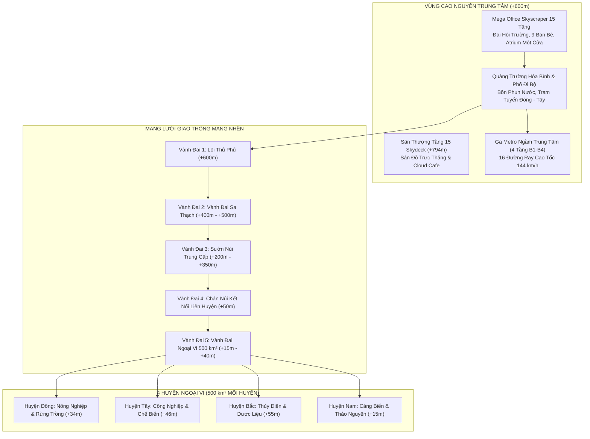

# 🌿 TÂN THẾ GIỚI — HIGH-PLATEAU COMMUNE SIMULATION
### Dự Án Game Đô Thị Mô Phỏng Tự Do Bất Tử • Anime Cel-Shaded Ghibli • Godot Engine 4.6.2 Forward+

[](https://godotengine.org/)
[-0071C5?logo=intel&logoColor=white)](https://www.intel.com/)
[](#)
[-success)](#)
[](#)

---

## 📖 1. TỔNG QUAN DỰ ÁN (PROJECT OVERVIEW)

**Tân Thế Giới** là một dự án game mô phỏng đô thị thế giới mở 3D góc nhìn thứ ba kết hợp góc nhìn thứ nhất, đưa người chơi vào vai **Thị Trưởng Đỉnh Vát** đồng hành cùng **Người Chăn Chiên** để kiến tạo một xã hội thịnh vượng, thánh khiết, hòa bình và tràn đầy tình huynh đệ trên một vùng cao nguyên hùng vĩ rộng $500\text{ km}^2 - 1500\text{ km}^2$.

### 🌟 4 Trụ Cột Triết Lý Đột Phá:
1. **Cõi Bất Tử Thanh Xuân & Hao Mòn Đồ Vật (Object Wear & Tear)**:
   - Con người trong Tân Thế Giới bất tử, không già đi, không chết chóc, không bệnh tật hiểm nghèo, mãi mãi tràn đầy sinh lực ở độ tuổi thanh xuân ($20 - 25$ tuổi).
   - Động lực kinh tế tuần hoàn và thị trường việc làm không đến từ áp lực sinh tồn tiêu cực, mà đến từ **sự hao mòn tự nhiên của máy móc, xe cộ, ray tàu, quần áo và sự lỗi thời công nghệ** khi Viện Hàn Lâm Khoa Học (HAS) công bố sáng chế mới.
2. **Xã Hội Liêm Khiết & Huynh Đệ Không Tham Nhũng**:
   - $100\%$ không có tham nhũng, rút ruột ngân quỹ hay áp bức.
   - Thể chế hai tài khoản tài chính độc lập:
     - **Kho Bạc Đô Thị (City Treasury - Thuế 5%)**: Tái đầu tư hạ tầng mạng nhện, trường học, bệnh viện, xe điện và chi trả dịch vụ công.
     - **Quỹ Dâng Chúa 1/10 (Tithe Fund)**: Chu cấp lương sung túc, đồng nhất cho Nhân sự Việc Chúa (NHVC) Toàn thời gian (mặc Âu phục Vest lịch lãm); đội ngũ NHVC Bán thời gian phục vụ tự nguyện 100% không nhận lương tiền tệ (Rule #4).
3. **Mỹ Thuật Anime Cel-Shaded Ghibli / Makoto Shinkai Chuẩn Mực**:
   - Ánh sáng Toon Shading phân tầng ấm áp, viền ngược Inverted Hull mảnh tinh tế, mặt nước bọt cách điệu, mây cuộn anime đa tầng bồng bềnh ở độ cao $+4000\text{m}$.
   - Tối ưu hóa triệt để phần cứng cho GPU tích hợp **Intel Iris Xe (60 FPS mượt mà)**: không dùng PBR nặng nề, áp dụng Shared Material caching và MultiMesh Octahedral Impostor LOD.
4. **Không Gian Kiến Trúc Mở Không Màn Hình Chờ (Seamless Streaming)**:
   - Toàn bộ thế giới $500\text{ km}^2$ được nạp liên tục bằng `WorldChunkStreamer` động.
   - Bước vào tòa nhà, lên thang máy 15 tầng, xuống ga ngầm Metro 4 tầng hay bước vào nhà mẫu đều diễn ra tức thì trong thế giới thật 100% không chuyển cảnh.

---

## 🏛️ 2. BẢNG TIẾN ĐỘ & KIẾN TRÚC KỸ THUẬT (AUDIT & TECHNICAL MILESTONES)

Dự án đã hoàn tất khắc phục và kiểm thử thực tế **22/22 hạng mục kỹ thuật cốt lõi (100% Pass)** theo quy chuẩn khắt khe của Enterprise Architecture:

| Giai đoạn | Hạng mục Kỹ thuật Cốt lõi | Tình trạng | Kết quả Kiểm thử |
| :--- | :--- | :---: | :--- |
| **Phase 1: Cấp cứu Hệ thống** | Đồng bộ bầu trời Ngày/Đêm với `WorldManager`, sửa mất 52/81 chunk, sửa âm quỹ và lỗi scale Area3D 8.94x trong Mega Office. | **HOÀN THÀNH** | [`test_day_night_and_visuals.gd`](file:///d:/Eaut/GMAE/game%20t%C3%A2n%20th%E1%BA%BF%20gi%E1%BB%9Bi/scripts/tests/test_day_night_and_visuals.gd) • PASS |
| **Phase 2: Vật lý & Phương tiện** | Bộ gõ Tiếng Việt IME, khoảng cách tương tác 6.0m, bám dốc `CharacterBody3D`, hồi phục thể lực trạm [E], trực thăng & buggy. | **HOÀN THÀNH** | [`test_helicopter_boarding_fix.gd`](file:///d:/Eaut/GMAE/game%20t%C3%A2n%20th%E1%BA%BF%20gi%E1%BB%9Bi/scripts/tests/test_helicopter_boarding_fix.gd) • PASS |
| **Phase 3: Dữ liệu & Giao diện** | Đồng bộ định danh 5 Huyện & tọa độ Huyện Nam (+20.000m), Ban thứ 9 (Ban Ca Ngợi), Radar MiniMap và lương NHVC Rule #4. | **HOÀN THÀNH** | [`test_civic_quests_and_four_districts.gd`](file:///d:/Eaut/GMAE/game%20t%C3%A2n%20th%E1%BA%BF%20gi%E1%BB%9Bi/scripts/tests/test_civic_quests_and_four_districts.gd) • PASS |
| **Phase 4: Tối ưu Iris Xe** | Khử cấp phát `StyleBoxFlat` mỗi frame, Tiered Simulation 3 cấp cho 300 NPC, gom nhóm Shared Material, khoanh lỗ DistantMacroTerrain. | **HOÀN THÀNH** | [`test_runtime_world_health.gd`](file:///d:/Eaut/GMAE/game%20t%C3%A2n%20th%E1%BA%BF%20gi%E1%BB%9Bi/scripts/tests/test_runtime_world_health.gd) • PASS |
| **Phần E: Giao thông & Tương tác** | Cổng Ga Metro mặt đất ngoại vi bám chuẩn độ cao tự nhiên, khử collision khi lên tàu ngầm/tram, khóa thang máy gần nhất, nhặt item drop an toàn. | **HOÀN THÀNH** | [`test_central_metro_hub.gd`](file:///d:/Eaut/GMAE/game%20t%C3%A2n%20th%E1%BA%BF%20gi%E1%BB%9Bi/scripts/tests/test_central_metro_hub.gd) • PASS |
| **Phần F: CSDL, Logistics & 3D** | SQLite Native WAL mode, thoát chuỗi nháy đơn Sổ Đỏ, đồng bộ ngoại tuyến Logistics/Cư dân, cập nhật vị trí 3D xe tải, bọc camera `look_at()`, Octahedral cache. | **HOÀN THÀNH** | [`test_unified_timeline.gd`](file:///d:/Eaut/GMAE/game%20t%C3%A2n%20th%E1%BA%BF%20gi%E1%BB%9Bi/scripts/tests/test_unified_timeline.gd) • PASS |

### 🚀 LỘ TRÌNH TÍNH NĂNG MỞ RỘNG (EXPANSIONS ROADMAP — HOÀN TẤT 100%)

| Mã Tính Năng | Tên Tính Năng Mở Rộng | Quy Chuẩn Kỹ Thuật Đã Triển Khai | Kết Quả Kiểm Thử |
| :--- | :--- | :--- | :--- |
| **EXP-01** | **4 Trụ Sở Vệ Tinh Huyện (Satellite Hubs)** | Xây dựng 4 tòa nhà 4 tầng phong cách Tân Cổ Điển tại 4 Huyện (Đông/Tây/Bắc/Nam) kèm biển hiệu Diegetic 3D và trạm tương tác Hành chính & Hội trường. | [`test_expansions_e2e.gd`](file:///d:/Eaut/GMAE/game%20t%C3%A2n%20th%E1%BA%BF%20gi%E1%BB%9Bi/tests/test_expansions_e2e.gd) • PASS |
| **EXP-02** | **Đội Xe Bus Điện BRT Mạng Nhện** | Đội 8 xe bus điện BRT Toon chạy tuần hoàn trên 4 trục nan hoa, đón trả khách tại 12 trạm trung chuyển, hỗ trợ lên/xuống `[E]`/`[F]` và nhảy nhanh `[1]`-`[4]`. | [`test_expansions_e2e.gd`](file:///d:/Eaut/GMAE/game%20t%C3%A2n%20th%E1%BA%BF%20gi%E1%BB%9Bi/tests/test_expansions_e2e.gd) • PASS |
| **EXP-03** | **Chuỗi Cung Ứng Thi Công HousingPlot** | Kích hoạt chu kỳ `AVAILABLE` $\rightarrow$ `CONSTRUCTION (50%)` $\rightarrow$ `COMPLETED (100%)`, liên kết kho vật liệu gỗ/thép `LogisticsManager`. | [`test_expansions_e2e.gd`](file:///d:/Eaut/GMAE/game%20t%C3%A2n%20th%E1%BA%BF%20gi%E1%BB%9Bi/tests/test_expansions_e2e.gd) • PASS |
| **EXP-04** | **Nhà Ga Đón Tàu Lữ Khách & Nhập Cư** | Trạm đón tàu lữ khách tại Cảng Hòa Bình (+20.000m), kích hoạt quy trình nhập tịch, cấp CCCD và nâng trần dân số. | [`test_expansions_e2e.gd`](file:///d:/Eaut/GMAE/game%20t%C3%A2n%20th%E1%BA%BF%20gi%E1%BB%9Bi/tests/test_expansions_e2e.gd) • PASS |
| **EXP-05** | **4 Mùa Sinh Thái & Thời Tiết Động Ghibli** | Chu kỳ 4 Mùa (Xuân/Hạ/Thu/Đông) 7 ngày game, điều chỉnh sắc độ bầu trời/sương mù Toon và hệ số sản lượng nông/lâm/ngư nghiệp (+20% đến +30%). | [`test_expansions_e2e.gd`](file:///d:/Eaut/GMAE/game%20t%C3%A2n%20th%E1%BA%BF%20gi%E1%BB%9Bi/tests/test_expansions_e2e.gd) • PASS |
| **EXP-06** | **Bộ Tổng Hợp Âm Đa Bè (Pipe Organ / Piano)** | Tổng hợp hòa âm đa tần số cho Đàn Đại Quản Cầm (Tầng 11) và Grand Piano (Tầng 9), ban phước lành buff `+15% KBU`. | [`test_expansions_e2e.gd`](file:///d:/Eaut/GMAE/game%20t%C3%A2n%20th%E1%BA%BF%20gi%E1%BB%9Bi/tests/test_expansions_e2e.gd) • PASS |
| **EXP-07** | **Bộ Kiểm Thử Đầu-Cuối E2E Tự Động** | File runner tự động xác thực 5 chuẩn khắt khe: 81 chunks, tua đêm 06:00, chống âm ngân sách, cao độ Metro mặt đất, player collision layer = 2. | [`run_all_e2e_tests.gd`](file:///d:/Eaut/GMAE/game%20t%C3%A2n%20th%E1%BA%BF%20gi%E1%BB%9Bi/tests/run_all_e2e_tests.gd) • PASS |

---

## 📜 3. 13 QUY TẮC PHÁT TRIỂN CỐT LÕI (CORE RULES ENFORCEMENT)

Chi tiết quy chuẩn kỹ thuật được bảo lưu tại [AGENTS.md](file:///d:/Eaut/GMAE/game%20t%C3%A2n%20th%E1%BA%BF%20gi%E1%BB%9Bi/AGENTS.md) và [.agents/rules/tan_the_gioi_game_rules.md](file:///d:/Eaut/GMAE/game%20t%C3%A2n%20th%E1%BA%BF%20gi%E1%BB%9Bi/.agents/rules/tan_the_gioi_game_rules.md):

1. **Chống kẹt phím Bộ Gõ Tiếng Việt (Vietnamese IME Bulletproofing)**: Đăng ký cả `keycode` và `physical_keycode`; `PlayerController` quét `is_physical_key_pressed()` và 4 phím Mũi Tên.
2. **Hàm độ cao địa hình liên tục (Continuous Elevation Function)**: Mọi chunk, cây cối, NPC đều truy vấn qua `ModularNatureChunk.get_world_height(wx, wz)`. Sau Mega Office giữ cao nguyên bằng phẳng +600m.
3. **Bám dốc cho CharacterBody3D (Slope Snapping)**: `floor_snap_length = 0.5`, `floor_max_angle = 60°`, `floor_stop_on_slope = true`.
4. **Cơ cấu Tình Nguyện Viên NHVC (Part-Time)**: NHVC Bán thời gian tự nguyện 100%, không nhận lương tiền tệ, có nghề đời sống riêng.
5. **Cơ chế Night Skip**: Hỗ trợ đồng thời phím `[T]` / `[F5]` và giường ngủ `[E]` để tua nhanh sang 06:00 sáng.
6. **Kiểm thử tương tác End-to-End**: BẮT BUỘC mô phỏng Player bước vào cự ly $\rightarrow$ kích hoạt cảm biến $\rightarrow$ hiện bảng 3D $\rightarrow$ truyền `InputEventKey` $\rightarrow$ kiểm tra kết quả.
7. **Bảo hiểm 2 lớp cho vật thể tương tác (Dual-Layer Safety)**: `Area3D` đặt `layer = 1 | 2 | 4`, `mask = 1 | 2 | 4` ($R \ge 6.0\text{m}$), kèm Fallback đo cự ly thực tế trong `_process()`, hỗ trợ cả `[F]` và `[E]`.
8. **Bảng chữ 3D nhắc lệnh xuyên thấu (Diegetic UI Visibility)**: `Label3D` bật `billboard = BILLBOARD_ENABLED`, `no_depth_test = true`.
9. **Ưu tiên phố đi bộ & Sân đỗ trực thăng Skydeck**: Quảng Trường Hòa Bình dành 100% cho người đi bộ/tram/buggy nhẹ; Sân đỗ trực thăng đặt tại Sân Thượng Tầng 15 (+794.6m).
10. **Vùng đệm loại trừ thảm thực vật tự nhiên**: Rải cây cỏ, đá cuội loại trừ bán kính $R \ge 40\text{m}$ tính từ tâm quảng trường $(0,0)$.
11. **Tiêu chuẩn `@tool` hiển thị trực quan trong Godot Editor**: Các node kiến trúc thủ tục khai báo `@tool` để hiển thị trực quan trong 3D Viewport.
12. **Chuẩn Hóa Đặt Tên & Khởi Tạo Autoload**: Không dùng `class_name` trùng tên với Autoload Singleton; hỗ trợ Fallback 4 tầng và phương thức tiêm phụ thuộc.
13. **Phân Tách Hàm Mô Phỏng Cơ Khí**: Tách riêng Tầng Đọc Phím Bấm và Tầng Tính Toán Cơ Khí/Hao Mòn để kiểm thử CI/CD xác định.

---

## 🎮 4. HƯỚNG DẪN ĐIỀU KHIỂN & PHÍM TẮT (CONTROLS & SHORTCUTS)

Hệ thống điều khiển được tối ưu hóa đặc biệt chống kẹt phím Tiếng Việt Unikey/EVKey:

| Thao tác | Phím Bấm Chính | Phím Phụ / Tay Cầm | Ghi chú |
| :--- | :---: | :---: | :--- |
| **Di chuyển nhân vật** | `W, A, S, D` | 4 Phím Mũi Tên (`↑, ↓, ←, →`) | Không bị gián đoạn khi bật gõ Tiếng Việt |
| **Chạy nước rút (Sprint)** | `Shift` (Giữ) | — | Tiêu hao thể lực theo thời gian |
| **Nhảy / Vượt dốc** | `Space` | — | Bám dốc địa hình tự nhiên mượt mà |
| **Xoay góc nhìn Camera 360°** | Rê Chuột (Mouse) | — | Nhấn chuột trái để khóa/bắt chuột |
| **Chuyển góc nhìn (1st / 3rd)** | `V` | — | Chuyển đổi giữa góc nhìn thứ 1 và thứ 3 |
| **Tương tác đa dụng** | `[E]` | `[F]` | Mở cửa, nói chuyện NPC, dùng trạm, mua đất |
| **Lên / Xuống Phương Tiện** | `[F]` hoặc `[E]` | `[E]` / `[F]` | Lên/xuống Trực thăng, Buggy, Tàu Metro, Tram |
| **Bảng điều khiển Thang Máy** | `[E]` | Phím số `[1]` – `[9]` | Mở bảng 15 tầng; `[Esc]` để đóng bảng |
| **Tablet Điều Hành Civic OS** | `[M]` hoặc `[Tab]` | — | 8 Tab: Bản đồ, Huyện, Cư dân, Tech Tree, Nhà ở... |
| **Túi Đồ Cặp Công Vụ** | `[I]` | — | Quản lý kho đồ mang theo và trang thiết bị |
| **Hotbar Cầm Tay** | Phím `[1]` – `[8]` | Con lăn chuột | Trang bị công cụ / vật phẩm trên tay |
| **Tua Nhanh Qua Đêm (Night Skip)** | `[T]` hoặc `[F5]` | Ngủ giường `[E]` | Bỏ qua đêm, đón bình minh 06:00 sáng tức thì |
| **Tạm dừng / Tiếp tục Thời Gian**| `[F7]` | — | Dừng trôi đồng hồ thế giới để quan sát |
| **Lưu Game Nhanh (Quick Save)** | `[F6]` | Giao diện Cài Đặt | Lưu tiến trình vào SQLite WAL + file JSON |
| **Nạp Game Nhanh (Quick Load)** | `[F9]` | Giao diện Khởi Động | Khôi phục toàn bộ thế giới và offline progress |

---

## 🗺️ 5. CẤU TRÚC ĐỊA HÌNH VÀ HỆ THỐNG GIAO THÔNG



---

## 🧪 6. HƯỚNG DẪN KHỞI CHẠY & KIỂM THỬ TỰ ĐỘNG (TESTING & RUNNING)

### 🚀 Khởi Chạy Nhanh Từ Windows Terminal:
- **Khởi động Game trực tiếp**: Nhấp đúp [CHAY_GAME.bat](file:///d:/Eaut/GMAE/game%20t%C3%A2n%20th%E1%BA%BF%20gi%E1%BB%9Bi/CHAY_GAME.bat)
- **Mở Godot Editor 4.6.2 (Trực quan `@tool`)**: Nhấp đúp [MO_EDITOR_GODOT.bat](file:///d:/Eaut/GMAE/game%20t%C3%A2n%20th%E1%BA%BF%20gi%E1%BB%9Bi/MO_EDITOR_GODOT.bat)
- **Chạy toàn bộ 25+ bài kiểm thử tự động**: Nhấp đúp [CHAY_KIEM_THU_TOAN_BO.bat](file:///d:/Eaut/GMAE/game%20t%C3%A2n%20th%E1%BA%BF%20gi%E1%BB%9Bi/CHAY_KIEM_THU_TOAN_BO.bat)

### 💻 Chạy Từng Bài Test Headless Qua PowerShell:
```powershell
# Thiết lập môi trường cách ly (Environment Isolation)
$godot = "C:\Users\Admin\AppData\Local\Microsoft\WinGet\Packages\GodotEngine.GodotEngine_Microsoft.Winget.Source_8wekyb3d8bbwe\Godot_v4.6.2-stable_win64_console.exe"
$env:LOCALAPPDATA = "D:\Eaut\GMAE\game tân thế giới\.godot_env"
$env:APPDATA = "D:\Eaut\GMAE\game tân thế giới\.godot_env"
$env:USERPROFILE = "D:\Eaut\GMAE\game tân thế giới\.godot_env"
$env:HOME = "D:\Eaut\GMAE\game tân thế giới\.godot_env"

# 1. Kiểm thử Sức khỏe Toàn Diện Thế Giới 150 Khung Hình:
& $godot --headless --path . -s scripts/tests/test_runtime_world_health.gd

# 2. Kiểm thử Ga Metro 4 Tầng, 16 Ray & Tàu Cao Tốc:
& $godot --headless --path . -s scripts/tests/test_central_metro_hub.gd

# 3. Kiểm thử Mega Office 15 Tầng, 4 Thang Máy, Cầu Thang Bộ & Tram:
& $godot --headless --path . -s scripts/tests/test_mega_office_skyscraper.gd

# 4. Kiểm thử Cây Công Nghệ HAS 100 Bậc, Viện Hàn Lâm & Quỹ KBU:
& $godot --headless --path . -s scripts/tests/test_has_research_tech_tree.gd

# 5. Kiểm thử Mua Đất, Nhà Mẫu, Thi Công & Cấp Sổ Đỏ [E]:
& $godot --headless --path . -s scripts/tests/test_model_houses_and_construction.gd

# 6. Kiểm thử CSDL SQLite Native WAL Mode:
& $godot --headless --path . -s scripts/tests/test_sqlite_native.gd

# 7. Kiểm thử Chu Kỳ Ngày - Đêm & Night Skip:
& $godot --headless --path . -s scripts/tests/test_day_night_and_visuals.gd
```

---

## 📁 7. CẤU TRÚC THƯ MỤC DỰ ÁN (PROJECT DIRECTORY STRUCTURE)

```
game tân thế giới/
├── .agents/                        # Quy chuẩn phát triển dành cho AI & Nhà phát triển
│   └── rules/tan_the_gioi_game_rules.md
├── addons/                         # Các Plugin mở rộng engine
│   ├── godot-sqlite/               # SQLite GDExtension Native (WAL Mode)
│   ├── godot_mcp/                  # AI Game Developer Server (42 MCP Tools)
│   ├── octahedral_impostor_lod/    # LOD Impostor toán học cho rừng thông 1500 km²
│   ├── road-generator/             # Công cụ sinh đường mòn & đại lộ
│   ├── tau-plot/                   # Vẽ biểu đồ thống kê kinh tế & nhân sự
│   ├── unified_timeline/           # Máy chủ dòng thời gian thống nhất đơn điệu
│   └── vrm/                        # Godot-VRM, MToon Cel-Shader & Spring Bones
├── assets/                         # Tài nguyên âm thanh, 3D models, textures
├── scenes/                         # Các scene giao diện và thế giới (main_world.tscn)
├── scripts/                        # Toàn bộ mã nguồn trò chơi (GDScript)
│   ├── camera/                     # Cinematic Phantom Camera Controller 4 rigs
│   ├── characters/                 # PlayerController, NPCCharacter, VRMManager
│   ├── core/                       # Điều phối viên trung tâm, SaveManager, Audio
│   ├── elevator/                   # Thang máy kính Panorama 15 tầng
│   ├── environment/                # DayNightController Toon 4 presets
│   ├── interactive/                # Trạm dịch vụ [E], Lô đất nhà mẫu, Item drop
│   ├── simulation/                 # WorldManager, DatabaseManager, ResearchManager, Logistics
│   ├── terrain/                    # WorldChunkStreamer, ModularNatureChunk, CapitalBuilder
│   ├── tests/                      # 25+ Automated Headless Test Suites (100% Pass)
│   └── ui/                         # HUDOverlay, MacroMapModal, CitizenID, Radar
├── AGENTS.md                       # Bản tóm tắt 13 Quy tắc cốt lõi
├── GAME_DESIGN_CONCEPT.md          # Tài liệu thiết kế trò chơi tổng thể (Master GDD)
├── ai_context_system_instructions.md # Bản đặc tả kỹ thuật và hợp đồng kiến trúc AI
├── BAN_DANH_GIA_CHUYEN_MON_TAN_THE_GIOI.md # Báo cáo thẩm định CTO & Kiến trúc sư
├── CHAY_GAME.bat                   # File thực thi khởi chạy game nhanh
├── CHAY_KIEM_THU_TOAN_BO.bat       # File thực thi chạy toàn bộ kiểm thử
└── project.godot                   # File cấu hình trung tâm dự án Godot 4.6.2
```

---

<div align="center">

**TÂN THẾ GIỚI** — *Dựng xây miền đất thánh khiết, bình an, trường tồn và rực rỡ dưới ánh ban mai.*  
**Đơn vị phát triển:** Ban Quản Trị Đô Thị Đỉnh Vát & AI Development Core Team.

</div>
